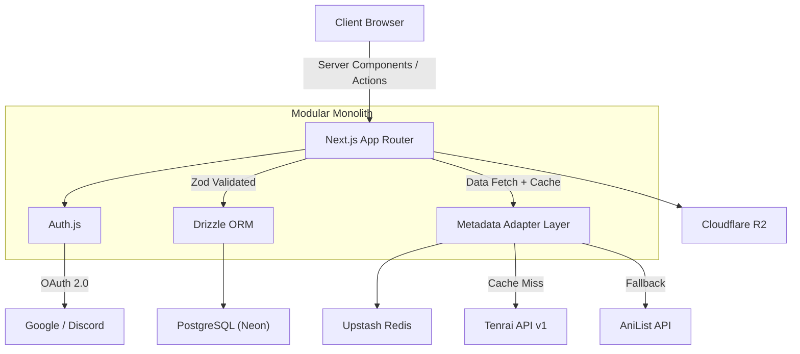

# Anivio

**Where anime discovery meets community discussion.**

## Overview

Anivio is a centralized anime community platform that unifies structured anime metadata with dynamic, community-driven social discussion. The key differentiator is **Contextualized Social Discovery** — anime shows, characters, and episodes are treated as live interactive entities within the social feed. Inline tag cards, hover cards with metadata, and one-click watchlist actions turn every mention of an anime into an actionable object.

## The Problem

Anime fandom is data-heavy and social, but no single platform accommodates both. Users currently split their time between database platforms like MyAnimeList and AniList for tracking, and general social platforms like Reddit for discussion. This creates friction — you can't add a show to your watchlist from within a discussion thread, and you can't see community sentiment from within a tracking page. Context is lost at every switch.

## Product Vision

Bridge the gap between discourse and database. Every anime mentioned in a post is a **live object** carrying its own score, artwork, and one-tap watchlist action. Discussion and discovery are no longer separate activities — they are the same experience.

## Core Differentiator

- **Inline anime entity tagging** with live metadata cards
- **Wilson Score confidence ranking** for trustworthy community ratings
- **Community-driven discussion** with rich-text posts and nested comments

## Features (MVP)

- **Authentication** — OAuth via Google and Discord
- **Anime Discovery** — Season browser, top charts, search, and detailed show pages
- **Communities** — User-created topic communities
- **Rich-Text Posts** — Tiptap editor with inline anime tagging (@mention-style entity cards)
- **Nested Comments** — Up to 8 levels deep, powered by PostgreSQL `ltree`
- **Ranking** — Wilson Score confidence ranking + Hot ranking algorithm
- **Watchlist Tracking** — Watching, Completed, Dropped, Planned statuses
- **Spoiler Protection** — Configurable spoiler tags and content warnings
- **Moderation Tools** — Community-level and platform-level moderation
- **Full-Text Search** — Search across posts, comments, communities, and anime

## Out of Scope (MVP)

The following are explicitly **not** part of the MVP:

Real-time chat · Direct messages · Native payments · Video hosting · Custom ML recommendations · Character-level tagging · Email notifications · Mobile apps · Localization beyond English

## Technology Stack

| Category | Technology |
|---|---|
| Framework | Next.js 16 (App Router, Cache Components) |
| Language | TypeScript (strict mode) |
| Styling | Tailwind CSS + shadcn/ui |
| Database | PostgreSQL 16+ on Neon |
| ORM | Drizzle ORM |
| Auth | Auth.js (Google, Discord) |
| Cache / Rate Limiting | Upstash Redis |
| Object Storage | Cloudflare R2 |
| Anime Metadata | Tenrai API v1 (primary), AniList (secondary) |
| Editor | Tiptap (restricted schema) |
| Testing | Vitest + Playwright |
| Monitoring | Sentry |
| Hosting | Vercel |

## Architecture



## Repository Structure (PROPOSED)

> [!NOTE]
> This structure is proposed and not yet implemented. It will be created during Milestone 1.

```
src/
  app/           # Routes, layouts, loading/error boundaries
  components/    # UI primitives, layout, feature components
  modules/       # Feature modules (auth, metadata, discussions, etc.)
  lib/           # DB client, Redis, storage, env, utils
  styles/        # Design tokens, globals
  test/          # Fixtures, factories, Playwright specs
drizzle/         # SQL migrations
scripts/         # Seed, maintenance scripts
docs/            # Project documentation
```

## Screenshots

Screenshots will be added as the UI is implemented.

## Prerequisites

- [Node.js](https://nodejs.org/) 22+
- [pnpm](https://pnpm.io/)
- PostgreSQL 16+ (or a [Neon](https://neon.tech/) account)
- [Upstash Redis](https://upstash.com/) account
- [Cloudflare R2](https://www.cloudflare.com/products/r2/) account
- Google OAuth credentials
- Discord OAuth credentials

## Getting Started

> [!IMPORTANT]
> The project is not yet initialized. Setup instructions will be added after Milestone 1 is complete.

See [docs/DEPLOYMENT.md](docs/DEPLOYMENT.md) for full deployment and environment setup details.

## Environment Variables

See [docs/DEPLOYMENT.md](docs/DEPLOYMENT.md) for the full variable reference.

| Variable |
|---|
| `DATABASE_URL` |
| `NEXTAUTH_URL` |
| `NEXTAUTH_SECRET` |
| `GOOGLE_CLIENT_ID` |
| `GOOGLE_CLIENT_SECRET` |
| `DISCORD_CLIENT_ID` |
| `DISCORD_CLIENT_SECRET` |
| `UPSTASH_REDIS_REST_URL` |
| `UPSTASH_REDIS_REST_TOKEN` |
| `CLOUDFLARE_R2_ACCESS_KEY_ID` |
| `CLOUDFLARE_R2_SECRET_ACCESS_KEY` |
| `CLOUDFLARE_R2_BUCKET_NAME` |
| `CLOUDFLARE_R2_ENDPOINT` |
| `TENRAI_API_KEY` |
| `TENRAI_API_BASE_URL` |
| `SENTRY_DSN` |
| `NEXT_PUBLIC_APP_URL` |

## Database

See [docs/DATABASE.md](docs/DATABASE.md) for the full schema, migrations, and database architecture documentation.

## Development Commands

> [!NOTE]
> Commands will be documented after project initialization in Milestone 1.

## Testing

See [docs/TESTING.md](docs/TESTING.md) for the full test strategy, conventions, and instructions.

## Deployment

See [docs/DEPLOYMENT.md](docs/DEPLOYMENT.md) for infrastructure, CI/CD, and deployment instructions.

## Documentation

| Document | Purpose |
|---|---|
| [docs/README.md](docs/README.md) | Documentation index and guide |
| [docs/PRODUCT.md](docs/PRODUCT.md) | Product vision, audience, positioning |
| [docs/SPEC.md](docs/SPEC.md) | Functional and non-functional specifications |
| [docs/DESIGN.md](docs/DESIGN.md) | UI/UX design system and component specs |
| [docs/WORKFLOW.md](docs/WORKFLOW.md) | User journeys and application workflows |
| [docs/STRUCTURE.md](docs/STRUCTURE.md) | Repository and application architecture |
| [docs/TECHSTACK.md](docs/TECHSTACK.md) | Technology stack decisions |
| [docs/DATABASE.md](docs/DATABASE.md) | Database schema and architecture |
| [docs/API.md](docs/API.md) | API contracts and integrations |
| [docs/SECURITY.md](docs/SECURITY.md) | Security and moderation |
| [docs/TESTING.md](docs/TESTING.md) | Quality assurance and test plan |
| [docs/DEPLOYMENT.md](docs/DEPLOYMENT.md) | Infrastructure and deployment |
| [docs/ROADMAP.md](docs/ROADMAP.md) | Development milestones and tasks |
| [docs/DECISIONS.md](docs/DECISIONS.md) | Architecture decision records |
| [docs/CONTRIBUTING.md](docs/CONTRIBUTING.md) | Development standards and conventions |
| [docs/CHANGELOG.md](docs/CHANGELOG.md) | Project change history |

## Project Status

🚧 **Pre-development** — Documentation baseline established. No application code has been written yet.

## Contributing

See [docs/CONTRIBUTING.md](docs/CONTRIBUTING.md) for development standards, branching conventions, and contribution guidelines.
