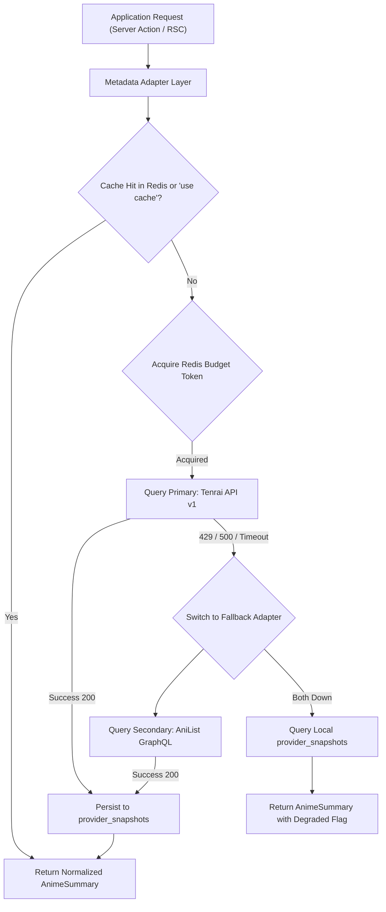

# Anivio — API & Integration Contracts

> **Single Source of Truth (SSOT) for Server Actions, Route Handlers & Provider Adapters**  
> Status: **LOCKED BASELINE (Version 1.0)**  
> Last Updated: 12 November 2026

This document defines the formal interfaces, typed input/output schemas, error taxonomy, and external integration contracts for the Anivio Anime Community Platform.

---

## 1. Internal Interfaces: Server Actions

All application state mutations occur via Next.js Server Actions. Every action follows an identical 5-step lifecycle:
1. Authenticate session via Auth.js.
2. Validate payload against a shared Zod schema.
3. Authorize user permissions on the loaded database target.
4. Execute mutation within a PostgreSQL transaction.
5. Revalidate cache tags and return a typed discriminated result.

### 1.1 Action Contract Table

| Action Name | Input Arguments (Zod Schema) | Authorization | Database & System Effects | Failure Codes |
|---|---|---|---|---|
| `createPost` | `{ communityId: uuid, title: string, documentJson: JSON, linkedMalId?: number, isSpoiler: boolean, mediaIds: uuid[] }` | Signed in, member of community, account >24h for links, not shadow-filtered | Inserts `posts`, `post_tags`, links `post_media`. Enqueues search vector update and revalidates feed. | `RateLimited`, `NotMember`, `ValidationFailed`, `CommunityLocked`, `Unauthenticated` |
| `updatePost` | `{ postId: uuid, title: string, documentJson: JSON, linkedMalId?: number, isSpoiler: boolean }` | Author of post within 24 hours OR community moderator | Updates `posts.title`, `posts.content`, recomputes tags, sets `edited_at = now()`. | `Forbidden`, `Expired`, `ValidationFailed`, `NotFound` |
| `createComment` | `{ postId: uuid, parentId?: uuid, content: string, isSpoiler: boolean }` | Signed in, post published, depth <= 8 | Calls `add_comment()`, increments `posts.comment_count`, enqueues score job and notification. | `RateLimited`, `ThreadLocked`, `DepthExceeded`, `ParentMissing`, `Unauthenticated` |
| `vote` | `{ targetType: 'post' \| 'comment', targetId: uuid, value: 1 \| -1 }` | Signed in, voter is NOT author of target | Upserts row in `post_votes` or `comment_votes`. Enqueues `recomputeScore` background job. | `Forbidden`, `TargetMissing`, `RateLimited`, `Unauthenticated` |
| `createCommunity` | `{ slug: string, name: string, description: string }` | Signed in, account age >= 3 days, max 2/week | Inserts `communities`, creates owner row in `community_members`, writes `audit_log`. | `SlugTaken`, `RateLimited`, `ValidationFailed`, `Unauthenticated` |
| `joinCommunity` | `{ communityId: uuid }` | Signed in | Idempotent insert into `community_members`, increments `communities.member_count`. | `RateLimited`, `Unauthenticated`, `NotFound` |
| `upsertWatchlistEntry` | `{ malId: number, status: 'watching' \| 'completed' \| 'dropped' \| 'planned', score?: number, episodesWatched?: number }` | Signed in, `malId` resolvable in metadata | Upserts row in `watchlists`. Validates `episodesWatched` <= total cached episodes. | `InvalidProgress`, `UnknownAnime`, `Unauthenticated` |
| `reportTarget` | `{ targetType: 'post' \| 'comment', targetId: uuid, reason: string, note?: string }` | Signed in, reporter is NOT author of target | Inserts `reports`. If >= 3 unique valid reports, sets target `status = 'filtered'` and alerts mod. | `AlreadyReported`, `RateLimited`, `Unauthenticated` |
| `resolveReport` | `{ reportId: uuid, decision: 'approve' \| 'remove' \| 'dismiss', reason: string }` | Community moderator OR Admin | Updates report state, modifies target status, writes immutable `moderation_actions` row. | `Forbidden`, `AlreadyResolved`, `Unauthenticated` |
| `deleteAccount` | `{ confirmation: string }` | Active session owner | Anonymizes user row, deletes sessions and accounts, retains authored posts with deleted marker. | `ConfirmationMismatch`, `Unauthenticated` |

---

## 2. Internal Interfaces: Route Handlers

Route Handlers serve public read-only JSON data, direct file upload signing, and background cron drainage.

| Path | Method | Purpose | Cache Strategy | Rate Limit |
|---|---|---|---|---|
| `/api/search/anime` | `GET` | Debounced search queries for navbar & editor combobox | 1 hour per query string in Redis | 30 requests / min per IP |
| `/api/hover/anime/[id]` | `GET` | Lightweight payload for inline tag hover cards | 24 hours in Redis & edge | 120 requests / min per IP |
| `/api/feed` | `GET` | Keyset-paginated post feed for infinite scroll | Dynamic (no cache for signed-in; 60s for anon) | 60 requests / min per IP |
| `/api/comments` | `GET` | Subtree fetch for deep "continue this thread" branches | None (always live query) | 60 requests / min per IP |
| `/api/upload/sign` | `POST` | Authorizes & returns presigned Cloudflare R2 upload URL | None (private, signed) | 10 uploads / hour per user |
| `/api/health` | `GET` | DB, Redis, and Metadata provider availability probe | None | Unrestricted (monitoring only) |
| `/api/cron/daily` | `POST` | Scheduled maintenance: season refresh, score sync, orphan sweep | None | Protected via `Authorization: Bearer <CRON_SECRET>` |

---

## 3. External Metadata Integration: Adapter Architecture

To insulate Anivio from upstream provider shutdowns or rate limit changes, all anime metadata interactions pass through an **Adapter Layer** implementing a strict normalized contract.



### 3.1 Normalized TypeScript Contract

```typescript
export type AnimeSummary = {
  malId: number;
  title: string;
  titleEnglish: string | null;
  images: {
    small: string;
    medium: string;
    large: string;
  };
  score: number | null;
  episodes: number | null;
  status: 'airing' | 'finished' | 'upcoming' | 'unknown';
  genres: string[];
  year: number | null;
  synopsis: string | null;
  isDegraded?: boolean;
  snapshotAgeHours?: number;
};

export interface MetadataProvider {
  name: string;
  searchAnime(query: string, page: number): Promise<Page<AnimeSummary>>;
  getSeason(season: string, year: number, page: number): Promise<Page<AnimeSummary>>;
  getTop(page: number): Promise<Page<AnimeSummary>>;
  getAnime(malId: number): Promise<AnimeSummary>;
  getEpisodes(malId: number, page: number): Promise<Page<EpisodeSummary>>;
  getCharacters(malId: number, page: number): Promise<Page<CharacterSummary>>;
}
```

### 3.2 The Six Wrapping Rules (LOCKED)
Every provider adapter implementation must adhere to these 6 mandatory operational rules:
1. **Timeout & Retries**: 5-second hard socket timeout; at most 2 retries with exponential backoff and randomized jitter.
2. **Rate Limit Handling**: Strictly honor upstream `Retry-After` headers on HTTP 429. Cache 404 responses negatively for 10 minutes.
3. **Token Bucket Consumption**: Consume a Redis token before dispatching an outbound request; release token immediately if satisfied by local cache.
4. **Single-Flight Concurrency Lock**: Implement an in-memory/Redis mutex lock per entity key so that concurrent misses for the same anime generate exactly one upstream fetch.
5. **Snapshot Persistence**: Automatically write an upsert row to `provider_snapshots` before returning. If outbound network fails, immediately serve the latest snapshot.
6. **Error Isolation**: Never throw raw network or provider errors across the module boundary. Return a typed `Result<T, ProviderError>` object.

---

## 4. Caching & Revalidation Matrix

| Data Dependency | Cache Layer | TTL / Duration | Invalidation Trigger |
|---|---|---|---|
| Season & Top Lists | Next.js `'use cache'` | 24 Hours | Time-based; refreshed by daily cron |
| Anime Detail & Synopsis | Next.js Cache + `provider_snapshots` | 24 Hours | Time-based, or manual refresh when score shifts materially |
| Anime Search Results | Upstash Redis | 1 Hour | Time-based (negative misses cached 5 minutes) |
| Inline Tag Hover Payload | Route Handler + Redis | 24 Hours | Time-based |
| Airing Episode Lists | PostgreSQL `episodes` table | 7 Days | Daily cron job (refreshing currently airing shows only) |
| Post Body & Metadata | Next.js Server Component Cache | 60 Seconds | Tagged invalidation on post edit, removal, or report |
| Comment Tree | Direct Database Query (GiST index) | **NEVER** | Always live query (<400ms server budget) |
| User Profile | Framework Cache | 60 Seconds | Tagged invalidation on username or avatar update |
| Watchlists & Settings | Database (owner-only query) | **NEVER** | Personal user state must never be cached across users |

---

## 5. Standard Error Taxonomy

All server actions and route handlers return errors matching this canonical schema:

| Error Code | HTTP Status | Trigger Condition | User-Facing Display Policy |
|---|---|---|---|
| `ValidationFailed` | 400 | Zod input schema rejection | Highlight specific form fields with actionable correction message |
| `Unauthenticated` | 401 | Missing or invalid session cookie | Prompt Auth Modal while preserving current URL return path |
| `Forbidden` | 403 | User lacks required role or ownership | State rule clearly (e.g. *"You must be a community member to post"*) |
| `NotFound` | 404 | Target entity missing or deleted | Display standard branded 404 view; never leak private entity existence |
| `Conflict` | 409 | Duplicate vote, taken slug, duplicate report | Explain existing state without encouraging blind retry |
| `RateLimited` | 429 | Redis token bucket exhausted | Display wait timer: *"Please wait X seconds before trying again"* |
| `ProviderUnavailable`| 200 (Degraded)| Upstream anime API timeout or failure | Render cached snapshot with amber `DegradedNotice` badge |
| `Internal` | 500 | Unhandled database or system crash | Friendly generic error message; report event ID to Sentry |

