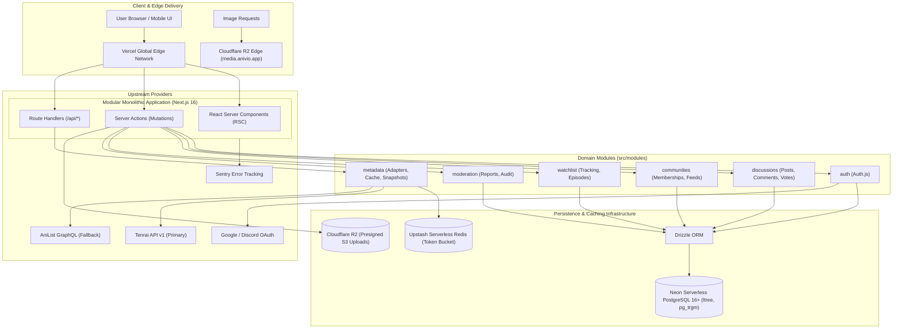

# Anivio — System Architecture, Technology Stack & Decision Records

> **Single Source of Truth (SSOT) for Codebase Organization, Technology Rationale & Architecture Decision Records**  
> Status: **LOCKED BASELINE (Version 1.0)**  
> Last Updated: 12 November 2026

This document defines the overarching technical architecture of the Anivio Anime Community Platform. It specifies the technology stack, target repository layout, module boundaries, component execution paradigms, formal Architecture Decision Records (`ADR-001` through `ADR-012`), and the Open Decisions Register.

---

## 1. High-Level System Architecture

Anivio is engineered as a **Domain-Driven Modular Monolith** utilizing Next.js 16 App Router on Vercel, backed by PostgreSQL 16+ on Neon, Upstash Redis, and Cloudflare R2:



---

## 2. Technology Stack Specification

| Category | Technology | Target Version | Architectural Role | Rejected Alternatives |
|---|---|---|---|---|
| **Framework** | Next.js | `16.x` | App Router, Server Components, Cache Components, Server Actions | Express + React SPA (dual repo friction), Remix |
| **Language** | TypeScript | `5.x` | Strict typing (`noImplicitAny`, strict null checks) across full stack | JavaScript, loosely typed TS |
| **UI Styling** | Tailwind CSS | `3.4.x` | CSS variables-driven design tokens (`src/styles/tokens.css`) | Styled-components (runtime CSS-in-JS breaks RSC) |
| **UI Primitives** | shadcn/ui | Latest CLI | Accessible headless primitives copied into `components/ui/` | Material UI, Ant Design (heavy runtime bundle) |
| **Database** | PostgreSQL | `16+` (Neon) | Relational persistence with `ltree`, `pg_trgm`, and `citext` | MongoDB (poor tree traversal), MySQL (lacks ltree) |
| **ORM** | Drizzle ORM | `0.36.x` | Zero-overhead type-safe query builder and SQL migration manager | Prisma (heavy Rust query engine, slow cold starts) |
| **Authentication**| Auth.js (v5)| `5.0.0-beta.x`| OAuth 2.0 (Google, Discord) with PostgreSQL database sessions | Custom JWTs (revocation risk), Clerk (expensive SaaS) |
| **Cache & Limits**| Upstash Redis| `1.34.x` | Distributed token bucket rate limiter and query cache | Node-cache (wiped on serverless cold starts) |
| **Object Storage**| Cloudflare R2 | S3 API | Presigned direct uploads for post media; zero egress fees | AWS S3 (high egress fees), Vercel Blob |
| **Metadata Engine**| Tenrai API v1| REST v1 | Primary anime discovery provider; MAL ID compatible | Jikan v4 (discontinued, aggressive 429 bans) |
| **Metadata Backup**| AniList API | GraphQL v2 | Secondary fallback provider when Tenrai is down | Custom scraping (fragile, violates Terms of Service) |
| **Validation** | Zod | `3.23.x` | Shared schemas validating form inputs and Server Action payloads| Yup, Joi |
| **Post Editor** | Tiptap | `2.x` | Headless rich-text editor with restricted schema & custom tag node | Draft.js, Quill, raw Markdown textarea |
| **Unit Testing** | Vitest | `2.x` | Unit tests for ranking math, path construction, Zod schemas | Jest (slower, complex ESM/TypeScript configuration) |
| **E2E Testing** | Playwright | `1.48.x` | Browser testing for 4 critical user journeys across preview DB | Cypress |
| **Monitoring** | Sentry | `8.x` | Real-time crash reporting and performance telemetry | Unmonitored production logs |
| **Hosting** | Vercel | Hobby → Pro | Zero-config deployment with edge caching for Next.js | Self-hosted VPS (high DevOps operational burden) |

---

## 3. Repository Layout & Target Directory Structure

```text
/
├── README.md                      # Public GitHub repository overview
├── docs/                          # SSOT Documentation System (6 Core Docs)
│   ├── README.md                  # Documentation index & navigation map
│   ├── PRODUCT_SPEC.md            # Product vision, requirements & user workflows
│   ├── ARCHITECTURE.md            # Tech stack, repo layout, import rules & ADRs
│   ├── BACKEND.md                 # PostgreSQL DDL, ltree functions, Server Actions & APIs
│   ├── DESIGN.md                  # Tokens, typography, 30 components & 10 page specs
│   ├── OPERATIONS.md              # Security controls, test suite, deployment & CI/CD
│   └── DEVELOPMENT.md             # Milestones M0–M9, task boards & contributing standards
├── drizzle/                       # Numbered forward-only SQL migrations (0001–0010)
├── scripts/                       # Idempotent seed scripts (minimal, realistic, stress)
├── public/                        # Static assets (favicons, logos, OG image templates)
├── src/
│   ├── app/                       # Next.js 16 App Router (routes, layouts, boundaries)
│   │   ├── (marketing)/           # Static policy pages (/about, /terms, /privacy)
│   │   ├── (main)/                # Core experience (/, /season, /top, /c, /anime, /u)
│   │   ├── (auth)/                # /auth/signin and /auth/onboarding
│   │   ├── mod/                   # Moderation queue (/mod, /mod/log)
│   │   └── api/                   # Public & maintenance route handlers
│   ├── components/                # UI component library
│   │   ├── ui/                    # Unstyled shadcn primitives
│   │   ├── anime/                 # AnimeCard, AnimeTagPill, AnimeHoverCard, EpisodeRow
│   │   ├── discussion/            # PostCard, CommentTree, CommentNode, VoteControl
│   │   ├── community/             # CommunityHeader, JoinButton, SortTabs
│   │   └── feedback/              # Skeleton, EmptyState, ErrorState, DegradedNotice
│   ├── modules/                   # Domain business logic & data access
│   │   ├── auth/                  # Sessions, onboarding helpers, role guards
│   │   ├── metadata/              # Adapters (Tenrai/AniList), snapshots, token bucket
│   │   ├── communities/           # Schema, queries, actions, slug validation
│   │   ├── discussions/           # Posts, comments (ltree), votes, ranking math
│   │   ├── watchlist/             # Schema, queries, progress updates
│   │   ├── moderation/            # Reports, automated thresholds, audit log
│   │   └── jobs/                  # Background worker queue & scheduled handlers
│   ├── lib/                       # Infrastructure clients (db, redis, storage, env)
│   └── styles/                    # tokens.css (CSS variables) and globals.css
```

### Module Boundary & Import Rules
- **Rule 1**: `src/lib/` may only import external third-party libraries. It must never import from `src/modules/` or `src/app/`.
- **Rule 2**: `src/components/ui/` primitives must never import domain modules or database queries.
- **Rule 3**: Domain modules in `src/modules/` must never import presentation code or JSX components.
- **Rule 4**: Server Components in `src/app/` compose components and invoke module actions; no module may import from `src/app/`.

---

## 4. Server vs. Client Component Boundaries

To guarantee our performance budget (**First-load JS < 180 KB compressed**), Anivio enforces a **Server-First Component Policy**:
- **Default**: Every component is a React Server Component (RSC), shipping 0 KB of client JavaScript.
- **Client Islands (`'use client'`)**: Restricted strictly to 10 leaf interactive components:
  1. `PostEditor.tsx`: Tiptap rich-text state and media dropzone.
  2. `VoteControl.tsx`: Immediate optimistic upvote/downvote feedback.
  3. `CommentComposer.tsx`: Controlled reply input and optimistic insert.
  4. `CommentNode.tsx`: Collapse/expand subtree toggle and inline reply form.
  5. `SpoilerBlock.tsx`: Local reveal toggle without server round-trip.
  6. `SearchBox.tsx`: Debounced keyboard input and combobox focus trap.
  7. `AnimeHoverCard.tsx`: Floating UI portal and Escape dismissal.
  8. `WatchlistControl.tsx`: Interactive status selector and episode counter.
  9. `MobileDrawer.tsx`: Off-canvas navigation slide-out.
  10. `Toast.tsx`: Transient feedback notification container.

---

## 5. Source Material Conflict Resolutions

During source analysis of the two initial planning documents, four critical contradictions were identified and resolved in favor of the **Build Planning Document**:

| # | Topic | Architecture Plan Recommendation | Build Planning Baseline (LOCKED) | Formal Resolution & Rationale |
|---|---|---|---|---|
| **CR-01** | Primary Anime Metadata Engine | Jikan REST API v4 | Tenrai API v1 as Primary, AniList as Fallback, PostgreSQL Snapshots | **Resolved to Tenrai + Snapshots**. Jikan v4 is unmaintained and experiences severe 429 IP bans. Tenrai provides active MAL-compatible endpoints. Snapshots ensure zero site downtime during outages. |
| **CR-02** | Caching Architecture | Next.js `cacheLife` around raw `fetch` | Three-layer caching: `'use cache'`, Redis token bucket, PostgreSQL snapshots | **Resolved to Three-Layer Model**. `cacheLife` alone cannot buffer external rate-limited APIs across serverless instances. Multi-layer isolates rendering, rate limits, and durability. |
| **CR-03** | Comment Nesting Depth Cap | Up to 10 levels deep | Hard-capped at 8 levels via database constraint | **Resolved to 8 levels**. 10 levels causes unusable horizontal compression on 320px mobile screens. Enforced via `CHECK (depth BETWEEN 1 AND 8)`. |
| **CR-04** | Real-Time Chat & WebSockets | Considered for real-time notifications | Strictly excluded from MVP scope | **Resolved to Strict Exclusion**. Stateful WebSocket servers dramatically increase hosting costs and moderation overhead. Asynchronous threaded comments scale cleanly. |

---

## 6. Architecture Decision Records (ADRs)

### ADR-001: Next.js 16 App Router as Full-Stack Framework
- **Status**: `LOCKED`
- **Context**: Need a fast, SEO-friendly frontend and backend in a unified repository maintainable by a solo developer.
- **Decision**: Next.js 16 App Router with React Server Components and Server Actions.
- **Consequences**: Shipped client bundle < 180 KB; mutations executed via type-safe Server Actions.

### ADR-002: PostgreSQL 16+ on Neon as Relational Persistence
- **Status**: `LOCKED`
- **Context**: Domain requires relational social integrity (votes, memberships) and complex hierarchical comment queries.
- **Decision**: Managed PostgreSQL 16+ on Neon with `ltree`, `pg_trgm`, and `citext` extensions.
- **Consequences**: Enables serverless database branching for preview deployments and native tree indexing.

### ADR-003: Hierarchical Comment Storage via PostgreSQL `ltree`
- **Status**: `LOCKED`
- **Context**: Recursive CTEs on parent pointers degrade severely during high-traffic episode discussions.
- **Decision**: Store comment paths as PostgreSQL `ltree` materialized paths indexed with GiST.
- **Consequences**: Entire 1,000-comment threads are retrieved in conversation order in a single query (`WHERE path <@ root ORDER BY path`) in <400ms.

### ADR-004: Drizzle ORM for Data Access
- **Status**: `LOCKED`
- **Context**: Need type-safe queries without heavy serverless cold starts.
- **Decision**: Drizzle ORM with raw SQL migrations committed directly to Git.
- **Consequences**: Zero runtime query engine overhead; transparent SQL generation; native support for `ltree` syntax.

### ADR-005: Auth.js with Database Sessions
- **Status**: `LOCKED`
- **Context**: Need secure identity without storing passwords.
- **Decision**: Auth.js with Google and Discord OAuth 2.0 and database session rows in PostgreSQL.
- **Consequences**: Zero password breach liability; sessions instantly revocable by moderators.

### ADR-006: External Metadata Adapter with Snapshot Fallback
- **Status**: `LOCKED`
- **Context**: External anime APIs suffer from outages and rate limits.
- **Decision**: Tenrai API v1 primary adapter + AniList fallback + automatic writing to `provider_snapshots` table.
- **Consequences**: Application renders cached snapshots with `DegradedNotice` during external provider downtime; zero 500 crashes.

### ADR-007: Algorithmic Ranking via Wilson Score and Hot Decay
- **Status**: `LOCKED`
- **Context**: Naive `upvotes - downvotes` ranking allows 1 upvote to outrank proven discussions and buries fresh threads.
- **Decision**: Implement Wilson Score Interval ($z=1.96$) for "Best" sorting and logarithmic time-decay for "Hot" sorting inside PostgreSQL immutable functions.
- **Consequences**: Statistically sound community ranking computed asynchronously via background jobs.

### ADR-008: Tiptap Editor with Restricted Schema
- **Status**: `LOCKED`
- **Context**: Need rich text with inline anime entity tagging while eliminating XSS vectors.
- **Decision**: Headless Tiptap editor serialized strictly to JSON conforming to an allowlist of nodes and marks.
- **Consequences**: Eliminates raw HTML injection; tags render server-side as static accessible cards.

### ADR-009: Media Storage on Cloudflare R2
- **Status**: `LOCKED`
- **Context**: Post image attachments require performant, cost-effective storage.
- **Decision**: Presigned direct uploads to Cloudflare R2 served from custom domain `media.anivio.app`.
- **Consequences**: Zero egress fees; file binary uploads bypass Vercel serverless functions.

### ADR-010: Native PostgreSQL Search (`tsvector` + `pg_trgm`)
- **Status**: `LOCKED`
- **Context**: Need discussion search without paying for external SaaS infrastructure.
- **Decision**: Generated `tsvector` column on `posts` table (weighted title A, body B) paired with GIN and trigram indexes.
- **Consequences**: Typo-tolerant full-text search with zero additional monthly hosting costs.

### ADR-011: Automated 3-Report Moderation Threshold
- **Status**: `LOCKED`
- **Context**: Solo developer cannot manually moderate thousands of daily posts in real time.
- **Decision**: 3 unique reports from accounts >24h old automatically transition content to `status = 'filtered'` and alert moderators.
- **Consequences**: Toxic content is suppressed automatically while awaiting human review.

### ADR-012: Privacy-Compliant Salted IP Hash Logging
- **Status**: `LOCKED`
- **Context**: Need abuse correlation without retaining personally identifiable IP addresses indefinitely.
- **Decision**: Hash IP addresses with a rotating monthly salt (`SHA256(ip + salt)`) in `audit_log` with a 30-day retention policy.
- **Consequences**: Fully compliant with GDPR and modern privacy standards.

---

## 7. Open Decisions Register

| Decision ID | Open Topic | Evaluated Options | Authoritative Baseline Recommendation | Decide By |
|---|---|---|---|---|
| **OD-01** | Character-Level Tagging | A) Include in V1<br>B) Defer to P2 | **Option B (Defer to P2)**. Anime-level tagging achieves 90% of product differentiator with significantly less editor complexity. | Milestone 6 |
| **OD-02** | Monetization Activation Date | A) Never<br>B) Launch<br>C) Post-Launch | **Option C (Post-Launch)**. Launch on Vercel Hobby; upgrade to Pro plan when affiliate links go live. | Milestone 9 |
| **OD-03** | Community Creation Eligibility | A) Any signed-in user<br>B) Accounts >3 days old, max 2/wk | **Option B (Accounts > 3 days old)**. Neutralizes automated community spam without manual admin queues. | Milestone 4 |
| **OD-04** | Content Rating Policy | A) SFW strictly<br>B) Allow NSFW with age-gate | **Option A (SFW only at launch)**. Uses provider safe-for-work filters to simplify moderation and legal exposure. | Milestone 3 |
| **OD-05** | Spoiler Scope Model | A) Post-level boolean<br>B) Post-level with optional episode field | **Option B (Post-level with optional episode field)**. Directly matches the needs of weekly episodic discussion threads. | Milestone 5 |
| **OD-06** | Author Post Editing Window | A) Unlimited<br>B) 24 hours<br>C) Immutable | **Option B (24 hours)**. Prevents authors from rewriting historical debate contexts while permitting typo corrections. | Milestone 4 |
| **OD-07** | Vote Roster Visibility | A) Aggregate score only<br>B) Public voter list | **Option A (Aggregate score only)**. Public voter rosters encourage vote brigading and user retaliation. | Milestone 5 |
| **OD-08** | Username Change Frequency | A) Never<br>B) Once every 30 days | **Option B (Once every 30 days, old name held 90 days)**. Prevents identity confusion and impersonation. | Milestone 2 |
| **OD-09** | Telemetry & Analytics | A) None<br>B) Cookie-free aggregate | **Option B (Cookie-free aggregate)**. Preserves privacy and eliminates GDPR cookie consent banner overhead. | Milestone 8 |
| **OD-10** | Outbound Email Notifications | A) None in V1<br>B) Weekly digest | **Option A (None in V1)**. Avoids deliverability and unsubscribe compliance burdens before achieving MAU. | Milestone 9 |
| **OD-11** | Synopsis Display Length | A) Full unedited text<br>B) Short excerpt + external link | **Option B (Short excerpt + link)**. Respects MyAnimeList copyright terms and keeps show views compact. | Milestone 3 |
| **OD-12** | IP Address Retention | A) Hash and keep 30 days<br>B) Do not store | **Option A (Hash and keep 30 days)**. Enables abuse investigation without holding personally identifiable data indefinitely. | Milestone 7 |
| **OD-13** | Database Preview Branch Strategy| A) Shared staging DB<br>B) Neon branch per PR | **Option B (Neon branch per PR)**. Fully isolates schema migrations during preview deployments. | Milestone 1 |
| **OD-14** | Repository Visibility | A) Private permanently<br>B) Public after launch | **Option B (Private during development; public post-launch)**. Serves as portfolio artifact once launched. | Milestone 9 |
| **OD-15** | Ranking Tie-Breaker | A) Entity UUID<br>B) Creation timestamp | **Option B (Creation timestamp)**. Resolves ties deterministically without jumping positions. | Milestone 5 |

