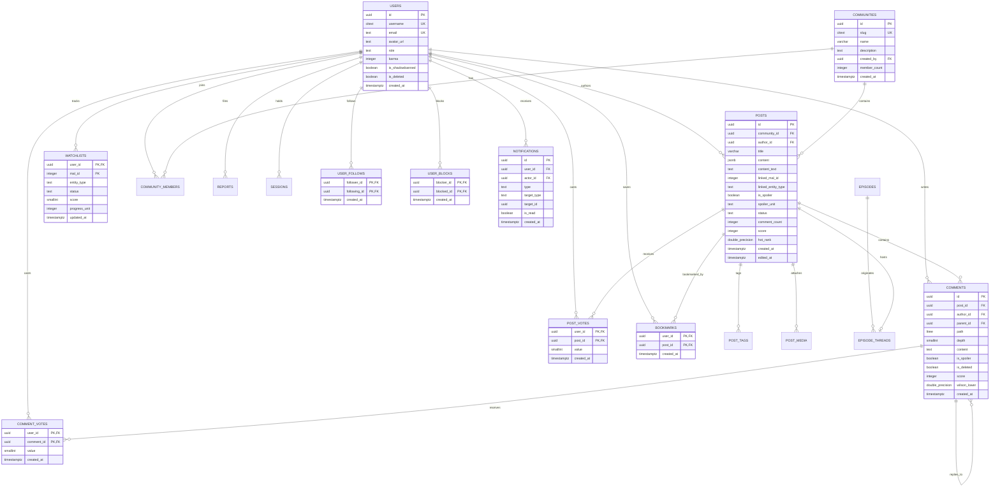

# Anivio — Database Architecture, Server Actions & API Contracts

> **Single Source of Truth (SSOT) for Relational Persistence, DDL Schemas, Server Actions & External Adapters**  
> Status: **CONSOLIDATED BASELINE (Version 1.1)**  
> Last Updated: 12 November 2026  
> Document Alignment: Reconciled with `README.md` & `ARCHITECTURE.md` (Version 1.1 Consolidated Architecture Baseline)

This document is the authoritative backend specification for the Anivio Platform. It defines the PostgreSQL 16+ relational schema, entity-relationship models, DDL statements, stored procedural functions, Server Actions, Route Handlers, external metadata adapter contracts, and the caching matrix.

---

## 1. Database Architecture & Extensions

Anivio is powered by **PostgreSQL 16+ on Neon**, leveraging three native extensions:
```sql
-- Migration 0001_extensions.sql
CREATE EXTENSION IF NOT EXISTS ltree;      -- Hierarchical materialized paths for comment trees
CREATE EXTENSION IF NOT EXISTS pg_trgm;     -- Trigram indexing for fuzzy title search
CREATE EXTENSION IF NOT EXISTS citext;      -- Case-insensitive text for usernames and community slugs
```

### Relational Entity-Relationship Diagram (ERD)



---

## 2. Table Schemas & Constraints (DDL)

### 2.1 Identity, Authentication & Social Graph
```sql
CREATE TABLE users (
  id uuid PRIMARY KEY DEFAULT gen_random_uuid(),
  username citext UNIQUE,
  email text UNIQUE,
  avatar_url text,
  role text NOT NULL DEFAULT 'user' CHECK (role IN ('user', 'moderator', 'admin')),
  karma integer NOT NULL DEFAULT 0,
  is_shadowbanned boolean NOT NULL DEFAULT false,
  is_deleted boolean NOT NULL DEFAULT false,
  created_at timestamptz NOT NULL DEFAULT now(),
  CONSTRAINT users_username_length CHECK (char_length(username::text) BETWEEN 3 AND 24)
);

CREATE TABLE accounts (
  id uuid PRIMARY KEY DEFAULT gen_random_uuid(),
  user_id uuid NOT NULL REFERENCES users(id) ON DELETE CASCADE,
  type text NOT NULL,
  provider text NOT NULL,
  provider_account_id text NOT NULL,
  refresh_token text,
  access_token text,
  expires_at bigint,
  token_type text,
  scope text,
  id_token text,
  session_state text,
  CONSTRAINT accounts_provider_unique UNIQUE (provider, provider_account_id)
);
CREATE INDEX accounts_user_id_idx ON accounts(user_id);

CREATE TABLE sessions (
  session_token text PRIMARY KEY,
  user_id uuid NOT NULL REFERENCES users(id) ON DELETE CASCADE,
  expires timestamptz NOT NULL
);
CREATE INDEX sessions_user_id_idx ON sessions(user_id);

CREATE TABLE user_follows (
  follower_id uuid NOT NULL REFERENCES users(id) ON DELETE CASCADE,
  following_id uuid NOT NULL REFERENCES users(id) ON DELETE CASCADE,
  created_at timestamptz NOT NULL DEFAULT now(),
  PRIMARY KEY (follower_id, following_id),
  CONSTRAINT user_follows_no_self CHECK (follower_id != following_id)
);
CREATE INDEX user_follows_following_idx ON user_follows(following_id);

CREATE TABLE user_blocks (
  blocker_id uuid NOT NULL REFERENCES users(id) ON DELETE CASCADE,
  blocked_id uuid NOT NULL REFERENCES users(id) ON DELETE CASCADE,
  created_at timestamptz NOT NULL DEFAULT now(),
  PRIMARY KEY (blocker_id, blocked_id),
  CONSTRAINT user_blocks_no_self CHECK (blocker_id != blocked_id)
);
```

### 2.2 Communities & Posts
```sql
CREATE TABLE communities (
  id uuid PRIMARY KEY DEFAULT gen_random_uuid(),
  slug citext UNIQUE NOT NULL,
  name varchar(50) NOT NULL,
  description text NOT NULL,
  created_by uuid NOT NULL REFERENCES users(id) ON DELETE RESTRICT,
  member_count integer NOT NULL DEFAULT 1,
  created_at timestamptz NOT NULL DEFAULT now(),
  CONSTRAINT communities_slug_format CHECK (slug ~ '^[a-z0-9-]+$' AND char_length(slug::text) BETWEEN 3 AND 24)
);
CREATE INDEX communities_member_count_idx ON communities(member_count DESC);

CREATE TABLE community_members (
  community_id uuid NOT NULL REFERENCES communities(id) ON DELETE CASCADE,
  user_id uuid NOT NULL REFERENCES users(id) ON DELETE CASCADE,
  role text NOT NULL DEFAULT 'member' CHECK (role IN ('member', 'moderator', 'owner')),
  joined_at timestamptz NOT NULL DEFAULT now(),
  PRIMARY KEY (community_id, user_id)
);
CREATE INDEX community_members_user_id_idx ON community_members(user_id);

CREATE TABLE posts (
  id uuid PRIMARY KEY DEFAULT gen_random_uuid(),
  community_id uuid NOT NULL REFERENCES communities(id) ON DELETE CASCADE,
  author_id uuid NOT NULL REFERENCES users(id) ON DELETE RESTRICT,
  title varchar(300) NOT NULL CHECK (char_length(title) >= 3),
  content jsonb NOT NULL,
  content_text text NOT NULL DEFAULT '',
  linked_mal_id integer,
  linked_entity_type text NOT NULL DEFAULT 'anime' CHECK (linked_entity_type IN ('anime', 'manga', 'light_novel', 'webtoon')),
  is_spoiler boolean NOT NULL DEFAULT false,
  spoiler_unit text, -- e.g. "Episode 12", "Chapter 45"
  status text NOT NULL DEFAULT 'published' CHECK (status IN ('published', 'removed', 'filtered')),
  comment_count integer NOT NULL DEFAULT 0,
  score integer NOT NULL DEFAULT 0,
  hot_rank double precision NOT NULL DEFAULT 0,
  created_at timestamptz NOT NULL DEFAULT now(),
  edited_at timestamptz
);

-- Full-Text Search Generated Vector & Indexes
ALTER TABLE posts ADD COLUMN search tsvector
  GENERATED ALWAYS AS (
    setweight(to_tsvector('english', coalesce(title, '')), 'A') ||
    setweight(to_tsvector('english', coalesce(content_text, '')), 'B')
  ) STORED;

CREATE INDEX posts_search_gin ON posts USING gin (search);
CREATE INDEX posts_title_trgm ON posts USING gin (title gin_trgm_ops);
CREATE INDEX posts_community_hot_idx ON posts (community_id, hot_rank DESC) WHERE status = 'published';
CREATE INDEX posts_community_new_idx ON posts (community_id, created_at DESC) WHERE status = 'published';
CREATE INDEX posts_author_idx ON posts (author_id, created_at DESC);

CREATE TABLE post_tags (
  post_id uuid NOT NULL REFERENCES posts(id) ON DELETE CASCADE,
  entity_type text NOT NULL CHECK (entity_type IN ('anime', 'manga', 'light_novel', 'webtoon', 'character', 'episode')),
  entity_id integer NOT NULL,
  display_label text NOT NULL,
  PRIMARY KEY (post_id, entity_type, entity_id)
);
CREATE INDEX post_tags_entity_idx ON post_tags(entity_type, entity_id);

CREATE TABLE post_media (
  id uuid PRIMARY KEY DEFAULT gen_random_uuid(),
  post_id uuid NOT NULL REFERENCES posts(id) ON DELETE CASCADE,
  storage_key text NOT NULL,
  width integer NOT NULL,
  height integer NOT NULL,
  mime_type text NOT NULL CHECK (mime_type IN ('image/webp', 'image/jpeg', 'image/png')),
  size_bytes integer NOT NULL CHECK (size_bytes <= 5242880),
  alt_text text NOT NULL,
  created_at timestamptz NOT NULL DEFAULT now()
);
CREATE INDEX post_media_post_id_idx ON post_media(post_id);

CREATE TABLE bookmarks (
  user_id uuid NOT NULL REFERENCES users(id) ON DELETE CASCADE,
  post_id uuid NOT NULL REFERENCES posts(id) ON DELETE CASCADE,
  created_at timestamptz NOT NULL DEFAULT now(),
  PRIMARY KEY (user_id, post_id)
);
CREATE INDEX bookmarks_user_idx ON bookmarks(user_id, created_at DESC);
```

### 2.3 Comments, Hierarchy & Voting
```sql
CREATE SEQUENCE comment_path_seq;

CREATE TABLE comments (
  id uuid PRIMARY KEY DEFAULT gen_random_uuid(),
  post_id uuid NOT NULL REFERENCES posts(id) ON DELETE CASCADE,
  author_id uuid NOT NULL REFERENCES users(id) ON DELETE RESTRICT,
  parent_id uuid REFERENCES comments(id) ON DELETE RESTRICT,
  path ltree NOT NULL,
  depth smallint NOT NULL,
  content text NOT NULL CHECK (char_length(content) BETWEEN 1 AND 10000),
  is_spoiler boolean NOT NULL DEFAULT false,
  is_deleted boolean NOT NULL DEFAULT false,
  score integer NOT NULL DEFAULT 0,
  wilson_lower double precision NOT NULL DEFAULT 0,
  created_at timestamptz NOT NULL DEFAULT now(),
  CONSTRAINT comments_depth_matches_path CHECK (nlevel(path) = depth),
  CONSTRAINT comments_depth_cap CHECK (depth BETWEEN 1 AND 8),
  CONSTRAINT comments_path_unique UNIQUE (post_id, path)
);

CREATE INDEX comments_path_gist ON comments USING gist (path);
CREATE INDEX comments_post_path ON comments (post_id, path);
CREATE INDEX comments_post_rank ON comments (post_id, wilson_lower DESC);

CREATE TABLE post_votes (
  user_id uuid NOT NULL REFERENCES users(id) ON DELETE CASCADE,
  post_id uuid NOT NULL REFERENCES posts(id) ON DELETE CASCADE,
  value smallint NOT NULL CHECK (value IN (-1, 1)),
  created_at timestamptz NOT NULL DEFAULT now(),
  PRIMARY KEY (user_id, post_id)
);

CREATE TABLE comment_votes (
  user_id uuid NOT NULL REFERENCES users(id) ON DELETE CASCADE,
  comment_id uuid NOT NULL REFERENCES comments(id) ON DELETE CASCADE,
  value smallint NOT NULL CHECK (value IN (-1, 1)),
  created_at timestamptz NOT NULL DEFAULT now(),
  PRIMARY KEY (user_id, comment_id)
);
```

### 2.4 Library Tracking, Catalog Units & Snapshots
```sql
CREATE TABLE watchlists (
  user_id uuid NOT NULL REFERENCES users(id) ON DELETE CASCADE,
  mal_id integer NOT NULL,
  entity_type text NOT NULL DEFAULT 'anime' CHECK (entity_type IN ('anime', 'manga', 'light_novel', 'webtoon')),
  status text NOT NULL CHECK (status IN ('watching', 'reading', 'completed', 'on_hold', 'dropped', 'planned')),
  score smallint CHECK (score BETWEEN 1 AND 10 OR score IS NULL),
  episodes_watched integer NOT NULL DEFAULT 0 CHECK (episodes_watched >= 0),
  chapters_read integer NOT NULL DEFAULT 0 CHECK (chapters_read >= 0),
  volumes_read integer NOT NULL DEFAULT 0 CHECK (volumes_read >= 0),
  updated_at timestamptz NOT NULL DEFAULT now(),
  PRIMARY KEY (user_id, mal_id)
);
CREATE INDEX watchlists_user_status_idx ON watchlists(user_id, status);

CREATE TABLE episodes (
  mal_id integer NOT NULL,
  episode_number integer NOT NULL,
  title text,
  aired_at timestamptz,
  provider_fetched_at timestamptz NOT NULL DEFAULT now(),
  PRIMARY KEY (mal_id, episode_number)
);

CREATE TABLE episode_threads (
  mal_id integer NOT NULL,
  episode_number integer NOT NULL,
  post_id uuid UNIQUE NOT NULL REFERENCES posts(id) ON DELETE CASCADE,
  created_at timestamptz NOT NULL DEFAULT now(),
  PRIMARY KEY (mal_id, episode_number)
);

CREATE TABLE provider_snapshots (
  entity_type text NOT NULL CHECK (entity_type IN ('anime', 'manga', 'light_novel', 'webtoon', 'character', 'episode', 'season')),
  entity_id integer NOT NULL,
  provider text NOT NULL,
  payload jsonb NOT NULL,
  fetched_at timestamptz NOT NULL DEFAULT now(),
  PRIMARY KEY (entity_type, entity_id)
);
```

### 2.5 Moderation, Notifications & Audit Logs
```sql
CREATE TABLE reports (
  id uuid PRIMARY KEY DEFAULT gen_random_uuid(),
  reporter_id uuid NOT NULL REFERENCES users(id) ON DELETE CASCADE,
  target_type text NOT NULL CHECK (target_type IN ('post', 'comment', 'user')),
  target_id uuid NOT NULL,
  reason text NOT NULL CHECK (reason IN ('spam', 'harassment', 'spoilers', 'off_topic', 'illegal')),
  note text,
  state text NOT NULL DEFAULT 'open' CHECK (state IN ('open', 'actioned', 'dismissed')),
  created_at timestamptz NOT NULL DEFAULT now(),
  resolved_by uuid REFERENCES users(id),
  resolved_at timestamptz,
  CONSTRAINT reports_unique_reporter UNIQUE (reporter_id, target_type, target_id)
);
CREATE INDEX reports_queue_idx ON reports(state, created_at) WHERE state = 'open';

CREATE TABLE moderation_actions (
  id uuid PRIMARY KEY DEFAULT gen_random_uuid(),
  actor_id uuid NOT NULL REFERENCES users(id) ON DELETE RESTRICT,
  target_type text NOT NULL,
  target_id uuid NOT NULL,
  action text NOT NULL CHECK (action IN ('remove', 'restore', 'filter', 'shadowban', 'unshadowban', 'ban')),
  reason text NOT NULL,
  created_at timestamptz NOT NULL DEFAULT now()
);

CREATE TABLE notifications (
  id uuid PRIMARY KEY DEFAULT gen_random_uuid(),
  user_id uuid NOT NULL REFERENCES users(id) ON DELETE CASCADE,
  actor_id uuid REFERENCES users(id) ON DELETE SET NULL,
  type text NOT NULL CHECK (type IN ('reply', 'mention', 'vote_milestone', 'moderation')),
  target_type text NOT NULL CHECK (target_type IN ('post', 'comment', 'community')),
  target_id uuid NOT NULL,
  is_read boolean NOT NULL DEFAULT false,
  created_at timestamptz NOT NULL DEFAULT now()
);
CREATE INDEX notifications_user_unread_idx ON notifications(user_id, created_at DESC) WHERE is_read = false;

CREATE TABLE audit_log (
  id uuid PRIMARY KEY DEFAULT gen_random_uuid(),
  actor_id uuid NOT NULL REFERENCES users(id) ON DELETE RESTRICT,
  action text NOT NULL,
  metadata jsonb,
  ip_hash text,
  created_at timestamptz NOT NULL DEFAULT now()
);
CREATE INDEX audit_log_actor_idx ON audit_log(actor_id, created_at);

CREATE TABLE jobs (
  id uuid PRIMARY KEY DEFAULT gen_random_uuid(),
  kind text NOT NULL,
  payload jsonb NOT NULL,
  run_after timestamptz NOT NULL DEFAULT now(),
  attempts integer NOT NULL DEFAULT 0,
  locked_at timestamptz,
  created_at timestamptz NOT NULL DEFAULT now()
);
CREATE INDEX jobs_queue_idx ON jobs(run_after) WHERE locked_at IS NULL;
```

---

## 3. Stored Functions & Procedural Logic

### 3.1 Transactional Hierarchical Insertion (`add_comment`)
Serializes insertions on a per-post basis using PostgreSQL advisory transaction locks, completely eliminating path insertion race conditions:
```sql
CREATE OR REPLACE FUNCTION add_comment(
  p_post uuid,
  p_author uuid,
  p_parent uuid,
  p_content text,
  p_spoiler boolean
) RETURNS uuid LANGUAGE plpgsql AS $$
DECLARE
  v_parent_path ltree;
  v_parent_depth smallint;
  v_path ltree;
  v_id uuid;
BEGIN
  -- Advisory lock scoped to transaction on post_id hash
  PERFORM pg_advisory_xact_lock(hashtext(p_post::text));

  IF p_parent IS NULL THEN
    v_path := nextval('comment_path_seq')::text::ltree;
  ELSE
    SELECT path, depth INTO v_parent_path, v_parent_depth
      FROM comments WHERE id = p_parent AND post_id = p_post;

    IF v_parent_path IS NULL THEN
      RAISE EXCEPTION 'parent comment not found in post';
    END IF;

    IF v_parent_depth >= 8 THEN
      RAISE EXCEPTION 'comments_depth_cap: maximum nesting depth exceeded';
    END IF;

    v_path := v_parent_path || nextval('comment_path_seq')::text::ltree;
  END IF;

  INSERT INTO comments (post_id, author_id, parent_id, path, depth, content, is_spoiler)
  VALUES (p_post, p_author, p_parent, v_path, nlevel(v_path), p_content, p_spoiler)
  RETURNING id INTO v_id;

  UPDATE posts SET comment_count = comment_count + 1 WHERE id = p_post;

  RETURN v_id;
END $$;
```

### 3.2 Wilson Score Lower Bound Function
```sql
CREATE OR REPLACE FUNCTION wilson_lower(ups integer, downs integer)
RETURNS double precision LANGUAGE sql IMMUTABLE AS $$
  WITH v AS (
    SELECT ups::double precision AS u,
           downs::double precision AS d,
           (ups + downs)::double precision AS n,
           1.96::double precision AS z
  )
  SELECT CASE WHEN n = 0 THEN 0::double precision ELSE
    ((u / n) + z*z/(2*n) - z * sqrt(((u/n) * (1 - u/n) + z*z/(4*n)) / n))
      / (1 + z*z/n)
  END
  FROM v;
$$;
```

### 3.3 Hot Rank Time-Decay Function
```sql
CREATE OR REPLACE FUNCTION hot_rank(score integer, created_at timestamptz)
RETURNS double precision LANGUAGE sql IMMUTABLE AS $$
  SELECT (CASE WHEN score > 0 THEN 1 WHEN score < 0 THEN -1 ELSE 0 END)
         * log(10, GREATEST(abs(score), 1)::numeric)::double precision
         + (extract(epoch FROM created_at) / 45000.0);
$$;
```

---

## 4. Server Actions Specifications

All mutations in Anivio execute via Server Actions. Every action validates authorization and arguments via Zod, returning a typed discriminated union (`ActionResult<T>`):

| Action Name | Input Arguments | Authorization | Database Effects | Error Codes |
|---|---|---|---|---|
| `createPost` | `{ communityId: uuid, title: string, documentJson: JSON, linkedMalId?: number, linkedEntityType?: string, isSpoiler: boolean, spoilerUnit?: string, mediaIds: uuid[] }` | Signed in, community member, account >24h for links, not shadowbanned | Inserts `posts`, `post_tags`, links `post_media`. Enqueues search update & revalidates feed. | `RateLimited`, `NotMember`, `ValidationFailed`, `Unauthenticated` |
| `updatePost` | `{ postId: uuid, title: string, documentJson: JSON, linkedMalId?: number, isSpoiler: boolean, spoilerUnit?: string }` | Post author within 24 hours OR community moderator | Updates `posts.title`, `posts.content`, recomputes tags, sets `edited_at = now()`. | `Forbidden`, `Expired`, `ValidationFailed`, `NotFound` |
| `createComment` | `{ postId: uuid, parentId?: uuid, content: string, isSpoiler: boolean }` | Signed in, post published, depth <= 8 | Calls `add_comment()`, increments `posts.comment_count`, enqueues score job and notification. | `RateLimited`, `DepthExceeded`, `ParentMissing`, `Unauthenticated` |
| `vote` | `{ targetType: 'post' \| 'comment', targetId: uuid, value: 1 \| -1 }` | Signed in, voter is NOT author of target | Upserts row in `post_votes` or `comment_votes`. Enqueues `recomputeScore` job. | `Forbidden`, `TargetMissing`, `RateLimited`, `Unauthenticated` |
| `createCommunity` | `{ slug: string, name: string, description: string }` | **Platform Administrator** (Launch baseline; trusted-user creation deferred to post-launch) | Inserts `communities`, creates owner row in `community_members`, writes `audit_log`. | `Forbidden`, `SlugTaken`, `RateLimited`, `ValidationFailed`, `Unauthenticated` |
| `joinCommunity` | `{ communityId: uuid }` | Signed in | Idempotent insert into `community_members`, increments `communities.member_count`. | `RateLimited`, `Unauthenticated`, `NotFound` |
| `upsertWatchlistEntry` | `{ malId: number, entityType?: string, status: 'watching' \| 'reading' \| 'completed' \| 'on_hold' \| 'dropped' \| 'planned', score?: number, episodesWatched?: number, chaptersRead?: number, volumesRead?: number }` | Signed in, `malId` resolvable in metadata | Upserts row in `watchlists`. Validates units <= total cached units. | `InvalidProgress`, `UnknownAnime`, `Unauthenticated` |
| `followUser` | `{ targetUserId: uuid }` | Signed in, targetUserId != self, not blocked | Inserts into `user_follows`. | `SelfFollowNotAllowed`, `Blocked`, `RateLimited`, `Unauthenticated` |
| `unfollowUser` | `{ targetUserId: uuid }` | Signed in | Deletes row from `user_follows`. | `Unauthenticated` |
| `toggleBookmark` | `{ postId: uuid }` | Signed in | Idempotent insert or delete from `bookmarks`. | `RateLimited`, `Unauthenticated`, `NotFound` |
| `revealSpoiler` | `{ targetType: 'post' \| 'comment', targetId: uuid }` | Signed in or session holder | Fetches and returns unmasked content for client render without pre-leaking in initial RSC payload. | `TargetNotFound`, `RateLimited` |
| `markNotificationRead` | `{ notificationId: uuid }` | Signed in notification recipient | Sets `notifications.is_read = true`. | `NotFound`, `Forbidden`, `Unauthenticated` |
| `reportTarget` | `{ targetType: 'post' \| 'comment', targetId: uuid, reason: string, note?: string }` | Signed in, reporter is NOT author of target | Inserts `reports`. If >= 3 unique valid reports, sets target `status = 'filtered'` and alerts mod. | `AlreadyReported`, `RateLimited`, `Unauthenticated` |
| `resolveReport` | `{ reportId: uuid, decision: 'approve' \| 'remove' \| 'dismiss', reason: string }` | Community moderator OR Admin | Updates report state, modifies target status, writes immutable `moderation_actions` row. | `Forbidden`, `AlreadyResolved`, `Unauthenticated` |
| `deleteAccount` | `{ confirmation: string }` | Active session owner | Anonymizes user row, deletes sessions/accounts, retains authored posts with deleted marker. | `ConfirmationMismatch`, `Unauthenticated` |

---

## 5. Route Handlers & API Endpoints

| Route Path | Method | Purpose | Cache Policy | Rate Limit |
|---|---|---|---|---|
| `/api/search/anime` | `GET` | Debounced anime/manga search for navbar & editor combobox | 1 hour per query string in Redis | 30 requests / min per IP |
| `/api/hover/anime/[id]` | `GET` | Lightweight payload for inline tag hover cards | 24 hours in Redis & edge | 120 requests / min per IP |
| `/api/feed` | `GET` | Keyset-paginated post feed for infinite scroll | Dynamic (no cache for signed-in; 60s for anon) | 60 requests / min per IP |
| `/api/comments` | `GET` | Subtree fetch for deep "continue this thread" branches | None (always live query) | 60 requests / min per IP |
| `/api/spoiler/reveal` | `POST` | Server-validated endpoint to fetch masked spoiler body | Dynamic (server-enforced withholding) | 120 requests / min per IP |
| `/api/upload/sign` | `POST` | Authorizes & returns presigned Cloudflare R2 upload URL | None (private, signed) | 10 uploads / hour per user |
| `/api/health` | `GET` | Database, Redis, and Metadata provider availability probe | None | Unrestricted (monitoring only) |
| `/api/cron/daily` | `POST` | Scheduled daily maintenance: season refresh, score sync, orphan sweep | None | Protected via `Authorization: Bearer <CRON_SECRET>` |

---

## 6. External Metadata Adapter Contract

### 6.1 TypeScript Adapter Interface
```typescript
export type CatalogItemSummary = {
  id: number;
  entityType: 'anime' | 'manga' | 'light_novel' | 'webtoon';
  title: string;
  titleEnglish: string | null;
  images: { small: string; medium: string; large: string };
  score: number | null;
  totalUnits: number | null; -- episodes, chapters, or volumes
  status: 'airing' | 'publishing' | 'finished' | 'upcoming' | 'unknown';
  genres: string[];
  year: number | null;
  synopsis: string | null;
  isDegraded?: boolean;
  snapshotAgeHours?: number;
};

export interface MetadataProvider {
  name: string;
  search(query: string, type: string, page: number): Promise<Page<CatalogItemSummary>>;
  getSeason(season: string, year: number, page: number): Promise<Page<CatalogItemSummary>>;
  getTop(type: string, page: number): Promise<Page<CatalogItemSummary>>;
  getItem(id: number, type: string): Promise<CatalogItemSummary>;
  getUnits(id: number, type: string, page: number): Promise<Page<UnitSummary>>;
  getCharacters(id: number, type: string, page: number): Promise<Page<CharacterSummary>>;
}
```

### 6.2 The Six Mandatory Adapter Wrapping Rules (LOCKED)
1. **Timeout & Retries**: 5-second socket timeout; max 2 retries with exponential backoff and randomized jitter.
2. **Rate Limit Handling**: Strictly honor upstream `Retry-After` headers on HTTP 429. Cache 404 responses negatively for 10 minutes.
3. **Token Bucket Consumption**: Consume a Redis token before dispatching outbound requests; release token immediately if satisfied by local cache.
4. **Single-Flight Mutex**: Enforce an in-memory/Redis mutex lock per entity key so that concurrent misses for the same catalog item generate exactly one upstream fetch.
5. **Snapshot Persistence**: Automatically write an upsert row to `provider_snapshots` before returning. If outbound network fails, immediately serve the latest snapshot with `DegradedNotice`.
6. **Error Isolation**: Never throw raw network or provider errors across the module boundary. Return a typed `Result<T, ProviderError>` object.

---

## 7. Caching & Revalidation Matrix

| Data Layer | Cache Strategy | Duration | Invalidation Mechanism |
|---|---|---|---|
| Season & Top Lists | Next.js `'use cache'` | 24 Hours | Time-based; refreshed by daily cron |
| Show Detail & Synopsis | Next.js Cache + `provider_snapshots` | 24 Hours | Time-based, or manual refresh when score shifts materially |
| Catalog Search Results | Upstash Redis | 1 Hour | Time-based (negative misses cached 5 minutes) |
| Inline Tag Hover Payload | Route Handler + Redis | 24 Hours | Time-based |
| Airing Episode Lists | PostgreSQL `episodes` table | 7 Days | Daily cron job (refreshing currently airing shows only) |
| Post Body & Metadata | Next.js Server Component Cache | 60 Seconds | Tagged invalidation on post edit, removal, or report |
| Spoiler-Masked Content | Server-Enforced Masking | Dynamic | Never cached in raw RSC payload; delivered on demand |
| Comment Tree | Direct Database Query (GiST index) | **NEVER** | Always live query (<400ms server budget) |
| User Profile | Framework Cache | 60 Seconds | Tagged invalidation on username or avatar update |
| Social Graph & Follows | Database Query | **NEVER** | Always live query for accurate feeds |
| Notifications & Bookmarks | Direct Database Query | **NEVER** | Private user state; live keyset queries |
| Watchlists & Settings | Direct Database Query (owner only) | **NEVER** | Personal user state must never be cached across users |
