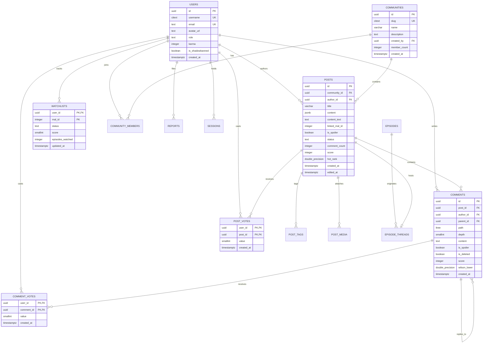

# Anivio — Database Architecture & Schema Specification

> **Definitive Single Source of Truth for Relational Persistence & DDL**  
> Status: **LOCKED BASELINE (Version 1.0)**  
> Last Updated: 12 November 2026

This document specifies the PostgreSQL relational architecture, entity-relationship models, exact table schemas, data types, index strategies, cascading behaviors, and procedural SQL functions for the Anivio Anime Community Platform.

---

## 1. Database Overview & Extensions

Anivio utilizes **PostgreSQL 16+ hosted on Neon**. To ensure optimal query performance and domain-level integrity, the database relies on three native PostgreSQL extensions:

```sql
-- Migration 0001_extensions.sql
CREATE EXTENSION IF NOT EXISTS ltree;      -- Hierarchical materialized paths for comment trees
CREATE EXTENSION IF NOT EXISTS pg_trgm;     -- Trigram indexing for fuzzy title search
CREATE EXTENSION IF NOT EXISTS citext;      -- Case-insensitive text for usernames and community slugs
```

### Conventions & Rules
- **Identifiers**: All table and column names use `snake_case`. Table names are plural (e.g., `posts`, `communities`).
- **Primary Keys**: Standard tables use `uuid PRIMARY KEY DEFAULT gen_random_uuid()`. Natural junction tables use composite primary keys (e.g., `(user_id, post_id)`).
- **Timestamps**: All timestamps use `timestamptz DEFAULT now()`. Dates are never stored as strings.
- **Enums**: Implemented as standard `text` columns with explicit `CHECK` constraints (e.g., `CHECK (role IN ('member', 'moderator', 'owner'))`). This avoids PostgreSQL enum migration transaction locking.
- **Soft Deletion**: Applied strictly to user-generated discussion rows (`posts`, `comments`) via `is_deleted boolean DEFAULT false` to preserve descendant comment branches.

---

## 2. Entity-Relationship Diagram (ERD)



---

## 3. Table Definitions & Constraints

### 3.1 Identity & Authentication Tables

#### `users`
```sql
CREATE TABLE users (
  id uuid PRIMARY KEY DEFAULT gen_random_uuid(),
  username citext UNIQUE,
  email text UNIQUE,
  avatar_url text,
  role text NOT NULL DEFAULT 'user' CHECK (role IN ('user', 'moderator', 'admin')),
  karma integer NOT NULL DEFAULT 0,
  is_shadowbanned boolean NOT NULL DEFAULT false,
  is_deleted boolean NOT NULL DEFAULT false,
  created_at timestamptz NOT NULL DEFAULT now(),
  CONSTRAINT users_username_length CHECK (char_length(username::text) BETWEEN 3 AND 24)
);
```

#### `accounts` (Auth.js)
```sql
CREATE TABLE accounts (
  id uuid PRIMARY KEY DEFAULT gen_random_uuid(),
  user_id uuid NOT NULL REFERENCES users(id) ON DELETE CASCADE,
  type text NOT NULL,
  provider text NOT NULL,
  provider_account_id text NOT NULL,
  refresh_token text,
  access_token text,
  expires_at bigint,
  token_type text,
  scope text,
  id_token text,
  session_state text,
  CONSTRAINT accounts_provider_unique UNIQUE (provider, provider_account_id)
);
CREATE INDEX accounts_user_id_idx ON accounts(user_id);
```

#### `sessions` (Auth.js)
```sql
CREATE TABLE sessions (
  session_token text PRIMARY KEY,
  user_id uuid NOT NULL REFERENCES users(id) ON DELETE CASCADE,
  expires timestamptz NOT NULL
);
CREATE INDEX sessions_user_id_idx ON sessions(user_id);
```

---

### 3.2 Community & Content Tables

#### `communities`
```sql
CREATE TABLE communities (
  id uuid PRIMARY KEY DEFAULT gen_random_uuid(),
  slug citext UNIQUE NOT NULL,
  name varchar(50) NOT NULL,
  description text NOT NULL,
  created_by uuid NOT NULL REFERENCES users(id) ON DELETE RESTRICT,
  member_count integer NOT NULL DEFAULT 1,
  created_at timestamptz NOT NULL DEFAULT now(),
  CONSTRAINT communities_slug_format CHECK (slug ~ '^[a-z0-9-]+$' AND char_length(slug::text) BETWEEN 3 AND 24)
);
CREATE INDEX communities_member_count_idx ON communities(member_count DESC);
```

#### `community_members`
```sql
CREATE TABLE community_members (
  community_id uuid NOT NULL REFERENCES communities(id) ON DELETE CASCADE,
  user_id uuid NOT NULL REFERENCES users(id) ON DELETE CASCADE,
  role text NOT NULL DEFAULT 'member' CHECK (role IN ('member', 'moderator', 'owner')),
  joined_at timestamptz NOT NULL DEFAULT now(),
  PRIMARY KEY (community_id, user_id)
);
CREATE INDEX community_members_user_id_idx ON community_members(user_id);
```

#### `posts`
```sql
CREATE TABLE posts (
  id uuid PRIMARY KEY DEFAULT gen_random_uuid(),
  community_id uuid NOT NULL REFERENCES communities(id) ON DELETE CASCADE,
  author_id uuid NOT NULL REFERENCES users(id) ON DELETE RESTRICT,
  title varchar(300) NOT NULL CHECK (char_length(title) >= 3),
  content jsonb NOT NULL,
  content_text text NOT NULL DEFAULT '',
  linked_mal_id integer,
  is_spoiler boolean NOT NULL DEFAULT false,
  status text NOT NULL DEFAULT 'published' CHECK (status IN ('published', 'removed', 'filtered')),
  comment_count integer NOT NULL DEFAULT 0,
  score integer NOT NULL DEFAULT 0,
  hot_rank double precision NOT NULL DEFAULT 0,
  created_at timestamptz NOT NULL DEFAULT now(),
  edited_at timestamptz
);

-- Search Generated Column & Indexes
ALTER TABLE posts ADD COLUMN search tsvector
  GENERATED ALWAYS AS (
    setweight(to_tsvector('english', coalesce(title, '')), 'A') ||
    setweight(to_tsvector('english', coalesce(content_text, '')), 'B')
  ) STORED;

CREATE INDEX posts_search_gin ON posts USING gin (search);
CREATE INDEX posts_title_trgm ON posts USING gin (title gin_trgm_ops);
CREATE INDEX posts_community_hot_idx ON posts (community_id, hot_rank DESC) WHERE status = 'published';
CREATE INDEX posts_community_new_idx ON posts (community_id, created_at DESC) WHERE status = 'published';
CREATE INDEX posts_author_idx ON posts (author_id, created_at DESC);
```

#### `post_tags`
```sql
CREATE TABLE post_tags (
  post_id uuid NOT NULL REFERENCES posts(id) ON DELETE CASCADE,
  entity_type text NOT NULL CHECK (entity_type IN ('anime', 'character', 'episode')),
  entity_id integer NOT NULL,
  display_label text NOT NULL,
  PRIMARY KEY (post_id, entity_type, entity_id)
);
CREATE INDEX post_tags_entity_idx ON post_tags(entity_type, entity_id);
```

#### `post_media`
```sql
CREATE TABLE post_media (
  id uuid PRIMARY KEY DEFAULT gen_random_uuid(),
  post_id uuid NOT NULL REFERENCES posts(id) ON DELETE CASCADE,
  storage_key text NOT NULL,
  width integer NOT NULL,
  height integer NOT NULL,
  mime_type text NOT NULL CHECK (mime_type IN ('image/webp', 'image/jpeg', 'image/png')),
  size_bytes integer NOT NULL CHECK (size_bytes <= 5242880),
  alt_text text NOT NULL,
  created_at timestamptz NOT NULL DEFAULT now()
);
CREATE INDEX post_media_post_id_idx ON post_media(post_id);
```

---

### 3.3 Comments & Voting Tables

#### `comments`
```sql
CREATE SEQUENCE comment_path_seq;

CREATE TABLE comments (
  id uuid PRIMARY KEY DEFAULT gen_random_uuid(),
  post_id uuid NOT NULL REFERENCES posts(id) ON DELETE CASCADE,
  author_id uuid NOT NULL REFERENCES users(id) ON DELETE RESTRICT,
  parent_id uuid REFERENCES comments(id) ON DELETE RESTRICT,
  path ltree NOT NULL,
  depth smallint NOT NULL,
  content text NOT NULL CHECK (char_length(content) BETWEEN 1 AND 10000),
  is_spoiler boolean NOT NULL DEFAULT false,
  is_deleted boolean NOT NULL DEFAULT false,
  score integer NOT NULL DEFAULT 0,
  wilson_lower double precision NOT NULL DEFAULT 0,
  created_at timestamptz NOT NULL DEFAULT now(),
  CONSTRAINT comments_depth_matches_path CHECK (nlevel(path) = depth),
  CONSTRAINT comments_depth_cap CHECK (depth BETWEEN 1 AND 8),
  CONSTRAINT comments_path_unique UNIQUE (post_id, path)
);

CREATE INDEX comments_path_gist ON comments USING gist (path);
CREATE INDEX comments_post_path ON comments (post_id, path);
CREATE INDEX comments_post_rank ON comments (post_id, wilson_lower DESC);
```

#### `post_votes` & `comment_votes`
```sql
CREATE TABLE post_votes (
  user_id uuid NOT NULL REFERENCES users(id) ON DELETE CASCADE,
  post_id uuid NOT NULL REFERENCES posts(id) ON DELETE CASCADE,
  value smallint NOT NULL CHECK (value IN (-1, 1)),
  created_at timestamptz NOT NULL DEFAULT now(),
  PRIMARY KEY (user_id, post_id)
);

CREATE TABLE comment_votes (
  user_id uuid NOT NULL REFERENCES users(id) ON DELETE CASCADE,
  comment_id uuid NOT NULL REFERENCES comments(id) ON DELETE CASCADE,
  value smallint NOT NULL CHECK (value IN (-1, 1)),
  created_at timestamptz NOT NULL DEFAULT now(),
  PRIMARY KEY (user_id, comment_id)
);
```

---

### 3.4 Tracking, Operations & Moderation Tables

#### `watchlists`
```sql
CREATE TABLE watchlists (
  user_id uuid NOT NULL REFERENCES users(id) ON DELETE CASCADE,
  mal_id integer NOT NULL,
  status text NOT NULL CHECK (status IN ('watching', 'completed', 'dropped', 'planned')),
  score smallint CHECK (score BETWEEN 1 AND 10 OR score IS NULL),
  episodes_watched integer NOT NULL DEFAULT 0 CHECK (episodes_watched >= 0),
  updated_at timestamptz NOT NULL DEFAULT now(),
  PRIMARY KEY (user_id, mal_id)
);
CREATE INDEX watchlists_user_status_idx ON watchlists(user_id, status);
```

#### `episodes` & `episode_threads`
```sql
CREATE TABLE episodes (
  mal_id integer NOT NULL,
  episode_number integer NOT NULL,
  title text,
  aired_at timestamptz,
  provider_fetched_at timestamptz NOT NULL DEFAULT now(),
  PRIMARY KEY (mal_id, episode_number)
);

CREATE TABLE episode_threads (
  mal_id integer NOT NULL,
  episode_number integer NOT NULL,
  post_id uuid UNIQUE NOT NULL REFERENCES posts(id) ON DELETE CASCADE,
  created_at timestamptz NOT NULL DEFAULT now(),
  PRIMARY KEY (mal_id, episode_number)
);
```

#### `provider_snapshots`
```sql
CREATE TABLE provider_snapshots (
  entity_type text NOT NULL CHECK (entity_type IN ('anime', 'character', 'episode', 'season')),
  entity_id integer NOT NULL,
  provider text NOT NULL,
  payload jsonb NOT NULL,
  fetched_at timestamptz NOT NULL DEFAULT now(),
  PRIMARY KEY (entity_type, entity_id)
);
```

#### `reports`, `moderation_actions` & `audit_log`
```sql
CREATE TABLE reports (
  id uuid PRIMARY KEY DEFAULT gen_random_uuid(),
  reporter_id uuid NOT NULL REFERENCES users(id) ON DELETE CASCADE,
  target_type text NOT NULL CHECK (target_type IN ('post', 'comment', 'user')),
  target_id uuid NOT NULL,
  reason text NOT NULL CHECK (reason IN ('spam', 'harassment', 'spoilers', 'off_topic', 'illegal')),
  note text,
  state text NOT NULL DEFAULT 'open' CHECK (state IN ('open', 'actioned', 'dismissed')),
  created_at timestamptz NOT NULL DEFAULT now(),
  resolved_by uuid REFERENCES users(id),
  resolved_at timestamptz,
  CONSTRAINT reports_unique_reporter UNIQUE (reporter_id, target_type, target_id)
);
CREATE INDEX reports_queue_idx ON reports(state, created_at) WHERE state = 'open';

CREATE TABLE moderation_actions (
  id uuid PRIMARY KEY DEFAULT gen_random_uuid(),
  actor_id uuid NOT NULL REFERENCES users(id) ON DELETE RESTRICT,
  target_type text NOT NULL,
  target_id uuid NOT NULL,
  action text NOT NULL CHECK (action IN ('remove', 'restore', 'filter', 'shadowban', 'unshadowban', 'ban')),
  reason text NOT NULL,
  created_at timestamptz NOT NULL DEFAULT now()
);

CREATE TABLE audit_log (
  id uuid PRIMARY KEY DEFAULT gen_random_uuid(),
  actor_id uuid NOT NULL REFERENCES users(id) ON DELETE RESTRICT,
  action text NOT NULL,
  metadata jsonb,
  ip_hash text,
  created_at timestamptz NOT NULL DEFAULT now()
);
CREATE INDEX audit_log_actor_idx ON audit_log(actor_id, created_at);
```

#### `jobs`
```sql
CREATE TABLE jobs (
  id uuid PRIMARY KEY DEFAULT gen_random_uuid(),
  kind text NOT NULL,
  payload jsonb NOT NULL,
  run_after timestamptz NOT NULL DEFAULT now(),
  attempts integer NOT NULL DEFAULT 0,
  locked_at timestamptz,
  created_at timestamptz NOT NULL DEFAULT now()
);
CREATE INDEX jobs_queue_idx ON jobs(run_after) WHERE locked_at IS NULL;
```

---

## 4. Critical DDL & Procedural SQL Functions

### 4.1 Hierarchical Comment Insertion Function (`add_comment`)
This stored function serializes insertions on a per-post basis using PostgreSQL transactional advisory locks, eliminating path collision races:

```sql
CREATE OR REPLACE FUNCTION add_comment(
  p_post uuid,
  p_author uuid,
  p_parent uuid,
  p_content text,
  p_spoiler boolean
) RETURNS uuid LANGUAGE plpgsql AS $$
DECLARE
  v_parent_path ltree;
  v_parent_depth smallint;
  v_path ltree;
  v_id uuid;
BEGIN
  -- Acquire transaction-scoped advisory lock on post_id hash to prevent race conditions
  PERFORM pg_advisory_xact_lock(hashtext(p_post::text));

  IF p_parent IS NULL THEN
    v_path := nextval('comment_path_seq')::text::ltree;
  ELSE
    SELECT path, depth INTO v_parent_path, v_parent_depth
      FROM comments WHERE id = p_parent AND post_id = p_post;

    IF v_parent_path IS NULL THEN
      RAISE EXCEPTION 'parent comment not found in post';
    END IF;

    IF v_parent_depth >= 8 THEN
      RAISE EXCEPTION 'comments_depth_cap: maximum nesting depth exceeded';
    END IF;

    v_path := v_parent_path || nextval('comment_path_seq')::text::ltree;
  END IF;

  INSERT INTO comments (post_id, author_id, parent_id, path, depth, content, is_spoiler)
  VALUES (p_post, p_author, p_parent, v_path, nlevel(v_path), p_content, p_spoiler)
  RETURNING id INTO v_id;

  -- Increment denormalized comment count on post
  UPDATE posts SET comment_count = comment_count + 1 WHERE id = p_post;

  RETURN v_id;
END $$;
```

### 4.2 Algorithmic Ranking Functions

#### Wilson Score Lower Bound Function
```sql
CREATE OR REPLACE FUNCTION wilson_lower(ups integer, downs integer)
RETURNS double precision LANGUAGE sql IMMUTABLE AS $$
  WITH v AS (
    SELECT ups::double precision AS u,
           downs::double precision AS d,
           (ups + downs)::double precision AS n,
           1.96::double precision AS z
  )
  SELECT CASE WHEN n = 0 THEN 0::double precision ELSE
    ((u / n) + z*z/(2*n) - z * sqrt(((u/n) * (1 - u/n) + z*z/(4*n)) / n))
      / (1 + z*z/n)
  END
  FROM v;
$$;
```

#### Hot Rank Time-Decay Function
```sql
CREATE OR REPLACE FUNCTION hot_rank(score integer, created_at timestamptz)
RETURNS double precision LANGUAGE sql IMMUTABLE AS $$
  SELECT (CASE WHEN score > 0 THEN 1 WHEN score < 0 THEN -1 ELSE 0 END)
         * log(10, GREATEST(abs(score), 1)::numeric)::double precision
         + (extract(epoch FROM created_at) / 45000.0);
$$;
```

---

## 5. Migration Execution Sequence

Migrations are numbered, immutable once applied in staging/production, and forward-only:

| Migration File | Contents & Responsibilities | Target Milestone |
|---|---|---|
| `0001_extensions.sql` | `ltree`, `pg_trgm`, `citext` extensions | Milestone 1 |
| `0002_identity.sql` | `users`, `accounts`, `sessions` tables & constraints | Milestone 2 |
| `0003_community.sql` | `communities`, `community_members` | Milestone 4 |
| `0004_content.sql` | `posts`, `post_tags`, `post_media` | Milestone 4 |
| `0005_comments.sql` | `comment_path_seq`, `comments`, `add_comment()`, ranking functions | Milestone 5 |
| `0006_votes.sql` | `post_votes`, `comment_votes`, counters | Milestone 5 |
| `0007_tracking.sql` | `watchlists`, `episodes`, `episode_threads`, `provider_snapshots` | Milestone 6 |
| `0008_moderation.sql`| `reports`, `moderation_actions`, `audit_log` | Milestone 7 |
| `0009_search.sql` | `posts.search` tsvector, GIN index, `jobs` queue | Milestone 8 |
| `0010_hardening.sql` | Refined indexes, check constraints identified in load testing | Milestone 8 |

---

## 6. Seed & Fixture Strategy

To guarantee honest interface testing during development, three idempotent seed scripts are maintained in `scripts/`:

1. **`seed-minimal.ts`**:
   - 5 communities (`c/general`, `c/seasonal`, `c/recommendations`, `c/shonen`, `c/seinen`).
   - 10 test users with realistic usernames.
   - 20 posts with tagged anime entities and 50 comments.
2. **`seed-realistic.ts`**:
   - 15 communities, 100 users, 250 posts, and 2,500 nested comments up to 6 levels deep.
   - Populates realistic vote distributions to verify Wilson Score ranking.
3. **`seed-stress.ts`**:
   - 1 community containing 10,000 posts.
   - A single stress thread containing 1,000 comments nested to depth 8 to assert query execution time under 400ms at p95.

