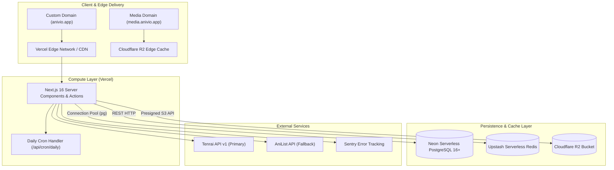

# Anivio — Infrastructure, Operations & Deployment

> **Single Source of Truth (SSOT) for Hosting, CI/CD, Environment Variables & Backups**  
> Status: **LOCKED BASELINE (Version 1.0)**  
> Last Updated: 12 November 2026

This document specifies the hosting topology, environment variable schemas, continuous integration/continuous deployment (CI/CD) pipelines, database migration rules, and disaster recovery strategies for the Anivio Anime Community Platform.

---

## 1. Hosting Architecture & Infrastructure Topology

Anivio is engineered as a serverless, low-maintenance modular monolith designed to operate on a zero-dollar budget during development and launch, scaling gracefully upon monetization.

### Infrastructure Provider Breakdown
- **Compute & Hosting**: **Vercel** (Hobby plan during launch; upgrade to Pro upon enabling contextual affiliate revenue).
- **Database Engine**: **Neon PostgreSQL** (Serverless compute with branch-per-pull-request environments and automated point-in-time recovery).
- **Cache & Rate Limiter**: **Upstash Redis** (Serverless REST API client that avoids connection pooling constraints).
- **Media Object Storage**: **Cloudflare R2** (Zero-egress fee S3-compatible storage behind custom delivery domain `media.anivio.app`).
- **Telemetry & Logging**: **Sentry** (Free tier for real-time error logging and performance tracing).

---

## 2. Environment Variables & Configuration Schema

All configuration values are environment-driven and strictly validated at boot time via Zod (`src/lib/env.ts`). If any required variable is missing or malformed, the application will refuse to start, preventing silent runtime failures.

| Variable Name | Purpose & Usage | Secret? | Target Environment |
|---|---|---|---|
| `DATABASE_URL` | Neon PostgreSQL pooled connection string | **YES** | Local `.env.local`, Vercel Preview, Production |
| `AUTH_SECRET` | 32-character key for session cookie encryption | **YES** | Local `.env.local`, Vercel Preview, Production |
| `AUTH_GOOGLE_ID` | Google Cloud OAuth 2.0 Web Client ID | No | Local, Vercel Preview, Production |
| `AUTH_GOOGLE_SECRET` | Google Cloud OAuth 2.0 Client Secret | **YES** | Local, Vercel Preview, Production |
| `AUTH_DISCORD_ID` | Discord Developer Portal Application ID | No | Local, Vercel Preview, Production |
| `AUTH_DISCORD_SECRET`| Discord Developer Portal Client Secret | **YES** | Local, Vercel Preview, Production |
| `UPSTASH_REDIS_REST_URL` | Upstash Redis REST endpoint URL | No | Local, Vercel Preview, Production |
| `UPSTASH_REDIS_REST_TOKEN`| Upstash Redis REST authentication token | **YES** | Local, Vercel Preview, Production |
| `R2_ACCOUNT_ID` | Cloudflare Account Identifier | No | Local, Vercel Preview, Production |
| `R2_ACCESS_KEY_ID` | Cloudflare R2 S3 Access Key | **YES** | Local, Vercel Preview, Production |
| `R2_SECRET_ACCESS_KEY` | Cloudflare R2 S3 Secret Access Key | **YES** | Local, Vercel Preview, Production |
| `R2_BUCKET` | R2 Bucket Name (`anivio-uploads-prod`) | No | Local, Vercel Preview, Production |
| `R2_PUBLIC_URL` | Public CDN delivery origin (`https://media.anivio.app`) | No | Local, Vercel Preview, Production |
| `METADATA_PROVIDER` | Active adapter toggle (`tenrai` \| `anilist`) | No | Local, Vercel Preview, Production |
| `TENRAI_BASE_URL` | Primary Tenrai API endpoint URL | No | Local, Vercel Preview, Production |
| `ANILIST_ENDPOINT` | Fallback AniList GraphQL endpoint URL | No | Local, Vercel Preview, Production |
| `CRON_SECRET` | Shared secret authorizing `/api/cron/daily` | **YES** | Vercel Environment Settings |
| `SENTRY_DSN` | Sentry project DSN for client/server telemetry | No | Local, Vercel Preview, Production |
| `NEXT_PUBLIC_SITE_URL`| Canonical site origin (`https://anivio.app`) | No | Local, Vercel Preview, Production |

---

## 3. CI/CD Pipeline (GitHub Actions)

Every pull request targeted at `main` triggers an automated GitHub Actions workflow (`.github/workflows/ci.yml`). Merging is blocked until all quality gates pass:

```mermaid
flowchart LR
    Commit["Git Push to Branch"] --> Install["1. Pnpm Install (Frozen Lockfile)"]
    Install --> Typecheck["2. TypeScript Typecheck (tsc --noEmit)"]
    Typecheck --> Lint["3. ESLint & Prettier Format Check"]
    Lint --> Tests["4. Vitest Unit & Integration Tests"]
    Tests --> Migrations["5. Migration Drift & Safety Check"]
    Migrations --> Build["6. Production Build & Bundle Check"]
    Build --> E2E["7. Playwright E2E Tests (Preview DB)"]
    E2E --> Ready["Pull Request Approved for Merge"]
```

### Pipeline Failure Conditions
- **Lockfile Drift**: Running `pnpm install` must not modify `pnpm-lock.yaml`.
- **TypeScript Errors**: Any `tsc` error, even in test files, fails the build.
- **Destructive SQL**: Any migration containing raw `DROP COLUMN`, `DROP TABLE`, or `TRUNCATE` without an explicit bypass comment is rejected.
- **Bundle Budget Violation**: A client bundle exceeding 180 KB compressed for the feed fails the pipeline.

---

## 4. Database Migration Policy & Zero-Downtime Deployments

### Forward-Only Migrations
- Once a migration is applied to staging or production, it is **immutable**. Corrections must be applied as a new forward migration.
- Migrations must maintain **two-version backward compatibility**:
  1. Adding a new column must be done as `NULLABLE` or declare a default value so the currently running older code version does not break on write.
  2. Renaming or removing columns requires a three-step phased deployment (add new column -> dual-write/backfill -> remove deprecated column in later deploy).

### Rollback Strategy
- **Application Rollback**: Instant one-click revert to the previous deployment artifact in the Vercel dashboard (< 30 seconds).
- **Database Safety Guarantee**: Because migrations are strictly non-breaking, rolling back application code will never crash against the new database schema.

---

## 5. Backup, Disaster Recovery & Spending Guards

### Automated Backups
1. **Neon Point-in-Time Recovery (PITR)**: Enables rolling the database state back to any second within the past 7 days.
2. **Weekly Logical Dump**: A scheduled GitHub Actions workflow runs every Sunday night, taking a full `pg_dump` of the production database, encrypting it, and uploading it to an isolated Cloudflare R2 bucket with a 30-day retention policy.

### Hard Spending Limits & Quotas
To prevent unexpected infrastructure charges during traffic spikes:
- **Vercel**: Set spend management notification alert at $20 and hard spend threshold.
- **Neon**: Configure compute limits to max 2 CU (Compute Units).
- **Upstash Redis**: Free tier ceiling configured to hard-block excess requests rather than auto-billing.
- **Cloudflare R2**: Set billing threshold alerts on object write operations.

