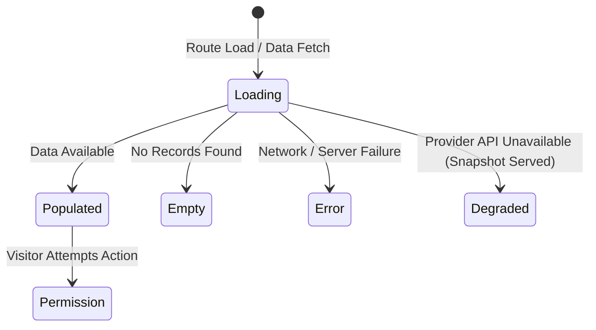

# Anivio — UI/UX & Design System

> **Definitive Single Source of Truth for Visual & Interaction Design**  
> Status: **CONSOLIDATED BASELINE (Version 1.1)**  
> Last Updated: 12 November 2026  
> Document Alignment: Reconciled with `README.md` & `ARCHITECTURE.md` (Version 1.1 Consolidated Architecture Baseline)

This document specifies the complete visual language, design token architecture, typography hierarchy, component specifications, page layouts, and accessibility standards for the Anivio Platform.

---

## 1. Design Direction & Philosophy

### Product Personality
Calm, focused, content-first, and respectful. Fandom platforms frequently suffer from two extremes: chaotic walls of posters with unconstrained contrast, or overwhelming dark interfaces saturated with neon noise. Anivio achieves visual tranquility by keeping surfaces near-monochrome, reserving vivid accents strictly for user actions and state indicators, and letting anime and fiction artwork serve as the primary vibrant element.

### Visual Principles (LOCKED)
1. **Colour is information, not decoration**: Accent colours signal state changes, active filters, interactive buttons, or error conditions. Surfaces and typography carry everything else.
2. **Artwork is the only loud element**: Posters and cover art provide visual character; the surrounding frame remains quiet, predictable, and clean.
3. **Titles are native entities**: Anime, manga, manhwa, webtoons, and light novels are represented as structured catalog cards with clear media badges, never mere text strings.
4. **One card, one idea**: Each card represents a discrete entity (a post, a catalog item, a comment node). Avoid compound dashboards.
5. **Density with air**: High information density separated by a strict 4px mathematical rhythm rather than visual clutter and heavy borders.
6. **Never lie about state**: Loading, empty, error, degraded, and permission states are visually distinct, honest, and actionable.
7. **Spoiler safety by design**: Spoiler protection is a product-level capability. Sensitive text is withheld on the server, and reveal interactions are explicit, keyboard-accessible, and screen-reader compliant.

### Layout Philosophy
- **Mobile-first**: The phone viewport (320px–390px) is the primary reference design, not a degraded fallback.
- **Single-thumb ergonomics**: Primary call-to-actions, voting chevrons, library buttons, and drawer navigations are placed within the bottom two-thirds of the mobile viewport.

---

## 2. Design Tokens Architecture

All design tokens are defined as standard CSS custom properties in `src/styles/tokens.css` and bound into Tailwind CSS via `tailwind.config.ts`. Direct raw hex values inside components are strictly prohibited in code review.

```css
/* src/styles/tokens.css - Baseline Dark Theme */
:root {
  --surface-0: #080B14;
  --surface-1: #0F172A;
  --surface-2: #16203A;
  --surface-3: #1D2948;

  --border-subtle: #22304E;
  --border-strong: #33456B;

  --text-primary: #E8EDF7;
  --text-secondary: #A9B5CC;
  --text-muted: #8A97B0;

  --accent-cyan: #22D3EE;
  --accent-magenta: #E879F9;
  --accent-violet: #818CF8;
  --accent-orange: #FB923C;

  --state-success: #34D399;
  --state-warning: #FBBF24;
  --state-danger: #F87171;

  --focus-ring: #22D3EE;
}
```

### Color Tokens Specification

| Token | Hex Value | Purpose & Application | Contrast Ratio (on `--surface-1`) |
|---|---|---|---|
| `--surface-0` | `#080B14` | Deepest canvas background layer | Reference surface |
| `--surface-1` | `#0F172A` | Base reading panels, sidebars, main column | ~1.15:1 to canvas |
| `--surface-2` | `#16203A` | Cards, input fields, code blocks | ~1.35:1 to canvas |
| `--surface-3` | `#1D2948` | Hover states, active dropdown items, popovers | ~1.65:1 to canvas |
| `--border-subtle`| `#22304E` | Card outlines, row dividers, header bottom rule | Non-text decorative |
| `--border-strong`| `#33456B` | Focused input borders, active card highlights | Non-text contrast |
| `--text-primary` | `#E8EDF7` | Headings, post titles, comment bodies | **14.2:1** (WCAG AAA) |
| `--text-secondary`| `#A9B5CC`| Timestamps, usernames, metadata chips | **8.4:1** (WCAG AAA) |
| `--text-muted` | `#8A97B0` | Helper text, disabled labels, placeholders | **5.6:1** (WCAG AA) |
| `--accent-cyan` | `#22D3EE` | Hyperlinks, active tab indicator, tag pill borders | **9.1:1** (WCAG AAA) |
| `--accent-magenta`| `#E879F9`| Primary call-to-action buttons, active vote indicator | *Requires dark text if filled* |
| `--accent-violet` | `#818CF8`| Community tags, secondary pill highlights | **6.1:1** (WCAG AA) |
| `--accent-orange` | `#FB923C`| Upvote active state, "Hot" sort icon | **8.1:1** (WCAG AAA) |
| `--state-success`| `#34D399` | Saved confirmation, library active badge | **9.2:1** (WCAG AAA) |
| `--state-warning`| `#FBBF24` | Degraded snapshot banner, quota warning | **11.4:1** (WCAG AAA) |
| `--state-danger` | `#F87171` | Deletion buttons, error alerts, banned badge | **5.5:1** (WCAG AA) |

#### Enforced Color Rules
- **Rule 1**: Accent colours (`--accent-cyan`, `--accent-magenta`) must never be used for continuous body copy.
- **Rule 2**: Cyan and Magenta must never appear adjacent as large contiguous color blocks to prevent chromatic aberration vibration.
- **Rule 3**: Filled Magenta buttons must render text in `--surface-0` for AA readability.

---

## 3. Typography System

All fonts are self-hosted with `font-display: swap` to prevent FOIT (Flash of Invisible Text) and subset to Latin character sets.

| Token / Style | Font Family | Weight | Size / Line Height | Primary Usage |
|---|---|---|---|---|
| `font-display` | Space Grotesk | 600 (SemiBold) | 40px / 48px | Unique page title (max one per page) |
| `font-h1` | Space Grotesk | 600 (SemiBold) | 32px / 40px | Section headers |
| `font-h2` | Space Grotesk | 600 (SemiBold) | 24px / 32px | Community headers, panel headings |
| `font-h3` | Space Grotesk | 600 (SemiBold) | 19px / 28px | Post titles on detail view, card headings |
| `font-body` | Inter | 400 (Regular) | 16px / 26px | Post copy, comment text, article body |
| `font-body-sm` | Inter | 400 (Regular) | 14px / 22px | Metadata lines, sidebar descriptions |
| `font-label` | Inter | 500 (Medium) | 13px / 18px (0.01em) | Buttons, sort tabs, form labels |
| `font-micro` | Inter | 500 (Medium) | 12px / 16px | Badge counters, status pills, timestamps |
| `font-code` | JetBrains Mono | 400 (Regular) | 13px / 20px | Monospace snippets, IDs, SQL, system logs |

### Typography Constraints
- Reading column max width is capped at **720px** (approx. 70 characters per line) to maintain optimal reading velocity.
- Body line-height must never drop below **1.5** (26px on 16px font).

---

## 4. Layout, Spacing, Radius & Motion

### Spacing Scale (4px Base Grid)
`4px`, `8px`, `12px`, `16px`, `24px`, `32px`, `48px`, `64px`
- Component internal padding: `12px` or `16px`.
- Card and element gap: `16px` or `24px`.
- Page section vertical rhythm: `32px` or `48px`.
- Arbitrary non-scale pixel values are rejected in review.

### Border Radius Scale
- **Interactive Controls (Inputs, Buttons)**: `6px` (`rounded-md`)
- **Content Cards (Posts, Catalog Cards)**: `10px` (`rounded-lg`)
- **Panels & Dialog Overlays**: `16px` (`rounded-xl`)
- **Pills, Badges & Avatars**: `999px` (`rounded-full`)
- *Nesting Rule*: A container with radius `10px` enclosing an inner control with `6px` maintains harmonious concentric curvature.

### Elevation & Shadows
In dark interfaces, elevation is communicated through surface brightness and border highlights rather than diffuse drop shadows.
- **Layer 1 (Cards)**: Background `--surface-2`, border `1px solid --border-subtle`.
- **Layer 2 (Popovers, Modals, HoverCards)**: Background `--surface-3`, border `1px solid --border-strong`, shadow `0 8px 24px rgba(0, 0, 0, 0.45)`.

### Motion & Transitions
- **Micro-interactions (Button hover, active press)**: `120ms ease-out cubic-bezier(0.2, 0, 0, 1)`.
- **Popovers, dropdowns, accordion expansion**: `200ms ease-out cubic-bezier(0.2, 0, 0, 1)`.
- **Page transitions**: `320ms ease-out cubic-bezier(0.2, 0, 0, 1)`.
- *Accessibility Constraint*: All transitions evaluate `@media (prefers-reduced-motion: reduce)` to instantly jump states without animation.

### Breakpoints & Responsive Behaviors
| Breakpoint | Viewport Width | Layout Transformation |
|---|---|---|
| `base` | 320px – 639px | Single column stack; 2-col poster grid; sidebar collapses to drawer; sort tabs render as segmented control; indent guides max 3 visible. |
| `sm` | 640px – 767px | 3-column poster grid; feed cards gain expanded thumbnail. |
| `md` | 768px – 1023px | Reading column expands; nested comments display up to 4 visible indentation levels. |
| `lg` | 1024px – 1279px | 2-column layout: 680px main reading feed + 300px sticky community sidebar. |
| `xl` | 1280px+ | Max container width 1200px centered; 4–6 column poster grids; optional right rail on post detail. |

---

## 5. Component Specifications (All 30 Primitives)

| Component Name | Type | Anatomy & Slots | States | Interaction & Design Rules |
|---|---|---|---|---|
| **AppShell** | Server | Top Header, Main Viewport container, Footer, Mobile Navigation Sheet | Authenticated / Anonymous | Enforces max-w-7xl centered container with responsive guttering. |
| **Header** | Server + Client | Logo wordmark, global Search trigger, Season/Top links, Auth Button / User Profile dropdown | Default, Scrolled (subtle border bottom) | Sticky header with blur backdrop (`backdrop-blur-md bg-surface-0/80`). |
| **MobileDrawer** | Client | Sliding panel containing navigation links, joined communities, account actions | Open, Closed | Triggered by hamburger icon; full keyboard trap and Escape dismissal. |
| **CatalogCard (Feed)** | Server | 2:3 aspect ratio poster, Format badge (Anime/Manga/Novel), Title, Rating chip, Genre pills | Default, Hover lift (-2px), Skeleton, Degraded | Displays official cover image directly from provider CDN with explicit dimensions. |
| **CatalogCard (Detail)** | Server | Hero banner, large poster (300px), title, format chip, metadata facts table, LibraryControl | Default, Loading, Degraded | Never re-hosts images. Displays explicit provider attribution. |
| **CatalogTagPill** | Client | 20px circular thumbnail, format badge, title, subtle cyan border | Default, Hover, Focus | Operates as a button triggering `CatalogHoverCard`; never a simple hyperlink. |
| **CatalogHoverCard** | Client | Poster, title, format badge, score, genre tags, synopsis excerpt, one-tap LibraryControl | Loading, Loaded, Degraded, Error | Viewport-aware positioning. Opens after 200ms intent hover or keyboard focus. |
| **SeasonGrid** | Server | Responsive CSS grid displaying catalog cards with season/year filter controls | Loading skeleton, Populated, Empty | Skeletons match exact card geometry to prevent layout shift. |
| **SearchBox** | Client | Search input icon, text field, format filter, clear button, dropdown listbox | Default, Active typing, Loading spinner, Results | Debounces input by 300ms. Fully navigable with Arrow keys and Enter. |
| **UnitList** | Server | Table of units (episodes/chapters): number, title, air/pub date, discussion thread badge | Populated, Airing/Releasing today, Empty | Rows link directly to episode/chapter discussion threads. |
| **PostCard** | Server | Community icon/name, Author, timestamp, Title, excerpt, Tag cards, VoteControl, Comment count, BookmarkButton | Default, Sticky (pinned), Removed placeholder, Filtered | Pinned posts display cyan pin icon. Removed posts preserve thread continuity. |
| **PostEditor** | Client | Title field, Tiptap toolbar, editor canvas, Image upload strip, Spoiler toggle, Submit CTA | Pristine, Dirty, Uploading, Pending, Error | Restricts formatting to approved schema. Warns if navigating away with unsaved draft. |
| **CommentTree** | Server | Server-assembled nested tree of comments with vertical guide lines | Loading, Populated, Empty | Emits semantic `<ul>` and `<li>` structure for accessibility. |
| **CommentNode** | Client | Avatar, username, timestamp, content body, VoteControl, Reply trigger, Collapse toggle | Default, Collapsed, Spoiler, Deleted, Pending | Clicking indent guide collapses comment subtree. |
| **CommentComposer** | Client | Textarea, spoiler checkbox, character counter, Submit button | Default, Active, Submitting, Error | Optimistically adds comment into local tree while server action processes. |
| **VoteControl** | Client | Upvote chevron, net score, Downvote chevron | Unvoted, Upvoted (orange), Downvoted (violet), Pending | Optimistic score update with instantaneous rollback upon server error. |
| **SortTabs** | Server | Tab group: "Hot", "New", "Best" | Active (cyan bottom indicator), Inactive | URL-driven state via search parameters (`?sort=hot`). |
| **CommunityHeader**| Server | Community name, slug, description, member count, JoinButton, sort bar | Default, Expanded description | Mobile caps description at 2 lines with an "Expand" toggle. |
| **JoinButton** | Client | Button toggling membership | Unjoined (cyan outline), Joined (surface-3 filled), Pending | Optimistic toggle with server rollback. |
| **LibraryControl** | Client | Status dropdown (Watching/Reading, Completed, On Hold, Dropped, Plan), Score (1-10), Unit counter | Default, Saving, Active | Reusable across Show Detail, Hover Cards, and Unit views. Adapts labels to medium. |
| **ProfileHeader** | Server | Large avatar, username, karma pill, join date, FollowButton, Tab switcher | Default | Public profile header with social actions. |
| **ImageUploader** | Client | Dropzone grid supporting up to 4 images, progress rings, alt text inputs | Idle, Dragover, Uploading, Done | Enforces 5MB limit and client-side WebP re-encoding validation. |
| **SpoilerBlock** | Client | Obfuscated container, "Contains Spoilers — Click to reveal" accessible banner | Hidden, Unlocking, Revealed | Server withholds sensitive content; client requests authorized reveal without pre-leaking in initial HTML. |
| **ReportDialog** | Client | Modal dialog with reason radio group (Spam, Harassment, Spoilers, Other), optional note | Open, Submitting, Success | Accessible modal with focus lock and Escape dismissal. |
| **ModerationQueue**| Server | Filter bar, list/table of flagged items, action triggers (Approve, Remove, Filter) | Default, Empty | Desktop renders as high-density table; mobile renders as action cards. |
| **NotificationBell**| Client | Bell icon with unread count badge, popover listing notifications | Unread count > 0, No unread, Open | Badges use `--accent-magenta` with high contrast. |
| **Skeleton** | Server | Grey pulsating block matching geometry of target element | Static / Shimmer | Declared with exact pixel widths and heights to maintain zero CLS. |
| **EmptyState** | Server | Explanatory icon, concise message ("No posts yet in this community"), primary CTA | Default | Never states "Nothing here"; always instructs user on next actionable step. |
| **ErrorState** | Client | Alert triangle icon, friendly explanation, Retry CTA button | Default | Provides explicit recovery action without dumping stack traces. |
| **DegradedNotice** | Server | Warning icon, notice message with snapshot timestamp ("Showing cached catalog data") | Inline banner | Informs user that upstream data provider is down without blocking reading. |
| **Toast** | Client | Floating transient alert (success, warning, error) | Visible (auto-dismiss 4s), Dismissed | Rendered via accessible portal with `aria-live="polite"`. |
| **Pagination** | Client | "Load More" button or cursor-based previous/next links | Idle, Loading | Supports keyset cursor pagination for infinite feeds. |

---

## 6. Page-Level Specifications

### 1. Global Home Feed (`/`)
- **Layout**: Two-column layout (Main 680px, Sidebar 300px) on desktop; single-column on mobile.
- **Feed Modes**: Segmented feed toggle between:
  - **Following**: Posts from joined communities and followed users.
  - **Discover**: Algorithmic discovery balancing trending, top, and interest-relevant content.
- **Above the Fold**: Feed switcher, sort tabs (Hot, New, Best), first 2–3 post cards, joined communities shortcuts.
- **States**: Loading skeletons, Populated feed, Empty feed with community join recommendations, Degraded catalog thumbnails.
- **Mobile Behavior**: Sidebar moves into drawer navigation; sort tabs convert to a segmented control.

### 2. Season & Catalog Discovery (`/season`, `/catalog`)
- **Layout**: Full-width responsive poster grid (2 columns on mobile up to 6 on wide screens).
- **Above the Fold**: Format/Season/Year filter controls (Anime, Manga, Novels; e.g., "Fall 2026"), first 2 rows of poster cards.
- **States**: Loading skeleton grid, Populated grid, Empty season/filter notification.

### 3. Title Detail Page (`/anime/[id]`, `/catalog/[type]/[id]`)
- **Layout**: Two columns (Left: 300px poster + facts table; Right: Synopsis, format badge, LibraryControl, Episode/Chapter list, related community threads).
- **Above the Fold**: Poster, primary titles, format chip, studio/author, score badge, LibraryControl, initial synopsis excerpt.
- **Mobile Behavior**: Poster shrinks to 96px thumbnail alongside title; facts collapse into an accordion.

### 4. Story Unit Discussion Thread (`/anime/[id]/episodes/[n]`)
- **Layout**: Single reading column (720px centered).
- **Above the Fold**: Pinned unit metadata card (show title, episode/chapter number, release date), opening discussion prompt, first comment rows.
- **Mobile Behavior**: Sticky top bar indicates unit number when scrolling through comments.

### 5. Community Feed (`/c/[slug]`)
- **Layout**: Main feed (680px) + Community sidebar (300px) with rules, moderator list, and "Create Post" button.
- **Above the Fold**: Community title, member count, JoinButton, sort tabs, top pinned post.
- **Creation Notice**: Platform-administered communities at launch; trusted-user creation deferred to post-launch.
- **Mobile Behavior**: JoinButton pinned inside community header; sidebar collapsed behind "About Community" link.

### 6. Post Detail & Comment Tree (`/c/[slug]/p/[postId]`)
- **Layout**: 720px reading column with optional right rail for related threads.
- **Above the Fold**: Breadcrumb (`c/community`), author metadata, post title, post content, VoteControl, BookmarkButton, comment composer.
- **Comment Tree Layout**: Nested indentation with left border guides. Indentation depth capped at 3 visible levels on mobile (with "Continue this thread" links).

### 7. Post Composer (`/c/[slug]/submit`)
- **Layout**: Single column (720px centered) with live preview toggle.
- **Above the Fold**: Target community selector, title input, Tiptap formatting toolbar with inline catalog tagging, spoiler toggle with optional episode/chapter unit, editor body.
- **Mobile Behavior**: Toolbar collapses into an overflow horizontal scrolling strip.

### 8. User Profile (`/u/[username]`)
- **Layout**: Profile header + Tabbed navigation (`Posts`, `Comments`, `Library`, `Bookmarks` — bookmarks private to owner).
- **Above the Fold**: Avatar, username, karma score badge, account age, FollowButton, post filter tabs.

### 9. Moderation Dashboard (`/mod`)
- **Layout**: High-density desktop table / mobile card stack.
- **Above the Fold**: Filter tabs (All, Reported Posts, Reported Comments), queue count, top 5 priority reports with instant action buttons.

### 10. Legal & Policy Pages (`/about`, `/terms`, `/privacy`, `/guidelines`)
- **Layout**: Single reading column (680px) with sticky table of contents on desktop; clean static typography.

---

## 7. The Five State Patterns

Every data-dependent region throughout the application must implement all five states:



1. **Loading**: Must display layout-matched skeletons declaring exact CSS width and height. No generic circular spinners in page centers.
2. **Empty**: Features an informative icon, clear title explaining what belongs here, and an actionable button (e.g., *"No posts in c/shonen yet — be the first to start a discussion!"*).
3. **Error**: States specifically what went wrong without technical jargon, providing an explicit "Retry" button.
4. **Degraded**: When external provider APIs (Tenrai/AniList) are unreachable, the UI renders the last known cached data accompanied by a prominent warning badge: *"⚠️ Showing cached catalog information from [X hours ago]. External metadata provider is temporarily unreachable."*
5. **Permission**: Displayed when an unauthenticated visitor attempts an authenticated action (voting, posting, commenting). Renders an inline modal or redirect preserving the return URL.

---

## 8. Accessibility & Quality Standards Checklist

Before any UI pull request is merged, it must satisfy this verification checklist:

- [ ] **Focus Rings**: All interactive controls display an explicit `--focus-ring: #22D3EE 2px solid` with `outline-offset: 2px`. Focus outline is never suppressed via `outline: none` without a custom replacement.
- [ ] **Contrast Validation**: All body and metadata text pairs verified with a contrast checker to meet WCAG 2.1 AA (4.5:1 for normal, 3:1 for large).
- [ ] **Touch Target Size**: All touch targets (vote arrows, mobile navigation triggers, close buttons, library buttons) measure at least **44px × 44px**.
- [ ] **Keyboard Trapping**: Modals, drawers, and dialogs trap keyboard focus and dismiss upon pressing `Escape`.
- [ ] **Semantic Structure**: Every page features exactly one `<h1>` tag with logically nested `<h2>` and `<h3>` tags without skipping levels.
- [ ] **Screen Reader Announcements**: Dynamic mutations (upvoting, adding to library, following users, form errors) announce updates via `aria-live="polite"` regions.
- [ ] **Server-Enforced Spoiler A11y**: Spoiler text is withheld from the accessibility DOM tree until the reveal control is activated.
- [ ] **Respect Motion Preferences**: All animations and transitions evaluate `@media (prefers-reduced-motion: reduce)` to disable non-essential motion.
- [ ] **Zoom Testing**: Entire page layout functions cleanly at 200% browser zoom without text clipping or horizontal scrolling.
