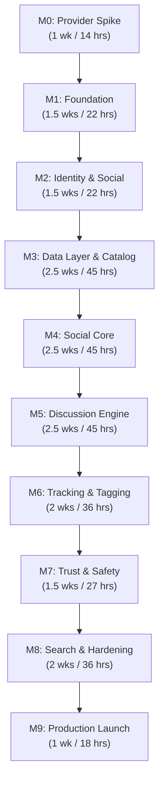

# Anivio — Development Roadmap, Engineering Standards & Changelog

> **Single Source of Truth (SSOT) for Milestones, Task Checklists, Git Workflow & Release History**  
> Status: **CONSOLIDATED BASELINE (Version 1.1)**  
> Last Updated: 12 November 2026  
> Document Alignment: Reconciled with `README.md` & `ARCHITECTURE.md` (Version 1.1 Consolidated Architecture Baseline)

This document is the operational guide for executing development on the Anivio Platform. It defines the 10 sequential implementation milestones, the engineering handbook, naming standards, and the release changelog.

---

## 1. Development Roadmap & Milestone Task Board

- **Developer Capacity**: Solo developer, ~18 focused working hours per week.
- **Total Estimated Effort**: ~310 hours across 17 focused weeks.
- **Execution Rhythm**: Two 6-hour build sessions + one 6-hour review/testing session per week. Every 4th week is reserved for hardening and debt payoff.

### Milestone Task Matrix

| Milestone | Target Scope & Tasks | Est. Hours | Definition of Done |
|---|---|---|---|
| **M0: Provider Spike** | `TASK-001`–`TASK-006`: Probe Tenrai API v1 & AniList GraphQL; record field nullability; save raw fixtures; verify provider quotas, terms, and attribution rules; author normalized `CatalogItemSummary` contract extensible to multi-format fiction. | ~14 hrs | Committed note + fixtures allowing subsequent milestones to build offline without live network calls; zero scraping dependencies. |
| **M1: Foundation** | `TASK-007`–`TASK-015`: Init Next.js 16 modular monolith with Server-First Component policy; wire `tokens.css`; add shadcn primitives; run Neon migration `0001_extensions.sql` (`ltree`, `pg_trgm`, `citext`); set up CI pipeline and deploy to Vercel. | ~22 hrs | Deployed placeholder web app with green CI pipeline, successful migration execution, and fully wired design tokens. |
| **M2: Identity & Social Graph** | `TASK-016`–`TASK-022`: Configure Google/Discord OAuth; Auth.js Drizzle adapter; migration `0002_identity.sql` (`users`, `accounts`, `sessions`, `user_follows`, `user_blocks`); session guards; onboarding username picker; public profile at `/u/[username]`; `/me/settings` self-deletion transaction. | ~22 hrs | Two real users can sign in with different providers, follow/block each other, view isolated settings, and delete accounts cleanly. |
| **M3: Data Layer & Catalog** | `TASK-023`–`TASK-030`: Migration for `provider_snapshots`, `episodes`, `catalog_items`; Tenrai adapter with 6 wrapping rules; AniList fallback; Upstash token bucket; `/season`, `/top`, and `/search` views; title detail pages with provider attribution; verify snapshot fallback. | ~45 hrs | With outbound network intentionally blocked, season and show pages render cleanly from local snapshots accompanied by `DegradedNotice`. |
| **M4: Social Core & Communities** | `TASK-031`–`TASK-039`: Migrations `0003` & `0004` (`communities`, `community_members`, `posts`, `post_tags`, `post_media`); platform-admin community creation for launch with owner/moderator hierarchy; idempotent join/leave; Tiptap editor with draft restore; Cloudflare R2 presigned upload signing; idempotent seed scripts. | ~45 hrs | Platform admins can provision communities, users can join/leave, author rich-text posts with media, and view paginated feeds. |
| **M5: Discussion Engine & Spoilers** | `TASK-040`–`TASK-046`: Migrations `0005` & `0006` (`ltree`, `add_comment()`, votes); semantic `CommentTree`; `CommentComposer` with depth cap (max 8); `/api/comments` branch load; server-enforced spoiler protection (withheld from initial RSC payloads, explicit reveal); asynchronous Wilson Score & Hot Rank jobs; load testing. | ~45 hrs | 1,000-comment thread renders in conversation order within budget (<400ms p95), 9th level is blocked, spoiler text is not leaked in HTML/RSC payloads, and Best/Hot sorts function accurately. |
| **M6: Tracking, Tagging & Bookmarks** | `TASK-047`–`TASK-053`: Migration `0007` (`watchlists`/library, `bookmarks`, `episodes`); `upsertWatchlistEntry` action supporting watching/reading progress; `/u/[username]/library` view; custom Tiptap `@` catalog tag extension; `CatalogTagPill` and `CatalogHoverCard` with one-tap library actions. | ~36 hrs | Author can tag catalog items in post body; readers can hover and add title to library without leaving the feed. |
| **M7: Trust & Safety** | `TASK-054`–`TASK-060`: Migration `0008` (`reports`, `moderation_actions`, `audit_log`); `reportTarget` action; 3-report auto-filter trigger; `/mod` queue dashboard; community moderator RBAC; admin shadowbanning (`is_shadowbanned`) and audit trail. | ~27 hrs | Flagged content automatically hides upon reaching 3 unique reports, and community moderators can action content in their assigned spaces. |
| **M8: Search, Notifications & Hardening**| `TASK-061`–`TASK-067`: Migration `0009` (`posts.search` tsvector GIN/trigram, `notifications`); global search view; in-app notification dispatch; `/api/cron/daily` maintenance endpoint; WCAG 2.1 AA a11y audit; performance budget audit (< 180 KB JS); static policy pages. | ~36 hrs | All 4 Playwright E2E journeys pass, accessibility audit is clean on core pages, notifications trigger properly, and full-text search handles typos. |
| **M9: Production Launch** | `TASK-068`–`TASK-073`: Provision production Neon DB; configure custom domain `anivio.app` and SSL; seed 8–10 official communities and 30 discussion threads; onboard initial 50 beta testers; launch week monitoring and error telemetry via Sentry. | ~18 hrs | A stranger on a mobile phone can sign up, find a title, join a community, and participate in a discussion without developer intervention. |

### Alternative 6-Week Scoped Contingency Plan
If external or academic time constraints compress available capacity, reduce scope rather than eliminating security fundamentals:
- **Weeks 1–2**: M0 + M1 + M2 (Foundation, Database, Identity & Sessions).
- **Weeks 3–4**: Scaled M3 + M4 (Metadata basics, show detail, 1–2 admin-seeded communities, plain-text posts).
- **Week 5**: Simplified M5 (Comments capped at 2 levels, server-side spoiler masking, raw score sorting).
- **Week 6**: Simplified M6 (Basic list tracking CRUD, manual QA testing, production deployment).
- *Excluded in 6-Week Plan*: Inline entity tagging, Wilson Score statistical ranking, complex moderation queues, full-text search, in-app notifications.

---

## 2. Engineering Standards & Git Workflow

### 2.1 Git Flow & Branch Naming
- `main` is protected permanently. Direct pushes are disabled.
- Branch prefixes:
  - `feat/feature-name` (e.g. `feat/tiptap-tag-node`)
  - `fix/bug-description` (e.g. `fix/comment-depth-cap`)
  - `chore/task-name` (e.g. `chore/upgrade-drizzle`)
  - `docs/doc-update` (e.g. `docs/api-contracts`)
  - `perf/optimization` (e.g. `perf/gist-index-tuning`)
- Commits use Conventional Commits: `<type>(<scope>): <concise description>`

### 2.2 Naming Conventions Reference Table

| Category | Convention | Pattern / Rule | Example |
|---|---|---|---|
| **Files & Folders** | `kebab-case` | Grouped by domain, not file type | `src/modules/discussions/create-post.ts` |
| **React Components** | `PascalCase` | One component per file, matches filename | `CommentNode.tsx`, `CatalogCard.tsx` |
| **React Hooks** | `camelCase` | Prefixed with `use` | `useOptimisticVote.ts` |
| **Server Actions** | `camelCase` | Verb-first action name | `createComment`, `upsertWatchlistEntry` |
| **Database Tables** | `snake_case` | Plural nouns; join tables alphabetical | `posts`, `post_votes`, `user_follows`, `bookmarks` |
| **Database Columns** | `snake_case` | Explicit descriptors, no abbreviations | `is_shadowbanned`, `wilson_lower` |
| **Environment Vars** | `SCREAMING_SNAKE`| Prefixed with service domain | `AUTH_GOOGLE_ID`, `R2_BUCKET` |
| **SQL Migrations** | `number_name.sql` | 4-digit sequential prefix, forward-only | `0005_comments.sql` |
| **Error Codes** | `PascalCase` | Discriminated string literals, stable | `DepthExceeded`, `SlugTaken` |

### 2.3 Pre-Merge PR Checklist
Before merging any pull request:
- [ ] Adheres to domain folder boundaries in [`docs/ARCHITECTURE.md`](ARCHITECTURE.md).
- [ ] Cross-module dependencies use narrow exported contracts, not deep internal imports.
- [ ] Database operations are non-destructive and backward-compatible per [`docs/OPERATIONS.md`](OPERATIONS.md).
- [ ] Inputs are validated via shared Zod schemas per [`docs/PRODUCT_SPEC.md`](PRODUCT_SPEC.md).
- [ ] Protected mutations enforce server-side authorization and rate limits.
- [ ] Spoiler-protected content is withheld on the server without pre-leaking in initial HTML/RSC payloads.
- [ ] Touch targets are >= 44x44px and focus rings are visible per [`docs/DESIGN.md`](DESIGN.md).
- [ ] Client bundle budget (< 180 KB) is maintained per [`docs/OPERATIONS.md`](OPERATIONS.md).
- [ ] Corresponding documentation files in `docs/` have been updated in the same PR.

---

## 3. Project Changelog

All notable changes to the Anivio project are documented here based on [Keep a Changelog](https://keepachangelog.com/en/1.0.0/) and [Semantic Versioning](https://semver.org/spec/v2.0.0.html).

### [1.1.0-docs] - 2026-11-12

#### Added
- Reconciled documentation suite with `README.md` (Version 1.1 Consolidated Baseline):
  - Formally integrated multi-format Asian fiction model (Anime, Manga, Manhwa, Light Novels, Webtoons) with anime-first metadata priority (`ADR-014`).
  - Added formal server-enforced spoiler withholding policy (`ADR-013`), guaranteeing zero sensitive content leaks in initial RSC/HTML payloads.
  - Added explicit schema and DDL definitions for social graph (`user_follows`, `user_blocks`), `notifications`, and `bookmarks` tables.
  - Added `followUser`, `unfollowUser`, `toggleBookmark`, `revealSpoiler`, and `markNotificationRead` Server Actions.
  - Added `/api/spoiler/reveal` route handler for authenticated on-demand spoiler unlocks.

#### Changed
- Aligned community creation policy to platform-admin provisioning at launch (`CR-05`, `OD-03`), deferring trusted-user creation to post-launch milestones to prevent spam and ghost communities.
- Reconciled `SpoilerBlock.tsx` client component to require server-side verification rather than a purely local blur toggle.
- Generalized catalog components (`CatalogCard`, `CatalogTagPill`, `CatalogHoverCard`, `LibraryControl`) to support extensible media badges and reading/watching progress.

---

### [1.0.0-docs] - 2026-11-12

#### Added
- Established the consolidated Single Source of Truth (SSOT) documentation suite:
  - `README.md` & `docs/README.md`: Project charter and documentation navigation index.
  - `docs/PRODUCT_SPEC.md`: Strategic vision, target personas, full functional specs (`FR-001`–`FR-041`), non-functional constraints, and interaction workflows (`WF-001`–`WF-018`).
  - `docs/ARCHITECTURE.md`: Next.js 16 App Router blueprint, pinned tech stack, component boundary matrix, conflict resolutions, and formal ADRs (`ADR-001`–`ADR-012`).
  - `docs/BACKEND.md`: PostgreSQL 16+ DDL schemas, `ltree` comment hierarchy function, Wilson Score SQL, Server Actions, Route Handlers, and Metadata Adapter contracts.
  - `docs/DESIGN.md`: UI/UX design tokens, typography, 30 component specifications, 10 page layouts, and 5 state patterns.
  - `docs/OPERATIONS.md`: Security controls, RBAC permission matrix, layered QA plan, Vercel/Neon/Upstash/R2 topology, environment variables, and CI/CD pipeline.
  - `docs/DEVELOPMENT.md`: Milestones M0–M9 task board, engineering standards, and changelog.

#### Changed
- Consolidated fragmented 16-document architecture into 6 cohesive, domain-focused core documents.
- Formally locked Tenrai API v1 + AniList fallback + local snapshots as metadata engine.
- Formally locked comment nesting depth at 8 levels via PostgreSQL check constraint.
- Formally locked three-tier caching model (`'use cache'`, Redis token bucket, PostgreSQL snapshots).
