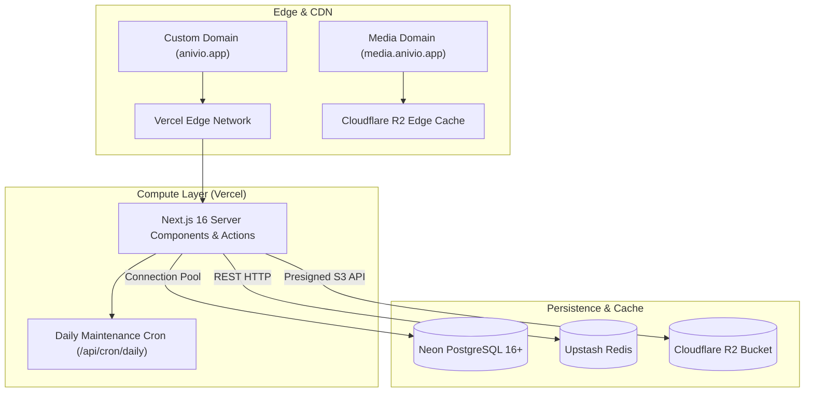

# Anivio — Security, Testing, Infrastructure & Operations

> **Single Source of Truth (SSOT) for Application Hardening, QA Test Suite, Deployment & CI/CD**  
> Status: **LOCKED BASELINE (Version 1.0)**  
> Last Updated: 12 November 2026

This document specifies the operational lifecycle of the Anivio Anime Community Platform. It defines security controls, role-based access models, automated testing layers, hosting architecture, environment configurations, CI/CD pipelines, and disaster recovery strategies.

---

## 1. Security Architecture & Threat Defenses

### 1.1 Authentication & Session Integrity
- **OAuth 2.0 with PKCE**: Restricts authentication exclusively to Google and Discord via Auth.js v5. No password storage, salting, or reset flows exist on the platform.
- **Database-Backed Sessions**: Session tokens are persisted in PostgreSQL `sessions`. Deleting a session row instantly terminates the active session on next request.
- **Cookie Security**:
  - `HttpOnly`: Immune to theft via client-side JavaScript (`document.cookie`).
  - `Secure`: Transmitted strictly over HTTPS.
  - `SameSite=Lax`: Mitigates Cross-Site Request Forgery (CSRF).

### 1.2 Role-Based Access Control (RBAC) Matrix

| Capability / Action | Anonymous Visitor | Standard User | Community Member | Community Moderator | Community Owner | Global Admin |
|---|---|---|---|---|---|---|
| View public feeds & anime data | ✅ | ✅ | ✅ | ✅ | ✅ | ✅ |
| Upvote / Downvote content | ❌ | ✅ | ✅ | ✅ | ✅ | ✅ |
| Manage personal watchlist | ❌ | ✅ | ✅ | ✅ | ✅ | ✅ |
| Post within community | ❌ | ❌ | ✅ | ✅ | ✅ | ✅ |
| Comment within community | ❌ | ✅ | ✅ | ✅ | ✅ | ✅ |
| Create a new community | ❌ | ✅ (Account >= 3d) | ✅ | ✅ | ✅ | ✅ |
| Edit post within 24 hours | ❌ | Author only | Author only | ✅ (In community) | ✅ (In community) | ✅ |
| Remove / Filter community posts | ❌ | ❌ | ❌ | ✅ (In community) | ✅ (In community) | ✅ |
| Access `/mod` queue | ❌ | ❌ | ❌ | ✅ (In community) | ✅ (In community) | ✅ |
| Shadowban user account | ❌ | ❌ | ❌ | ❌ | ❌ | ✅ |
| Access `/mod/log` system audit | ❌ | ❌ | ❌ | ❌ | ❌ | ✅ |

### 1.3 Injection & Content Defenses
- **SQL Injection**: All database queries are parameterized through Drizzle ORM or typed PostgreSQL function parameters (`$1`, `$2`). Raw string concatenation is prohibited.
- **Cross-Site Scripting (XSS)**: Tiptap editor enforces an allowlist JSON schema. Raw HTML, `<script>`, and inline base64 images are stripped. Post content renders via React Server Components.
- **Secure Image Uploads (Cloudflare R2)**: Direct presigned PUT uploads bypass application servers. Files are limited to 5MB and validated against `image/webp`, `image/jpeg`, and `image/png`. Images are served from an isolated origin (`media.anivio.app`).

### 1.4 Rate Limiting & Anti-Abuse (Upstash Redis)
- **Token Bucket Limits**:
  - Post creation: 5 posts / hour per user.
  - Comment creation: 30 comments / hour per user.
  - Voting: 120 votes / minute per user.
  - Anime search (`/api/search/anime`): 30 requests / minute per IP.
- **New Account Quarantine**: Accounts under 24 hours old have quartered limits and are **blocked from posting external hyperlinks**.
- **Automated 3-Report Threshold**: 3 unique reports from accounts >24h old automatically transition content to `status = 'filtered'` and enqueue it in `/mod`.
- **Shadowbanning (`is_shadowbanned`)**: Spammers experience normal site operations, but public queries filter out their content.
- **Privacy-Compliant IP Logging**: Hashed with a rotating salt (`SHA256(ip + salt)`) in `audit_log` with a strict 30-day retention policy.

---

## 2. Quality Assurance & Testing Plan

### 2.1 Test Architecture
Anivio enforces a high-value, layered test suite running on every pull request:

| Layer | Tool | Count | Scope & Validation |
|---|---|---|---|
| **Unit Tests** | Vitest | ~30 tests | Wilson Score math, Hot Rank decay, path sequence algorithms, Zod schemas, normalizers |
| **Integration Tests** | Vitest + Postgres | ~15 tests | `add_comment()` advisory lock, depth cap <= 8, composite PK duplicate votes, snapshot upsert |
| **E2E Tests** | Playwright | 4 journeys | Browser journeys: Onboarding, Post creation with tags, Comment nesting, Watchlist toggle |
| **Failure Injection** | Custom scripts | 3 scenarios | Upstream API down (snapshot fallback), Redis down, Database read-only |
| **Manual A11y** | Axe / Screen Reader | 5 pages | Keyboard trapping, focus visibility, contrast validation, screen reader nesting |
| **Load Testing** | k6 | 1 script | 200 concurrent readers on feed & 1,000-comment thread (<400ms server p95) |

### 2.2 The 4 Critical Playwright Journeys
1. **Journey 1: Auth & Onboarding**: OAuth mock callback -> `/auth/onboarding` -> Unique username validation -> Session cookie verification.
2. **Journey 2: Community & Post Creation**: Navigate to `/c/create` -> Create community -> Post with `@Anime` tag -> Verify inline `AnimeTagPill`.
3. **Journey 3: Commenting & Voting**: Post reply -> 3-level nesting -> Indent collapse -> Optimistic upvote score increment.
4. **Journey 4: Hover Card & Watchlist**: Hover over `AnimeTagPill` -> Open `AnimeHoverCard` -> Toggle "Watching" -> Verify item appears in `/u/[username]/watchlist`.

### 2.3 Automated Performance Budgets
- First-load JavaScript (Feed page): **< 180 KB compressed**.
- First-load JavaScript (Show page): **< 200 KB compressed**.
- Largest Contentful Paint (LCP): **< 2.5s on mobile 4G**.
- Cumulative Layout Shift (CLS): **< 0.1**.
- Thread server render time (1,000 nodes): **< 400ms at p95**.
- Outbound API calls on warm cache: **0 calls**.

---

## 3. Infrastructure & Hosting Topology

Anivio is deployed as a zero-cost modular monolith during MVP launch:

### Hosting Provider Tier Breakdown
- **Compute**: Vercel (Hobby plan during launch; upgrade to Pro upon enabling affiliate monetization).
- **Database**: Neon PostgreSQL 16+ (Serverless compute with branch-per-pull-request preview databases).
- **Cache**: Upstash Redis (Serverless HTTP REST client).
- **Object Storage**: Cloudflare R2 (10 GB free tier, **zero egress bandwidth fees**).
- **Telemetry**: Sentry (Developer free tier).
- **Total Initial Cost**: **$0.00 / month**.

---

## 4. Environment Variables Specification

All configuration values are environment-driven and strictly validated at boot time via Zod (`src/lib/env.ts`):

| Variable Name | Purpose & Usage | Secret? | Target Environment |
|---|---|---|---|
| `DATABASE_URL` | Neon PostgreSQL pooled connection string | **YES** | Local, Vercel Preview, Production |
| `AUTH_SECRET` | 32-character key for session cookie encryption | **YES** | Local, Vercel Preview, Production |
| `AUTH_GOOGLE_ID` | Google Cloud OAuth 2.0 Web Client ID | No | Local, Vercel Preview, Production |
| `AUTH_GOOGLE_SECRET` | Google Cloud OAuth 2.0 Client Secret | **YES** | Local, Vercel Preview, Production |
| `AUTH_DISCORD_ID` | Discord Developer Portal Application ID | No | Local, Vercel Preview, Production |
| `AUTH_DISCORD_SECRET`| Discord Developer Portal Client Secret | **YES** | Local, Vercel Preview, Production |
| `UPSTASH_REDIS_REST_URL` | Upstash Redis REST endpoint URL | No | Local, Vercel Preview, Production |
| `UPSTASH_REDIS_REST_TOKEN`| Upstash Redis REST authentication token | **YES** | Local, Vercel Preview, Production |
| `R2_ACCOUNT_ID` | Cloudflare Account Identifier | No | Local, Vercel Preview, Production |
| `R2_ACCESS_KEY_ID` | Cloudflare R2 S3 Access Key | **YES** | Local, Vercel Preview, Production |
| `R2_SECRET_ACCESS_KEY` | Cloudflare R2 S3 Secret Access Key | **YES** | Local, Vercel Preview, Production |
| `R2_BUCKET` | R2 Bucket Name (`anivio-uploads-prod`) | No | Local, Vercel Preview, Production |
| `R2_PUBLIC_URL` | Public CDN delivery origin (`https://media.anivio.app`) | No | Local, Vercel Preview, Production |
| `METADATA_PROVIDER` | Active adapter toggle (`tenrai` \| `anilist`) | No | Local, Vercel Preview, Production |
| `TENRAI_BASE_URL` | Primary Tenrai API endpoint URL | No | Local, Vercel Preview, Production |
| `ANILIST_ENDPOINT` | Fallback AniList GraphQL endpoint URL | No | Local, Vercel Preview, Production |
| `CRON_SECRET` | Shared secret authorizing `/api/cron/daily` | **YES** | Vercel Environment Settings |
| `SENTRY_DSN` | Sentry project DSN for client/server telemetry | No | Local, Vercel Preview, Production |
| `NEXT_PUBLIC_SITE_URL`| Canonical site origin (`https://anivio.app`) | No | Local, Vercel Preview, Production |

---

## 5. CI/CD Pipeline & Migration Policy

### 5.1 GitHub Actions Workflow
Every pull request to `main` must pass automated quality gates:
1. `pnpm install --frozen-lockfile` (Lockfile drift verification).
2. `tsc --noEmit` (Strict TypeScript verification).
3. ESLint & Prettier format check.
4. Vitest unit and integration test suite.
5. Drizzle migration drift check against an isolated Neon database branch.
6. Next.js production build and bundle size assertion (< 180 KB).
7. Playwright E2E test execution against preview deployment.

### 5.2 Forward-Only Database Migrations
- Applied migrations are **immutable**. Corrections are made via a new forward migration.
- All migrations must maintain backward compatibility with the previous application deployment (e.g. new columns must be `NULLABLE` or declare defaults).
- **Rollback Guarantee**: Application code can be reverted instantly in Vercel (< 30 seconds) without breaking against the database schema.

### 5.3 Backup & Recovery
- **Point-in-Time Recovery (PITR)**: Neon automated 7-day continuous PITR.
- **Weekly Logical Dump**: GitHub Actions executes a scheduled `pg_dump` every Sunday night, encrypted and archived to Cloudflare R2 with a 30-day retention policy.
- **Spending Caps**: Hard billing alerts configured on Vercel ($20 spend cap), Neon (2 CU max), and Upstash (hard block at free limit).
