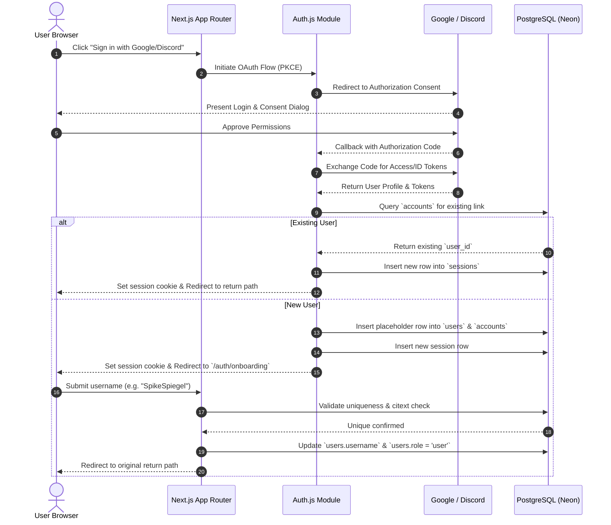
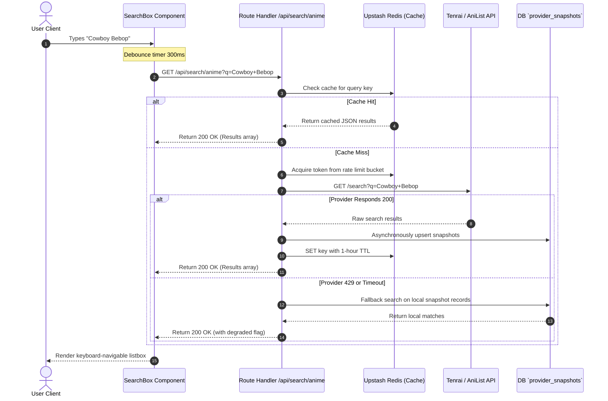
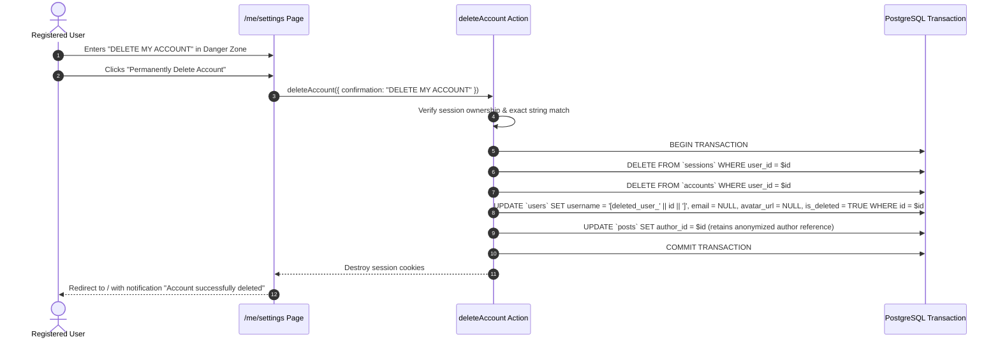

# Anivio — Product Vision, Specifications & User Workflows

> **Single Source of Truth (SSOT) for Product Identity, Functional Requirements & Interactions**  
> Status: **LOCKED BASELINE (Version 1.0)**  
> Last Updated: 12 November 2026

This document is the unified product and functional authority for the Anivio Anime Community Platform. It defines the product vision, target audience, competitive positioning, comprehensive functional requirements (`FR-001` through `FR-041`), non-functional requirements (`NFR-001` through `NFR-015`), and interaction workflows (`WF-001` through `WF-018`).

---

## 1. Product Identity & Strategic Vision

### 1.1 The Problem Statement
Anime fandom is inherently **data-heavy and highly social**, yet no single platform accommodates both behaviors:
- **Database Platforms (MyAnimeList, AniList)**: Excellent structured data (episode counts, airing dates, voice actors, complex genre tags) but rely on antiquated, static forums that fail to drive viral or dynamic community engagement.
- **Social Platforms (Reddit, X)**: Highly engaging, algorithmically sorted discussions, but treat anime titles as plain text without structured metadata, persistent tracking, or integrated watchlists.

**The Disconnect**: When users discover an anime in a social discussion, they must open a secondary application to view metadata or update their watchlist. When they finish an episode on a tracking site, they must leave to find active discussion threads.

### 1.2 The Solution: "Contextualized Social Discovery"
Anivio operates as a **contextualized social discovery engine** that bridges discourse and database. Anime franchises, episodes, and characters are treated as **native interactive entities** within the social feed:
- An author mentions an anime in a post using an `@` tag.
- The platform dynamically embeds an interactive card with real-time ratings, genre pills, and a one-tap watchlist toggle.
- Readers can inspect metadata, preview synopses, and add the show to their private watchlist without ever navigating away from the discussion.

### 1.3 Target Audience Segments
| Audience Segment | Persona Description | Platform Utility | MVP Priority |
|---|---|---|---|
| **The Seasonal Tracker** | Watches 5–15 currently airing shows per season. Values immediate discussion post-broadcast. | Weekly episodic discussion threads, community sentiment sorting, real-time episode progress tracking. | **Primary (P0)** |
| **The Archival Reviewer** | Maintains extensive watchlists of hundreds of completed shows. Enjoys writing long-form critical reviews. | Structured review authoring, 1–10 rating scales, public profile lists, and community reputation karma. | **Primary (P0)** |
| **The Casual Discoverer** | Watches anime sporadically. Relies on community consensus and recommendations. | "Hot" and "Best" algorithmically sorted feeds, spoiler-free discovery pages, and one-tap watchlist saving. | **Secondary (P1)** |
| **The Merchandise Collector**| Invested in physical media, figures, and collectibles. | Contextual affiliate merchandise links dynamically injected into tagged anime metadata cards. | **Tertiary (Post-Launch)** |

### 1.4 Competitive Differentiation
| Competitor | Core Strengths | Critical Limitations | Anivio Differentiation |
|---|---|---|---|
| **Reddit (`r/anime`)** | Advanced algorithmic sorting (Wilson Score, Hot ranking), massive user base. | Complete lack of native anime metadata, personal watchlists, or persistent reviews; discussions are ephemeral. | Integrates structured metadata natively into feeds. One-click watchlist tracking directly from discussions. |
| **MyAnimeList (MAL)** | Largest anime database; comprehensive catalog. | Outdated UI/UX; static chronological forums; official API strictly limits commercial use. | Modern dynamic feed using MAL-compatible data; makes community discussion the primary driver. |
| **AniList** | Modern UI/UX; flexible GraphQL API. | Aggressive rate limits (30 req/min); forums remain rigid and secondary to cataloging. | Community-first focus with metadata acting as a supportive layer; zero-downtime snapshot caching. |
| **Anime-Planet** | Strong internal recommendation engine; legal streaming links. | Smaller community footprint; limited granular episode-by-episode debate. | Focuses heavily on rich-text formatting, deep nested comment trees, and statistical confidence ranking. |

### 1.5 Core Product Principles (Non-Negotiable)
1. **Colour is information, not decoration**: Accent colours signal state changes, active filters, or errors. Surfaces remain near-monochrome.
2. **Posters are the only loud element**: Anime artwork carries visual identity; the surrounding interface remains calm.
3. **One card, one idea**: Each card represents a discrete entity (a post, an anime show, a comment node).
4. **Density with air**: High information density separated by a strict 4px rhythm rather than heavy borders.
5. **Never lie about state**: Loading, empty, error, degraded, and permission states are visually distinct and honest.

---

## 2. Functional Specifications Matrix (`FR-001` – `FR-041`)

### 2.1 Authentication & Onboarding
- **`FR-001` (OAuth 2.0 Auth - P0)**: Google and Discord OAuth 2.0 with PKCE via Auth.js. Database sessions in PostgreSQL. `HttpOnly`, `Secure`, `SameSite=Lax` cookies. No password storage.
- **`FR-002` (Username Onboarding - P0)**: Mandatory unique username selection upon initial sign-in. Case-insensitive uniqueness enforced via PostgreSQL `citext`. Length: 3–24 chars (`^[a-zA-Z0-9_-]+$`). Blocklist for reserved words (`admin`, `mod`, `anivio`).
- **`FR-003` (Account Deletion - P0)**: Self-deletion in Danger Zone via exact typed confirmation `DELETE MY ACCOUNT`. Atomic transaction destroys sessions/accounts, anonymizes user row, and soft-deletes authored posts/comments to preserve thread continuity.

### 2.2 User Profiles & Karma
- **`FR-004` (Public Profile - P0)**: Profile view at `/u/[username]` displaying avatar, username, total karma, account age, and public posts/comments. Framework-cached for 60s.
- **`FR-005` (Karma Tracking - P0)**: Karma reflects net sum of upvotes/downvotes received on authored content. Denormalized integer column updated asynchronously via background jobs and reconciled via daily repair scripts.

### 2.3 Anime Discovery & Show Pages
- **`FR-006` (Current Season Grid - P0)**: Responsive poster grid at `/season` displaying airing anime. 24h cache via `'use cache'`. Displays cached `provider_snapshots` with `DegradedNotice` if upstream API is unavailable.
- **`FR-007` (Top Anime List - P0)**: Paginated ranking at `/top` of highest-rated anime with keyset pagination.
- **`FR-008` (Debounced Anime Search - P0)**: Search endpoint `/api/search/anime` debounced at 300ms. Returns keyboard-navigable listbox with thumbnail, title, year, and score. Cached 1h in Redis; 30 req/min per IP rate limit.
- **`FR-009` (Show Detail Page - P0)**: View at `/anime/[malId]` rendering poster, title, score, genres, synopsis, episode list, and related threads. Prominently displays MyAnimeList attribution.

### 2.4 Communities
- **`FR-010` (Community Creation - P0)**: Authenticated users with accounts >= 3 days can create communities with unique slug (`^[a-z0-9-]+$`, 3–24 chars), display name, and description. Creator assigned `owner` role.
- **`FR-011` (Community Feed - P0)**: Route `/c/[slug]` displaying community header, rules sidebar, sort tabs (`Hot`, `New`, `Best`), and keyset-paginated post feed.
- **`FR-012` (Membership Management - P0)**: Idempotent `joinCommunity` / `leaveCommunity` actions using composite PK `(community_id, user_id)`. Optimistic button toggle with rollback on failure.

### 2.5 Posts & Rich-Text Editor
- **`FR-013` (Post Creation - P0)**: Rich-text posting via Tiptap. Title: 3–300 chars. Structured JSON document (max 50KB). Supports inline anime entity tags, spoiler flag, and up to 4 image attachments. Enqueues search vector update on publish.
- **`FR-014` (Post Editing Window - P0)**: Authors can edit title, content, and tags within 24 hours of creation. Moderators can edit or lock posts at any time. Sets `edited_at` timestamp and displays `(edited)` badge.
- **`FR-015` (Media Uploads via Cloudflare R2 - P1)**: Presigned direct upload URL via `/api/upload/sign`. Max 5MB per file, limited to `image/webp`, `image/jpeg`, `image/png`. Max 4 images per post. Mandatory `alt_text`.
- **`FR-016` (Post Card & Placeholders - P0)**: Post cards display community, author, timestamp, title, excerpt, tags, vote controls, and comment count. Removed posts render placeholder preserving descendant comment tree.
- **`FR-017` (Restricted Tiptap Schema - P0)**: Allowed nodes: Document, Paragraph, Headings (levels 2-3), Lists, Blockquote, CodeBlock, AnimeTagNode. Allowed marks: Bold, Italic, Strike, Code, Link (http/https), SpoilerMark. Raw HTML and embedded video are strictly prohibited.

### 2.6 Anime Entity Tagging & Hover Cards (The Core USP)
- **`FR-018` (Tag Insertion - P1)**: Typing `@` in editor opens combobox querying `/api/search/anime`. Inserts `AnimeTagNode` with attributes `entityType: 'anime'`, `entityId: malId`, and `label: title`. Validated on save; unresolvable tags downgrade to plain text.
- **`FR-019` (Inline Tag Pill - P1)**: Renders as pill button with 20px thumbnail, show title, and subtle cyan border. Behaves as an accessible button opening `AnimeHoverCard`.
- **`FR-020` (Anime Hover Card - P1)**: Floating card displaying poster, score, genres, synopsis excerpt, and one-tap `WatchlistControl`. Viewport-aware positioning. Dismissible with `Escape`.

### 2.7 Nested Comments & Discussion Engine
- **`FR-021` (Hierarchical Commenting via `ltree` - P0)**: Comments utilize PostgreSQL `ltree` materialized paths (`1`, `1.2`, `1.2.5`). Insertion handled via stored function `add_comment()` with advisory lock (`pg_advisory_xact_lock`). Hard depth cap at **8 levels** enforced by `CHECK (depth BETWEEN 1 AND 8)`.
- **`FR-022` (Single-Query Thread Assembly - P0)**: Thread query retrieves entire conversation tree in one indexed read (`WHERE post_id = $1 AND path <@ root ORDER BY path`). Server component assembles nested tree in memory (<400ms at p95 for 1,000 comments).
- **`FR-023` (Soft Deletion - P0)**: Deleting comment sets `is_deleted = true`. Content replaced with `[deleted]`; row preserved to prevent orphaning replies.

### 2.8 Voting & Algorithmic Ranking
- **`FR-024` (Polymorphic Voting - P0)**: Upvote (+1) or Downvote (-1) on posts and comments. Composite PK `(user_id, post_id)` or `(user_id, comment_id)` physically prevents duplicate votes. Author cannot vote on own content.
- **`FR-025` (Wilson Score Ranking - P1)**: Evaluates lower bound of Wilson Score Interval with 95% confidence ($z=1.96$) via immutable PostgreSQL function `wilson_lower(ups, downs)`. Prevents single-upvote items from outranking proven discussions. Used for "Best" sort.
- **`FR-026` (Hot Ranking - P1)**: Logarithmic score decay over time via PostgreSQL function `hot_rank(score, created_at)`. Used for "Hot" sort.

### 2.9 Spoilers, Watchlists & Tracking
- **`FR-028` (Spoiler Protection - P1)**: Boolean flags on posts and comments. Content is masked server-side and withheld from the DOM accessibility tree until explicitly toggled.
- **`FR-029` (Watchlist Tracking - P0)**: Users track shows under 4 statuses: `watching`, `completed`, `dropped`, `planned`. Tracks 1–10 rating score and `episodes_watched`. Private owner-only view at `/u/[username]/watchlist`.
- **`FR-030` (Unified WatchlistControl - P0)**: Shared client component used on Show pages, Hover Cards, and Episode views. Calls `upsertWatchlistEntry` action.
- **`FR-031` (Episode Discussion Threads - P1)**: On-demand thread generation at `/anime/[malId]/episodes/[n]` linked to composite key `(mal_id, episode_number)` in `episode_threads`. Idempotent creation.

### 2.10 Search, Moderation & Admin
- **`FR-033` (Full-Text Search - P0)**: Full-text search over posts using PostgreSQL generated `tsvector` column (title weighted `A`, body weighted `B`) with `GIN` index and `pg_trgm` fuzzy title matching.
- **`FR-035` (Reporting - P1)**: Reason codes: `spam`, `harassment`, `spoilers`, `off_topic`, `illegal`. Unique constraint prevents duplicate reports.
- **`FR-036` (Automated 3-Report Threshold - P1)**: When an item accumulates 3 unique reports from accounts >24h old, status transitions to `'filtered'`, removing it from public feeds and enqueuing in `/mod`.
- **`FR-037` (Moderation Queue - P1)**: Queue at `/mod` for community moderators and admins to approve, remove, or filter content. All actions write immutable audit log.
- **`FR-038` (Account Shadowbanning - P1)**: Admins can flag malicious bot accounts as `is_shadowbanned = true`. Content is accepted but silently omitted from public queries.
- **`FR-040` (Health Check - P0)**: `GET /api/health` probes DB, Redis, and upstream circuit breaker status.
- **`FR-041` (In-App Notifications - P2)**: In-app bell icon with unread count badge for replies and mentions.

---

## 3. Non-Functional Requirements (`NFR-001` – `NFR-015`)

- **`NFR-001` (LCP Performance)**: Largest Contentful Paint < 2.5s on simulated mid-range mobile device on 4G.
- **`NFR-002` (Thread Render Budget)**: Server processing time for 1,000-comment thread < 400ms at p95.
- **`NFR-003` (Bundle Budget)**: First-load JavaScript < 180 KB compressed for feeds, < 200 KB for show pages.
- **`NFR-004` (Layout Stability)**: Cumulative Layout Shift (CLS) < 0.1 across all routes.
- **`NFR-005` (Cache Efficiency)**: Zero outbound provider API calls on warm cache visits.
- **`NFR-006` (Provider Resilience)**: Zero user-facing 500 error pages during upstream API outages; system serves snapshots with `DegradedNotice`.
- **`NFR-007` (Hierarchy Scalability)**: Comment tree scales to tens of thousands of nodes without recursive query penalties via `ltree` with GiST index.
- **`NFR-008` (WCAG 2.1 AA Contrast)**: Minimum 4.5:1 contrast for normal text, 3:1 for large text.
- **`NFR-009` (Keyboard Operability)**: Every interactive element reachable via keyboard with visible focus ring (`--focus-ring: #22D3EE 2px`).
- **`NFR-010` (Screen Reader Support)**: Comment nesting announced as nested lists; vote totals announced as text; spoilers masked until revealed.
- **`NFR-011` (Zoom & Viewport)**: Fully functional at 200% zoom and 320px viewport without horizontal scrolling.
- **`NFR-012` (Reduced Motion)**: Honors `@media (prefers-reduced-motion: reduce)` across all transitions.
- **`NFR-013` (Content Sanitization)**: Strict schema validation prevents XSS; raw HTML injection is impossible.
- **`NFR-014` (Rate Limiting)**: Redis token bucket limits post/comment creation and search endpoints.
- **`NFR-015` (Privacy Compliance)**: Server logs never store plain IP addresses; salted hashes are retained for 30 days maximum.

---

## 4. End-to-End User Interaction Workflows (`WF-001` – `WF-018`)

### WF-002: OAuth Registration & Onboarding



### WF-004: Real-Time Anime Search & Debounced Querying



### WF-007: Rich-Text Post Creation with Anime Tagging

```mermaid
sequenceDiagram
    autonumber
    actor Author as Registered User
    participant Editor as PostEditor (Tiptap)
    participant Storage as Cloudflare R2
    participant Action as createPost Server Action
    participant Zod as Zod Validator
    participant DB as PostgreSQL (Neon)
    participant Queue as Background Job Queue

    Author->>Editor: Drafts post, types @Frieren
    Editor->>Editor: Selects anime from combobox; inserts TagNode
    alt Has Image Attachments
        Author->>Editor: Selects up to 4 images
        Editor->>Action: POST /api/upload/sign
        Action-->>Editor: Presigned R2 PUT URLs
        Editor->>Storage: Direct PUT image bytes (WebP)
        Storage-->>Editor: 200 OK (ETags & Keys)
    end
    Author->>Editor: Clicks "Publish Post"
    Editor->>Action: Call createPost(payload)
    Action->>Zod: Validate structured document JSON & metadata
    Zod-->>Action: Validated clean payload
    Action->>DB: BEGIN TRANSACTION
    Action->>DB: Verify membership in community
    Action->>DB: Insert row into `posts`
    Action->>DB: Insert rows into `post_tags` (entity_type='anime', entity_id=malId)
    Action->>DB: Insert rows into `post_media`
    Action->>DB: COMMIT TRANSACTION
    Action->>Queue: Enqueue search vector index update
    Action-->>Editor: Return { success: true, postId: uuid }
    Editor-->>Author: Redirect to /c/[slug]/p/[postId]
```

### WF-009: Nested Commenting & Discussion Tree

```mermaid
sequenceDiagram
    autonumber
    actor Commenter as Registered User
    participant UI as CommentComposer
    participant Action as createComment Action
    participant DB as PostgreSQL Function `add_comment`
    participant Job as Background Jobs

    Commenter->>UI: Enters reply text, toggles spoiler=false
    Commenter->>UI: Clicks "Reply"
    UI->>UI: Optimistically append comment node to local tree
    UI->>Action: Call createComment({ postId, parentId, content, isSpoiler })
    Action->>Action: Verify session & check rate limit
    Action->>DB: Call add_comment(p_post, p_author, p_parent, p_content, p_spoiler)
    Note over DB: Acquires pg_advisory_xact_lock(hashtext(post_id))
    Note over DB: Resolves parent ltree path; appends sequence value
    Note over DB: Verifies depth constraint (depth <= 8)
    Note over DB: Inserts comment row into `comments`
    DB-->>Action: Returns new comment UUID & ltree path
    Action->>Job: Enqueue notification to post/parent author
    Action-->>UI: Return { success: true, comment: row }
    UI->>UI: Reconcile optimistic node with server-confirmed row
```

### WF-014: Controlled Account Deletion



---

## 5. Explicitly Excluded V1 Functionality
The following items are strictly prohibited from Version 1 implementation:
1. Real-time chat rooms or WebSocket infrastructure.
2. Direct messaging (DM) between users.
3. Native e-commerce, checkout, or payment gateway handling.
4. Native video uploading or video streaming.
5. Proprietary machine learning recommendation engines.
6. Character-level tagging inside the editor (deferred to P2).
7. Outbound email notifications or marketing digests.
8. Native iOS / Android mobile applications.
9. Localization/internationalization beyond English.
10. Bulk scraping or complete offline mirroring of external anime databases.

