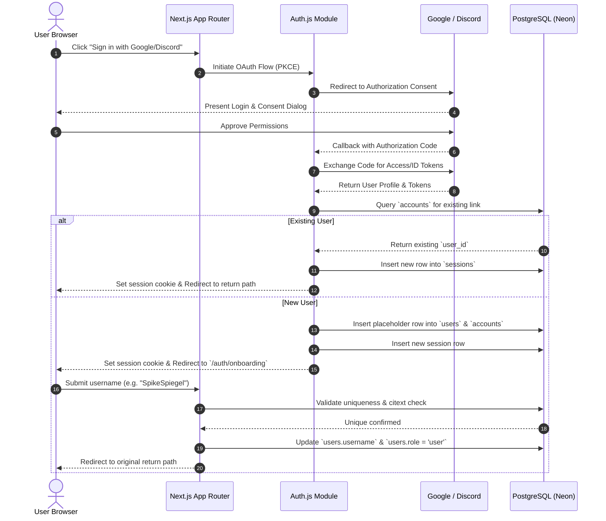
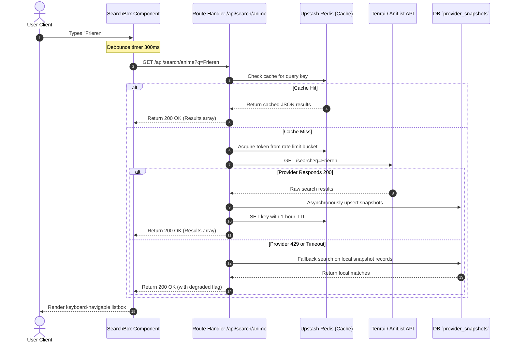
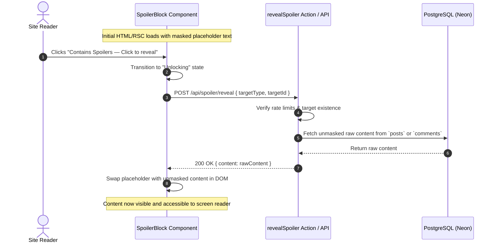
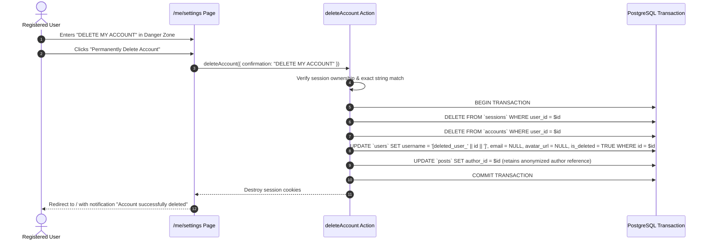

# Anivio — Product Vision, Specifications & User Workflows

> **Single Source of Truth (SSOT) for Product Identity, Functional Requirements & Interactions**  
> Status: **CONSOLIDATED BASELINE (Version 1.1)**  
> Last Updated: 12 November 2026  
> Document Alignment: Reconciled with `README.md` & `ARCHITECTURE.md` (Version 1.1 Consolidated Architecture Baseline)

This document is the unified product and functional authority for the Anivio Platform. It defines the product vision, target audience, competitive positioning, comprehensive functional requirements (`FR-001` through `FR-042`), non-functional requirements (`NFR-001` through `NFR-016`), and interaction workflows (`WF-001` through `WF-018`).

---

## 1. Product Identity & Strategic Vision

### 1.1 The Problem Statement
Anime and Asian fiction fandom is inherently **data-heavy and highly social**, yet fans often split their activity across multiple fragmented products:
- **Database Platforms (MyAnimeList, AniList)**: Provide structured information, ratings, and watchlists, but their discussion experience feels secondary, rigid, and separated from live discourse.
- **Social Platforms (Reddit, X)**: Offer active conversations and viral discovery, but titles are treated as plain text strings disconnected from a fan's personal library, progress, or structured metadata.
- **Spoiler Vulnerability**: Spoiler-heavy conversations make fandom browsing unsafe when users are at different episodes, chapters, or volumes.

**The Disconnect**: When users discover a title in a social thread, they must leave to check metadata or update their library. When they finish an episode or chapter on a tracking site, they must leave to find active discussions. Context is lost at every switch.

### 1.2 The Solution: "Contextualized Social Discovery"
Anivio operates as a **contextualized social discovery platform** that unites fandom discussions, structured title information, personal tracking, and community discovery into one seamless experience:
- An author mentions a title in a post using an `@` entity tag.
- The platform dynamically embeds an interactive catalog card with real-time ratings, format badges, and a one-tap library toggle.
- Readers can inspect metadata, preview synopses, and add the title to their private library without ever navigating away from the discussion.
- Fandom communities and user profiles form a hybrid experience combining Reddit-style communities with social-network following.
- Server-enforced spoiler controls protect viewers and readers across different points in a story.

### 1.3 Content Coverage & Initial Scope
- **Supported Formats**: Anime, Manga, Manhwa, Manhua, Webtoons, Light Novels, and Web Novels.
- **Initial Baseline**: Prioritizes anime metadata adapters and workflows while keeping the catalog and tracking schema fully extensible for other fiction formats. The database avoids anime-only assumptions where generic content entities apply.
- **Initial Market**: India-first, architected for global audiences and international scaling.
- **Platform Direction**: Responsive web application with optional PWA enhancements.

### 1.4 Target Audience Segments
| Audience Segment | Persona Description | Platform Utility | MVP Priority |
|---|---|---|---|
| **Seasonal Viewers & Readers** | Follows 5–15 currently airing/releasing titles. Values immediate discussion post-release. | Episodic/chapter discussion threads, community sentiment sorting, real-time progress tracking, progress-aware spoiler shielding. | **Primary (P0)** |
| **Archival Fans** | Maintains large personal lists of completed and planned titles. Enjoys writing structured reviews. | Structured review authoring, 1–10 rating scales, public profile lists, and community reputation karma. | **Primary (P0)** |
| **Casual Discoverers** | Browses fandom sporadically. Relies on community consensus and recommendations. | "Hot" and "Best" algorithmically sorted feeds, spoiler-safe discovery pages, and one-tap library saving. | **Secondary (P1)** |
| **Community Regulars** | Engages daily in fandom banter, theories, questions, and memes. | Subscribed communities, nested discussion trees, voting, and community identity. | **Primary (P0)** |
| **Creators & Artists** | Shares fan art, theories, and creative works subject to community rules. | High-quality media attachments, flair categorization, and creator profile showcases. | **Secondary (P2)** |

### 1.5 Competitive Differentiation
| Competitor | Core Strengths | Critical Limitations | Anivio Differentiation |
|---|---|---|---|
| **Reddit (`r/anime`, `r/manga`)** | Algorithmic ranking (Wilson Score, Hot), large user base. | Lacks native catalog metadata, personal tracking, or persistent reviews; discussions are ephemeral text. | Integrates structured metadata natively into feeds. One-click library tracking directly from discussions. |
| **MyAnimeList (MAL)** | Massive catalog and historical database. | Outdated UI/UX; static chronological forums; strict commercial API terms. | Modern dynamic feed with MAL-compatible data; makes community discussion the primary driver. |
| **AniList** | Modern UI; flexible GraphQL API. | Aggressive rate limits; community discussion remains secondary and rigid. | Community-first focus with metadata acting as a supportive layer; zero-downtime snapshot caching. |
| **Anime-Planet** | Legal streaming links; recommendation system. | Smaller community footprint; limited granular episode/chapter debate. | Rich-text post editor, deep nested comment trees (`ltree`), and statistical confidence ranking. |

### 1.6 Core Product Principles (Non-Negotiable)
1. **Community first**: Discussions and fandom participation are the primary experience; catalog data supports the conversation.
2. **Titles are native entities**: Anime, manga, webtoons, and novels are represented as structured catalog entities.
3. **Spoiler safety by design**: Spoiler protection is a product-level capability, not merely a client-side visual effect.
4. **User-controlled discovery**: The home feed balances followed communities and people with relevant discovery.
5. **Calm visual hierarchy**: Artwork provides visual character; the surrounding interface remains readable and restrained.
6. **Honest interface states**: Loading, empty, error, degraded, and permission states are visually distinct, honest, and actionable.
7. **Modular, not over-engineered**: Modular monolith deployed as a unified Next.js app; no premature microservices.
8. **Secure defaults**: Authorization, validation, privacy, and moderation are enforced strictly on the server.

---

## 2. Functional Specifications Matrix (`FR-001` – `FR-042`)

### 2.1 Authentication & Onboarding
- **`FR-001` (OAuth 2.0 Auth - P0)**: Google and Discord OAuth 2.0 with PKCE via Auth.js v5. Database sessions in PostgreSQL. `HttpOnly`, `Secure`, `SameSite=Lax` cookies. No password storage.
- **`FR-002` (Username Onboarding - P0)**: Mandatory unique username selection upon initial sign-in. Case-insensitive uniqueness enforced via PostgreSQL `citext`. Length: 3–24 chars (`^[a-zA-Z0-9_-]+$`). Blocklist for reserved words (`admin`, `mod`, `anivio`).
- **`FR-003` (Account Deletion - P0)**: Self-deletion in Danger Zone via exact typed confirmation `DELETE MY ACCOUNT`. Atomic transaction destroys sessions/accounts, anonymizes user row, and soft-deletes authored posts/comments to preserve thread continuity.

### 2.2 User Profiles, Social Graph & Karma
- **`FR-004` (Public Profile - P0)**: Profile view at `/u/[username]` displaying avatar, username, total karma, account age, and public posts/comments. Framework-cached for 60s.
- **`FR-005` (Karma Tracking - P0)**: Karma reflects net sum of upvotes/downvotes received on authored content. Denormalized integer column updated asynchronously via background jobs and reconciled via daily repair scripts.
- **`FR-006` (User Following & Blocks - P1)**: Authenticated users can follow or block other users via `user_follows` and `user_blocks`. Following populates the home "Following" feed; blocks hide content reciprocally.

### 2.3 Catalog Discovery & Title Pages
- **`FR-007` (Season & Catalog Grid - P0)**: Responsive poster grid at `/season` and `/catalog` displaying airing anime and popular titles with format filters (Anime, Manga, Novels). 24h cache via `'use cache'`. Displays cached snapshots with `DegradedNotice` during upstream downtime.
- **`FR-008` (Top Charts - P0)**: Keyset-paginated ranking at `/top` of highest-rated titles across categories.
- **`FR-009` (Debounced Catalog Search - P0)**: Search endpoint `/api/search/anime` debounced at 300ms. Returns keyboard-navigable listbox with thumbnail, title, format badge, year, and score. Cached 1h in Redis; 30 req/min per IP rate limit.
- **`FR-010` (Title Detail Page - P0)**: View at `/anime/[id]` or `/catalog/[type]/[id]` rendering poster, title, format chip, score, genres, synopsis, unit list (episodes/chapters), and related community discussions. Prominently displays provider attribution.

### 2.4 Communities
- **`FR-011` (Community Provisioning - P0 / Launch Policy)**: Platform-admin provisioned communities during initial launch to ensure active, focused discussions and prevent spam or ghost communities. Architecture preserves owner/moderator hierarchy and can support trusted-user creation (accounts >= 3 days old, rate-limited to 2/week) in post-launch milestones once anti-spam operations are validated.
- **`FR-012` (Community Feed - P0)**: Route `/c/[slug]` displaying community header, rules sidebar, sort tabs (`Hot`, `New`, `Best`), and keyset-paginated post feed.
- **`FR-013` (Membership Management - P0)**: Idempotent `joinCommunity` / `leaveCommunity` actions using composite PK `(community_id, user_id)`. Optimistic button toggle with rollback on failure.

### 2.5 Posts & Rich-Text Editor
- **`FR-014` (Post Creation - P0)**: Rich-text posting via Tiptap. Title: 3–300 chars. Structured JSON document (max 50KB). Supports inline catalog entity tags, spoiler flag with optional unit, and up to 4 image attachments. Enqueues search vector update on publish.
- **`FR-015` (Post Editing Window - P0)**: Authors can edit title, content, and tags within 24 hours of creation. Moderators can edit or lock posts at any time. Sets `edited_at` timestamp and displays `(edited)` badge.
- **`FR-016` (Media Uploads via Cloudflare R2 - P1)**: Presigned direct upload URL via `/api/upload/sign`. Max 5MB per file, limited to `image/webp`, `image/jpeg`, `image/png`. Max 4 images per post. Mandatory `alt_text`.
- **`FR-017` (Post Card & Placeholders - P0)**: Post cards display community, author, timestamp, title, excerpt, tags, vote controls, comment count, and bookmark action. Removed posts render placeholder preserving descendant comment tree.
- **`FR-018` (Restricted Tiptap Schema - P0)**: Allowed nodes: Document, Paragraph, Headings (levels 2-3), Lists, Blockquote, CodeBlock, CatalogTagNode. Allowed marks: Bold, Italic, Strike, Code, Link (http/https), SpoilerMark. Raw HTML and embedded video are strictly prohibited.
- **`FR-019` (Post Bookmarks - P1)**: Authenticated users can bookmark posts for persistent personal retrieval via `bookmarks` table and `/u/[username]/saved` tab.

### 2.6 Catalog Entity Tagging & Hover Cards (Core USP)
- **`FR-020` (Tag Insertion - P1)**: Typing `@` in editor opens combobox querying `/api/search/anime`. Inserts `CatalogTagNode` with attributes `entityType`, `entityId`, and `label`. Validated on save; unresolvable tags downgrade to plain text.
- **`FR-021` (Inline Tag Pill - P1)**: Renders as pill button with 20px thumbnail, format badge, title, and subtle cyan border. Behaves as an accessible button opening `CatalogHoverCard`.
- **`FR-022` (Catalog Hover Card - P1)**: Floating card displaying poster, score, format chip, genres, synopsis excerpt, and one-tap `LibraryControl`. Viewport-aware positioning. Dismissible with `Escape`.

### 2.7 Nested Comments & Discussion Engine
- **`FR-023` (Hierarchical Commenting via `ltree` - P0)**: Comments utilize PostgreSQL `ltree` materialized paths (`1`, `1.2`, `1.2.5`). Insertion handled via stored function `add_comment()` with advisory lock (`pg_advisory_xact_lock`). Hard depth cap at **8 levels** enforced by `CHECK (depth BETWEEN 1 AND 8)`.
- **`FR-024` (Single-Query Thread Assembly - P0)**: Thread query retrieves entire conversation tree in one indexed read (`WHERE post_id = $1 AND path <@ root ORDER BY path`). Server component assembles nested tree in memory (<400ms at p95 for 1,000 comments).
- **`FR-025` (Soft Deletion - P0)**: Deleting comment sets `is_deleted = true`. Content replaced with `[deleted]`; row preserved to prevent orphaning replies.

### 2.8 Voting & Algorithmic Ranking
- **`FR-026` (Polymorphic Voting - P0)**: Upvote (+1) or Downvote (-1) on posts and comments. Composite PK `(user_id, post_id)` or `(user_id, comment_id)` physically prevents duplicate votes. Author cannot vote on own content.
- **`FR-027` (Wilson Score Ranking - P1)**: Evaluates lower bound of Wilson Score Interval with 95% confidence ($z=1.96$) via immutable PostgreSQL function `wilson_lower(ups, downs)`. Prevents single-upvote items from outranking proven discussions. Used for "Best" sort.
- **`FR-028` (Hot Ranking - P1)**: Logarithmic score decay over time via PostgreSQL function `hot_rank(score, created_at)`. Used for "Hot" sort.

### 2.9 Spoilers, Library & Progress Tracking
- **`FR-029` (Server-Enforced Spoiler Protection - P0 / P1)**: Sensitive content is withheld on the server before serialization into JSON/RSC payloads. Frontend CSS blur alone is rejected. Full content is delivered only via an authenticated or explicit on-demand reveal request (`/api/spoiler/reveal` or `revealSpoiler`). Supports optional story unit metadata (e.g. "Episode 12", "Chapter 45").
- **`FR-030` (Personal Library Tracking - P0)**: Users track titles under 6 statuses: `watching`, `reading`, `completed`, `on_hold`, `dropped`, `planned`. Tracks 1–10 rating score and unit progress (`episodes_watched`, `chapters_read`, `volumes_read`). Private owner view at `/u/[username]/library`.
- **`FR-031` (Unified LibraryControl - P0)**: Shared client component used on Title pages, Hover Cards, and Unit views. Adapts labels to medium (Watching vs. Reading). Calls `upsertWatchlistEntry` action.
- **`FR-032` (Story Unit Discussion Threads - P1)**: On-demand thread generation at `/anime/[id]/episodes/[n]` linked to `(mal_id, episode_number)` in `episode_threads`. Idempotent creation.

### 2.10 Search, Moderation, Notifications & Admin
- **`FR-033` (Full-Text Search - P0)**: Full-text search over posts using PostgreSQL generated `tsvector` column (title weighted `A`, body weighted `B`) with `GIN` index and `pg_trgm` fuzzy title matching.
- **`FR-034` (Reporting - P1)**: Reason codes: `spam`, `harassment`, `spoilers`, `off_topic`, `illegal`. Unique constraint prevents duplicate reports.
- **`FR-035` (Automated 3-Report Threshold - P1)**: When an item accumulates 3 unique reports from accounts >24h old, status transitions to `'filtered'`, removing it from public feeds and enqueuing in `/mod`.
- **`FR-036` (Moderation Queue - P1)**: Queue at `/mod` for community moderators and admins to approve, remove, or filter content. All actions write immutable audit log.
- **`FR-037` (Account Shadowbanning - P1)**: Admins can flag malicious bot accounts as `is_shadowbanned = true`. Content is accepted but silently omitted from public queries.
- **`FR-038` (In-App Notifications - P1 / P2)**: In-app bell icon with unread count badge for replies, mentions, and moderation alerts. Handled via `notifications` table.
- **`FR-039` (Health Check - P0)**: `GET /api/health` probes DB, Redis, and upstream circuit breaker status.
- **`FR-040` (Hybrid Home Feed - P0)**: Home feed provides segmented switcher between "Following" (joined communities and followed users) and "Discover" (algorithmic feed balancing trending, top, and interest-relevant content).
- **`FR-041` (Feed Controls - P1)**: Users can mute specific communities and block users to filter content from all personal feed views.
- **`FR-042` (Audit Logging - P0)**: Security and moderation operations write actor ID, action, metadata, and salted IP hash to `audit_log` with a 30-day retention schedule.

---

## 3. Non-Functional Requirements (`NFR-001` – `NFR-016`)

- **`NFR-001` (LCP Performance)**: Largest Contentful Paint < 2.5s on simulated mid-range mobile device on 4G.
- **`NFR-002` (Thread Render Budget)**: Server processing time for 1,000-comment thread < 400ms at p95.
- **`NFR-003` (Bundle Budget)**: First-load JavaScript < 180 KB compressed for feeds, < 200 KB for title pages.
- **`NFR-004` (Layout Stability)**: Cumulative Layout Shift (CLS) < 0.1 across all routes.
- **`NFR-005` (Cache Efficiency)**: Zero outbound provider API calls on warm cache visits.
- **`NFR-006` (Provider Resilience)**: Zero user-facing 500 error pages during upstream API outages; system serves snapshots with `DegradedNotice`.
- **`NFR-007` (Hierarchy Scalability)**: Comment tree scales to tens of thousands of nodes without recursive query penalties via `ltree` with GiST index.
- **`NFR-008` (WCAG 2.1 AA Contrast)**: Minimum 4.5:1 contrast for normal text, 3:1 for large text.
- **`NFR-009` (Keyboard Operability)**: Every interactive element reachable via keyboard with visible focus ring (`--focus-ring: #22D3EE 2px`).
- **`NFR-010` (Server-Enforced Spoiler A11y)**: Withheld spoiler text is shielded from DOM accessibility tree and network inspectors until the user triggers an explicit reveal action.
- **`NFR-011` (Zoom & Viewport)**: Fully functional at 200% zoom and 320px viewport without horizontal scrolling.
- **`NFR-012` (Reduced Motion)**: Honors `@media (prefers-reduced-motion: reduce)` across all transitions.
- **`NFR-013` (Content Sanitization)**: Strict schema validation prevents XSS; raw HTML injection is impossible.
- **`NFR-014` (Rate Limiting)**: Redis token bucket limits post/comment creation, search, and upload endpoints.
- **`NFR-015` (Privacy Compliance)**: Server logs never store plain IP addresses; salted hashes are retained for 30 days maximum.
- **`NFR-016` (Extensible Domain Schema)**: Catalog entities, units, and library tracking models use generic discriminators to support multiple fiction formats without requiring breaking database migrations.

---

## 4. End-to-End User Interaction Workflows (`WF-001` – `WF-018`)

### WF-002: OAuth Registration & Onboarding



### WF-004: Real-Time Catalog Search & Debounced Querying



### WF-007: Rich-Text Post Creation with Catalog Tagging

```mermaid
sequenceDiagram
    autonumber
    actor Author as Registered User
    participant Editor as PostEditor (Tiptap)
    participant Storage as Cloudflare R2
    participant Action as createPost Server Action
    participant Zod as Zod Validator
    participant DB as PostgreSQL (Neon)
    participant Queue as Background Job Queue

    Author->>Editor: Drafts post, types @Frieren
    Editor->>Editor: Selects title from combobox; inserts CatalogTagNode
    alt Has Image Attachments
        Author->>Editor: Selects up to 4 images
        Editor->>Action: POST /api/upload/sign
        Action-->>Editor: Presigned R2 PUT URLs
        Editor->>Storage: Direct PUT image bytes (WebP)
        Storage-->>Editor: 200 OK (ETags & Keys)
    end
    Author->>Editor: Clicks "Publish Post"
    Editor->>Action: Call createPost(payload)
    Action->>Zod: Validate structured document JSON & metadata
    Zod-->>Action: Validated clean payload
    Action->>DB: BEGIN TRANSACTION
    Action->>DB: Verify membership in community
    Action->>DB: Insert row into `posts`
    Action->>DB: Insert rows into `post_tags` (entity_type='anime', entity_id=id)
    Action->>DB: Insert rows into `post_media`
    Action->>DB: COMMIT TRANSACTION
    Action->>Queue: Enqueue search vector index update
    Action-->>Editor: Return { success: true, postId: uuid }
    Editor-->>Author: Redirect to /c/[slug]/p/[postId]
```

### WF-009: Nested Commenting & Discussion Tree

```mermaid
sequenceDiagram
    autonumber
    actor Commenter as Registered User
    participant UI as CommentComposer
    participant Action as createComment Action
    participant DB as PostgreSQL Function `add_comment`
    participant Job as Background Jobs

    Commenter->>UI: Enters reply text, toggles spoiler=false
    Commenter->>UI: Clicks "Reply"
    UI->>UI: Optimistically append comment node to local tree
    UI->>Action: Call createComment({ postId, parentId, content, isSpoiler })
    Action->>Action: Verify session & check rate limit
    Action->>DB: Call add_comment(p_post, p_author, p_parent, p_content, p_spoiler)
    Note over DB: Acquires pg_advisory_xact_lock(hashtext(post_id))
    Note over DB: Resolves parent ltree path; appends sequence value
    Note over DB: Verifies depth constraint (depth <= 8)
    Note over DB: Inserts comment row into `comments`
    DB-->>Action: Returns new comment UUID & ltree path
    Action->>Job: Enqueue notification to post/parent author
    Action-->>UI: Return { success: true, comment: row }
    UI->>UI: Reconcile optimistic node with server-confirmed row
```

### WF-011: Server-Enforced Spoiler Reveal Workflow



### WF-014: Controlled Account Deletion



---

## 5. Explicitly Excluded V1 Functionality
The following items are strictly prohibited from Version 1 implementation:
1. Real-time chat rooms or WebSocket infrastructure.
2. Direct messaging (DM) between users.
3. Native e-commerce, checkout, or payment gateway handling.
4. Native video uploading or video streaming.
5. Proprietary machine learning recommendation engines.
6. Character-level tagging inside the editor (deferred to P2).
7. Outbound email notifications or marketing digests.
8. Native iOS / Android mobile applications.
9. Localization/internationalization beyond English.
10. Bulk scraping or complete offline mirroring of external anime databases.
