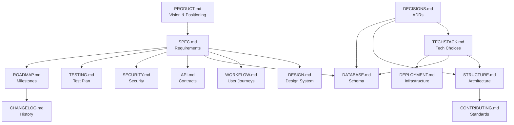

# Anivio — Documentation Index

## Purpose

These documents form the **Single Source of Truth (SSOT)** for the Anivio project. All development, architectural decisions, implementation, and testing must refer to these documents.

## Source of Truth Rules

1. **Every piece of information has one authoritative location.** That location is the document listed as the owner in the documentation map below.
2. **Other documents link to the authoritative section rather than duplicating.** If you find duplicated information, the authoritative document is correct.
3. **Ownership by topic:**

| Topic | Authoritative Document |
|---|---|
| Feature behaviour and requirements | [SPEC.md](SPEC.md) |
| Visual tokens and design system | [DESIGN.md](DESIGN.md) |
| User interactions and journeys | [WORKFLOW.md](WORKFLOW.md) |
| Repository and code architecture | [STRUCTURE.md](STRUCTURE.md) |
| Technology choices and rationale | [TECHSTACK.md](TECHSTACK.md) |
| Database schema and queries | [DATABASE.md](DATABASE.md) |
| API contracts and integrations | [API.md](API.md) |
| Security and moderation policies | [SECURITY.md](SECURITY.md) |
| Test strategy and coverage | [TESTING.md](TESTING.md) |
| Infrastructure and deployment | [DEPLOYMENT.md](DEPLOYMENT.md) |
| Architecture decision records | [DECISIONS.md](DECISIONS.md) |
| Product vision and positioning | [PRODUCT.md](PRODUCT.md) |
| Development milestones and tasks | [ROADMAP.md](ROADMAP.md) |
| Coding standards and conventions | [CONTRIBUTING.md](CONTRIBUTING.md) |
| Release history | [CHANGELOG.md](CHANGELOG.md) |

## Documentation Map

| Document | Role | Questions It Answers |
|---|---|---|
| [PRODUCT.md](PRODUCT.md) | Product vision, audience, positioning | Who is this for? What problem does it solve? How is it positioned? |
| [SPEC.md](SPEC.md) | Functional and non-functional specifications | What features exist? What are the acceptance criteria? What are the performance targets? |
| [DESIGN.md](DESIGN.md) | UI/UX design system and component specs | What do components look like? What are the color tokens? What are the spacing rules? |
| [WORKFLOW.md](WORKFLOW.md) | User journeys and application workflows | What happens when a user does X? What are the state transitions? |
| [STRUCTURE.md](STRUCTURE.md) | Repository and application architecture | Where does this code go? How are modules organized? What are the import rules? |
| [TECHSTACK.md](TECHSTACK.md) | Technology stack decisions | What library do I use for X? Why was Y chosen over Z? |
| [DATABASE.md](DATABASE.md) | Database schema and architecture | What tables exist? What are the indexes? How are migrations managed? |
| [API.md](API.md) | API contracts and integrations | What endpoints exist? What are the request/response shapes? How is the external API consumed? |
| [SECURITY.md](SECURITY.md) | Security and moderation | How is auth handled? What are the rate limits? How does moderation work? |
| [TESTING.md](TESTING.md) | Quality assurance and test plan | How do I test this? What coverage is required? What are the test conventions? |
| [DEPLOYMENT.md](DEPLOYMENT.md) | Infrastructure and deployment | How do I deploy? What are the environment variables? What is the CI/CD pipeline? |
| [ROADMAP.md](ROADMAP.md) | Development milestones and tasks | What should I build next? What is the milestone order? What are the task dependencies? |
| [DECISIONS.md](DECISIONS.md) | Architecture decision records | Why was this decision made? Is it locked or open? What were the alternatives? |
| [CONTRIBUTING.md](CONTRIBUTING.md) | Development standards and conventions | How do I name branches? What is the PR process? What are the code style rules? |
| [CHANGELOG.md](CHANGELOG.md) | Project change history | What changed in each release? When was feature X added? |

## How to Use These Docs

| Question | Start Here |
|---|---|
| "What feature should I build?" | [SPEC.md](SPEC.md) + [ROADMAP.md](ROADMAP.md) |
| "How should it look?" | [DESIGN.md](DESIGN.md) |
| "Where does this code go?" | [STRUCTURE.md](STRUCTURE.md) |
| "What tech do I use?" | [TECHSTACK.md](TECHSTACK.md) |
| "How is data stored?" | [DATABASE.md](DATABASE.md) |
| "What are the API contracts?" | [API.md](API.md) |
| "Is this decision locked?" | [DECISIONS.md](DECISIONS.md) |

## Documentation Hierarchy

## Decision Status Labels

The following status labels are used consistently across all documentation:

| Label | Meaning |
|---|---|
| `LOCKED` | Decision is final. Changing it requires a new ADR with rationale. |
| `OPEN` | Decision is pending discussion or investigation. |
| `PROPOSED` | A recommendation has been made but not yet accepted. |
| `DEPRECATED` | Previously locked decision that has been superseded. |
| `IMPLEMENTED` | Decision has been locked and the corresponding code is in place. |
| `VERIFIED` | Implemented and confirmed working via tests or review. |

## Identifier Conventions

Cross-referenced identifiers used throughout the documentation:

| Prefix | Domain | Example |
|---|---|---|
| `FR-xxx` | Functional requirement | FR-001: User registration |
| `NFR-xxx` | Non-functional requirement | NFR-001: Page load under 2s |
| `SEC-xxx` | Security requirement | SEC-001: CSRF protection |
| `UI-xxx` | UI requirement | UI-001: Navigation bar |
| `DB-xxx` | Database requirement | DB-001: Users table |
| `API-xxx` | API requirement | API-001: Auth endpoint |
| `TASK-xxx` | Implementation task | TASK-001: Set up Next.js project |
| `ADR-xxx` | Architecture decision record | ADR-001: Choose Drizzle over Prisma |

## Updating Documentation

> [!IMPORTANT]
> Any code change that modifies feature behaviour, API contracts, database structure, design tokens, or architecture **must** update the relevant document. A pull request that changes documented behaviour without updating docs should not be merged.

**Process:**

1. Identify which document owns the information being changed (see the ownership table above).
2. Update the authoritative document.
3. Check for cross-references in other documents and update links if needed.
4. Include the documentation update in the same PR as the code change.

## Conflict Resolution

If two documents describe the same thing differently, the **authoritative document** (per the ownership table above) is correct and the other document must be fixed. When you find a conflict:

1. Trust the authoritative document.
2. Update the non-authoritative document to link to the correct section.
3. Open a PR with the fix.
