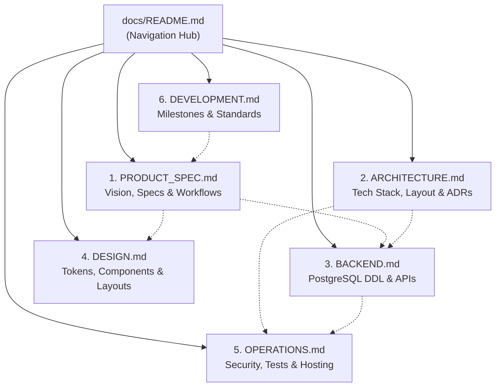

# Anivio — Documentation Index

> **Single Source of Truth (SSOT) Architecture**  
> Status: **CONSOLIDATED BASELINE (Version 1.1)**  
> Last Updated: 12 November 2026

This directory serves as the **Single Source of Truth (SSOT)** for the Anivio Anime Community Platform. The documentation is organized into **6 cohesive, domain-focused core documents** designed to eliminate cross-file fragmentation while preserving complete technical and architectural depth.

---

## 1. Documentation Map & Topic Ownership

| # | Document | Authoritative Domain | Primary Questions It Answers |
|---|---|---|---|
| 1 | **[`PRODUCT_SPEC.md`](PRODUCT_SPEC.md)** | Product Vision, Feature Specs & User Workflows | What are we building? Who is it for? What are the acceptance criteria for every feature? What does the interaction flow look like? |
| 2 | **[`ARCHITECTURE.md`](ARCHITECTURE.md)** | Technology Stack, Repository Blueprint & ADRs | What libraries are used? Where does code belong? What are the import boundaries? Why were specific architectural decisions locked? |
| 3 | **[`BACKEND.md`](BACKEND.md)** | Database DDL, Server Actions & API Contracts | How are tables structured? What are the SQL functions? What are the Server Action signatures? How is external anime data consumed? |
| 4 | **[`DESIGN.md`](DESIGN.md)** | Design Tokens, Components & Page Layouts | What are the exact color tokens? What is the typography scale? How are components styled? What do pages look like across breakpoints? |
| 5 | **[`OPERATIONS.md`](OPERATIONS.md)** | Security, Test Suite, Infrastructure & CI/CD | How is authentication secured? What are the rate limits? How is the app tested? What environment variables are required? How is it hosted? |
| 6 | **[`DEVELOPMENT.md`](DEVELOPMENT.md)** | Milestones M0–M9, Git Standards & Changelog | What should I build next? What are the milestone tasks? How should I name branches? What changed in recent releases? |

---

## 2. Documentation Hierarchy

---

## 3. Developer Navigation Guide

| If you are asking... | Consult this document: |
|---|---|
| "What feature am I building and what are its acceptance criteria?" | **[`PRODUCT_SPEC.md`](PRODUCT_SPEC.md)** |
| "What does the user interaction flow look like?" | **[`PRODUCT_SPEC.md`](PRODUCT_SPEC.md)** (Section 4) |
| "What library do I install and where do files go?" | **[`ARCHITECTURE.md`](ARCHITECTURE.md)** |
| "Why did we choose Tenrai over Jikan or Drizzle over Prisma?" | **[`ARCHITECTURE.md`](ARCHITECTURE.md)** (Section 6 - ADRs) |
| "What is the database schema or Server Action signature?" | **[`BACKEND.md`](BACKEND.md)** |
| "How do I handle external anime metadata rate limits?" | **[`BACKEND.md`](BACKEND.md)** (Section 6) |
| "What hex color, spacing, or component anatomy should I use?" | **[`DESIGN.md`](DESIGN.md)** |
| "How do I implement rate limiting, RBAC, or presigned R2 uploads?" | **[`OPERATIONS.md`](OPERATIONS.md)** (Section 1) |
| "What tests do I need to write and what are the performance budgets?"| **[`OPERATIONS.md`](OPERATIONS.md)** (Section 2) |
| "What environment variables must be configured to run locally?" | **[`OPERATIONS.md`](OPERATIONS.md)** (Section 4) |
| "What milestone and tasks should I work on right now?" | **[`DEVELOPMENT.md`](DEVELOPMENT.md)** (Section 1) |
| "What are the branch naming and commit rules?" | **[`DEVELOPMENT.md`](DEVELOPMENT.md)** (Section 2) |

---

## 4. Single Source of Truth Rules
1. **One Authoritative Location**: Every technical requirement belongs to its designated document per the table above.
2. **Mandatory Documentation Updates**: Any pull request that alters user-visible behavior, API contracts, database schema, or design tokens must update the corresponding document in the same PR.
3. **Traceability**: All code tasks must trace back to stable requirement identifiers (`FR-xxx`, `NFR-xxx`, `TASK-xxx`, `ADR-xxx`).
