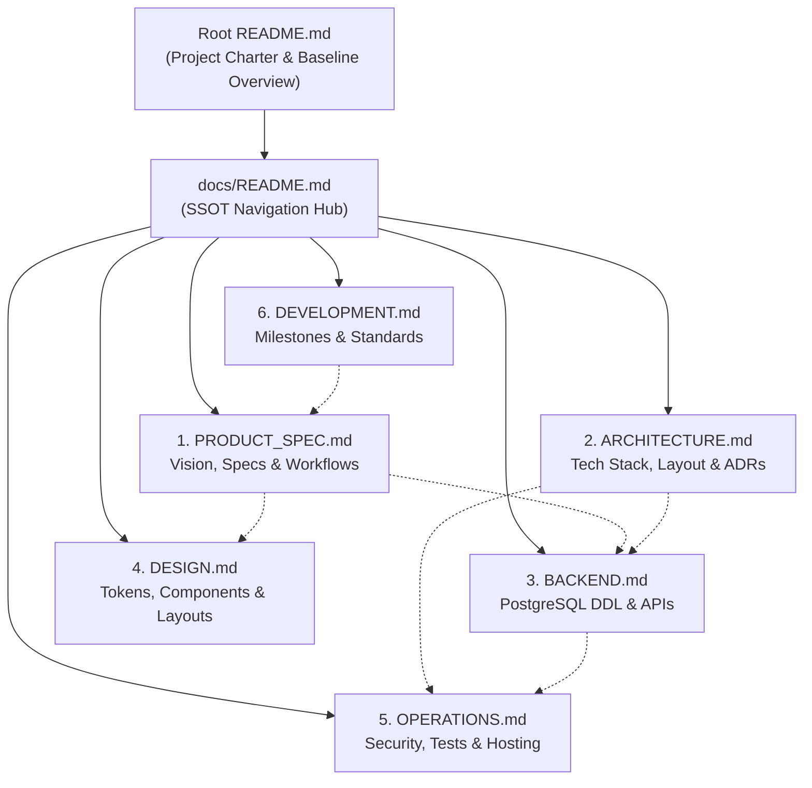

# Anivio — Documentation Index & Navigation Hub

> **Single Source of Truth (SSOT) Architecture Suite**  
> Status: **CONSOLIDATED BASELINE (Version 1.1)**  
> Last Updated: 12 November 2026  
> Document Alignment: Reconciled with root `README.md` (Version 1.1 Consolidated Architecture Baseline)

This directory serves as the **Single Source of Truth (SSOT)** for the Anivio Platform — a community-first social discovery platform for anime and the wider world of Japanese and Asian fiction (Manga, Manhwa, Manhua, Webtoons, Light Novels, and Web Novels).

The technical documentation is organized into **6 cohesive, domain-focused core documents** designed to eliminate cross-file fragmentation while preserving complete technical, architectural, and operational depth.

---

## 1. Documentation Map & Topic Ownership

| # | Document | Authoritative Domain | Primary Scope & Questions It Answers |
|---|---|---|---|
| 1 | **[`PRODUCT_SPEC.md`](PRODUCT_SPEC.md)** | Product Vision, Feature Specs & User Workflows | What are we building? Who is it for? Detailed functional requirements (`FR-001`–`FR-042`), non-functional constraints (`NFR-001`–`NFR-016`), user personas, and sequence interaction workflows (`WF-001`–`WF-018`). |
| 2 | **[`ARCHITECTURE.md`](ARCHITECTURE.md)** | Technology Stack, Repository Blueprint & ADRs | What libraries are used? Where does code belong? Module boundaries (`src/modules/*`), Server vs. Client component matrix, formal Architecture Decision Records (`ADR-001`–`ADR-014`), and Conflict Resolutions (`CR-01`–`CR-08`). |
| 3 | **[`BACKEND.md`](BACKEND.md)** | Database DDL, Server Actions & API Contracts | How are tables structured? Full PostgreSQL 16+ DDL (`users`, `communities`, `posts`, `comments`, `watchlists`, `user_follows`, `user_blocks`, `notifications`, `bookmarks`), `ltree` comment hierarchy function, Wilson Score SQL, Server Actions, Route Handlers, and external metadata adapter contracts. |
| 4 | **[`DESIGN.md`](DESIGN.md)** | Design Tokens, Components & Page Layouts | What are the exact color tokens (`tokens.css`)? What is the typography scale? Component specifications (all 30 primitives including `CatalogCard`, `LibraryControl`, `SpoilerBlock`), 10 page-level specs, 5 state patterns, and accessibility standards. |
| 5 | **[`OPERATIONS.md`](OPERATIONS.md)** | Security, Test Suite, Infrastructure & CI/CD | How is authentication secured? What is the launch RBAC matrix (Admin-only community creation)? Server-enforced spoiler protection, rate limits, layered QA plan, environment variables, Vercel/Neon/R2 deployment topology, and CI/CD pipeline. |
| 6 | **[`DEVELOPMENT.md`](DEVELOPMENT.md)** | Milestones M0–M9, Git Standards & Changelog | What should I build next? 10 sequential milestone task boards (M0–M9), alternative 6-week contingency plan, Git branch naming rules, Conventional Commits, pre-merge PR checklist, and release changelog. |

---

## 2. Documentation Hierarchy & System Flow

---

## 3. Developer Navigation Guide

| If you are asking... | Consult this document: |
|---|---|
| "What feature am I building and what are its acceptance criteria?" | **[`PRODUCT_SPEC.md`](PRODUCT_SPEC.md)** |
| "What does the user interaction flow look like?" | **[`PRODUCT_SPEC.md`](PRODUCT_SPEC.md)** (Section 4) |
| "What fiction formats are supported and how are they represented?" | **[`PRODUCT_SPEC.md`](PRODUCT_SPEC.md)** (Sec 1.3) & **[`BACKEND.md`](BACKEND.md)** (Sec 2) |
| "What library do I install and where do files go?" | **[`ARCHITECTURE.md`](ARCHITECTURE.md)** (Section 2 & 3) |
| "What are the import rules across modules and UI?" | **[`ARCHITECTURE.md`](ARCHITECTURE.md)** (Section 3) |
| "Why did we choose Tenrai over Jikan or Drizzle over Prisma?" | **[`ARCHITECTURE.md`](ARCHITECTURE.md)** (Section 6 - ADRs) |
| "Why is community creation admin-only at launch?" | **[`ARCHITECTURE.md`](ARCHITECTURE.md)** (CR-05, OD-03) & **[`OPERATIONS.md`](OPERATIONS.md)** (Sec 1.2) |
| "Why must spoiler protection be enforced on the server?" | **[`ARCHITECTURE.md`](ARCHITECTURE.md)** (ADR-013) & **[`OPERATIONS.md`](OPERATIONS.md)** (Sec 1.3) |
| "What is the database schema or Server Action signature?" | **[`BACKEND.md`](BACKEND.md)** (Section 2 & 4) |
| "How do I handle external anime metadata rate limits and snapshots?" | **[`BACKEND.md`](BACKEND.md)** (Section 6) |
| "What hex color, spacing, or component anatomy should I use?" | **[`DESIGN.md`](DESIGN.md)** (Section 2 & 5) |
| "What do the 5 UI states look like (Loading, Empty, Error, Degraded, Permission)?" | **[`DESIGN.md`](DESIGN.md)** (Section 7) |
| "How do I implement rate limiting, RBAC, or presigned R2 uploads?" | **[`OPERATIONS.md`](OPERATIONS.md)** (Section 1) |
| "What tests do I need to write and what are the performance budgets?"| **[`OPERATIONS.md`](OPERATIONS.md)** (Section 2) |
| "What environment variables must be configured to run locally?" | **[`OPERATIONS.md`](OPERATIONS.md)** (Section 4) |
| "What milestone and tasks should I work on right now?" | **[`DEVELOPMENT.md`](DEVELOPMENT.md)** (Section 1) |
| "What are the branch naming, commit rules, and pre-merge checklist?" | **[`DEVELOPMENT.md`](DEVELOPMENT.md)** (Section 2) |

---

## 4. Single Source of Truth Rules

1. **One Authoritative Location**: Every technical requirement belongs to its designated document per the domain map above.
2. **Mandatory Documentation Updates**: Any pull request that alters user-visible behavior, API contracts, database schema, design tokens, or operational policies must update the corresponding document in the same PR.
3. **Traceability**: All code tasks must trace back to stable requirement identifiers (`FR-xxx`, `NFR-xxx`, `TASK-xxx`, `ADR-xxx`, `CR-xxx`, `OD-xxx`).
4. **Explicit Conflict Resolution**: If two documents appear to conflict, resolve the conflict explicitly across all affected documents; never leave contradictory specifications in the repository.
