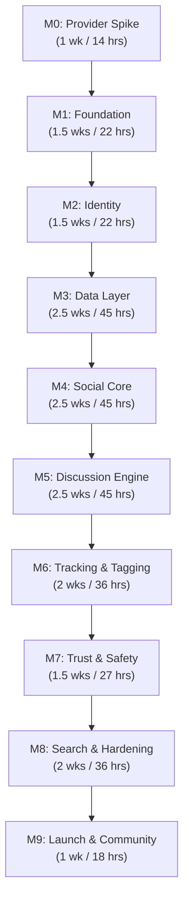

# Anivio — Development Roadmap & Milestone Task Board

> **Single Source of Truth (SSOT) for Development Sequencing, Deliverables & Task Checklists**  
> Status: **LOCKED BASELINE (Version 1.0)**  
> Current Progress: **Pre-Development / Planning Baseline Established**  
> Last Updated: 12 November 2026

This document specifies the 10 sequential implementation milestones, prerequisites, task breakdowns, effort estimations, and concrete definitions of done for building the Anivio Anime Community Platform.

---

## 1. Roadmap Overview & Timeline

- **Developer Capacity**: Solo developer, ~18 focused working hours per week.
- **Total Estimated Effort**: ~310 hours across 17 focused weeks.
- **Execution Rhythm**: Two 6-hour build sessions + one 6-hour review/testing session per week. Every 4th week is reserved for hardening and debt payoff.

---

## 2. Milestone Task Board

### M0. Provider Spike
- **Status**: `PLANNED`
- **Estimated Effort**: 1 week (~14 hours)
- **Prerequisites**: None.
- **Purpose**: Validate upstream anime metadata API capabilities, rate limits, and payload shapes before authoring production schema.
- **Tasks**:
  - [ ] `TASK-001`: Write exploratory script probing Tenrai API v1 for search, season, top, show detail, episodes, and characters.
  - [ ] `TASK-002`: Record exact field nullability and save raw JSON responses as test fixtures in `src/test/fixtures/`.
  - [ ] `TASK-003`: Run 50 consecutive calls to observe rate-limit headers and verify HTTP 429 response structure.
  - [ ] `TASK-004`: Repeat operations against AniList GraphQL API to record schema parity and gap analysis.
  - [ ] `TASK-005`: Author canonical normalized TypeScript definitions (`AnimeSummary`, `EpisodeSummary`).
  - [ ] `TASK-006`: Commit initial provider spike report to repository.
- **Definition of Done**: Committed fixtures and type contracts allowing subsequent milestones to build offline without live network dependencies.

---

### M1. Project Foundation & Design System
- **Status**: `PLANNED`
- **Estimated Effort**: 1.5 weeks (~22 hours)
- **Prerequisites**: M0 complete.
- **Purpose**: Deployable Next.js 16 skeleton, database migration pipeline, and visual token system.
- **Tasks**:
  - [ ] `TASK-007`: Initialize Next.js 16 App Router repository with TypeScript (strict mode) and Cache Components.
  - [ ] `TASK-008`: Configure Tailwind CSS and bind all 16 design tokens in `tokens.css`.
  - [ ] `TASK-009`: Copy core shadcn/ui primitives into `src/components/ui/` (Button, Input, Popover, Dialog, Skeleton, Toast).
  - [ ] `TASK-010`: Provision Neon PostgreSQL database and configure Drizzle ORM client.
  - [ ] `TASK-011`: Write and run migration `0001_extensions.sql` (`ltree`, `pg_trgm`, `citext`).
  - [ ] `TASK-012`: Implement baseline `AppShell`, Header, Footer, and Global Error/404 boundaries.
  - [ ] `TASK-013`: Build reusable feedback primitives: `Skeleton`, `EmptyState`, `ErrorState`, `DegradedNotice`.
  - [ ] `TASK-014`: Configure GitHub Actions CI pipeline (typecheck, lint, test, build).
  - [ ] `TASK-015`: Deploy skeleton to Vercel and verify production preview workflow.
- **Definition of Done**: Deployed placeholder web app with green CI pipeline, successful migration execution, and fully wired design tokens.

---

### M2. Identity & User Profiles
- **Status**: `PLANNED`
- **Estimated Effort**: 1.5 weeks (~22 hours)
- **Prerequisites**: M1 complete.
- **Purpose**: Authenticated sessions, account onboarding, and profile views.
- **Tasks**:
  - [ ] `TASK-016`: Configure Google and Discord OAuth applications with exact redirect URIs.
  - [ ] `TASK-017`: Install Auth.js and configure Drizzle PostgreSQL adapter for database sessions.
  - [ ] `TASK-018`: Author and apply migration `0002_identity.sql` (`users`, `accounts`, `sessions`).
  - [ ] `TASK-019`: Implement server session guards (`requireUser`, `requireModerator`, `getOptionalUser`).
  - [ ] `TASK-020`: Build onboarding flow with debounced case-insensitive username availability check.
  - [ ] `TASK-021`: Build public profile page at `/u/[username]` displaying avatar, karma, and join date.
  - [ ] `TASK-022`: Build account settings at `/me/settings` with controlled self-deletion transaction.
- **Definition of Done**: Two real users can sign in with different providers, view isolated settings, and delete their accounts cleanly.

---

### M3. Anime Metadata & Resilience Layer
- **Status**: `PLANNED`
- **Estimated Effort**: 2.5 weeks (~45 hours)
- **Prerequisites**: M2 complete.
- **Purpose**: Anime discovery browsing backed by persistent snapshots and circuit breakers.
- **Tasks**:
  - [ ] `TASK-023`: Author and apply migration for `provider_snapshots`, `episodes`, and `provider_budget`.
  - [ ] `TASK-024`: Implement Tenrai metadata adapter adhering to normalized `AnimeSummary` contract.
  - [ ] `TASK-025`: Implement 6 adapter wrapping rules (5s timeout, 2 retries, 429 backoff, single-flight mutex).
  - [ ] `TASK-026`: Implement Upstash Redis token bucket rate limiting.
  - [ ] `TASK-027`: Build `/season` grid, `/top` list, and `/search` pages with layout-matched skeletons.
  - [ ] `TASK-028`: Build `AnimeCard` component in feed and detail sizes with explicit MyAnimeList attribution.
  - [ ] `TASK-029`: Build `/anime/[malId]` detail view displaying facts, synopsis, and episode list.
  - [ ] `TASK-030`: Implement snapshot writing on read and verify graceful fallback with `DegradedNotice`.
- **Definition of Done**: With outbound network intentionally blocked, season and show pages render cleanly from local snapshots.

---

### M4. Social Core: Communities & Posts
- **Status**: `PLANNED`
- **Estimated Effort**: 2.5 weeks (~45 hours)
- **Prerequisites**: M3 complete.
- **Purpose**: Community spaces, Tiptap rich-text post creation, and feeds.
- **Tasks**:
  - [ ] `TASK-031`: Author and apply migrations `0003_community.sql` and `0004_content.sql`.
  - [ ] `TASK-032`: Implement community creation action with 3-day account age rule and slug uniqueness.
  - [ ] `TASK-033`: Implement idempotent `joinCommunity` and `leaveCommunity` actions.
  - [ ] `TASK-034`: Build `/c/[slug]` community feed with Hot, New, and Best sort tabs.
  - [ ] `TASK-035`: Configure Tiptap editor with restricted schema and draft auto-restore in local storage.
  - [ ] `TASK-036`: Build `/c/[slug]/submit` composer and `createPost` server action with transaction boundaries.
  - [ ] `TASK-037`: Implement direct Cloudflare R2 image upload signing via `/api/upload/sign`.
  - [ ] `TASK-038`: Build `PostCard` and detail page `/c/[slug]/p/[postId]` with removed placeholders.
  - [ ] `TASK-039`: Author idempotent seed scripts (`seed-minimal.ts`, `seed-realistic.ts`).
- **Definition of Done**: Users can create a community, author rich-text posts with media, and view paginated feeds.

---

### M5. Discussion Engine & Comment Trees
- **Status**: `PLANNED`
- **Estimated Effort**: 2.5 weeks (~45 hours)
- **Prerequisites**: M4 complete.
- **Purpose**: Deep hierarchical discussion trees, voting mechanics, and Wilson Score sorting.
- **Tasks**:
  - [ ] `TASK-040`: Author and apply migration `0005_comments.sql` and `0006_votes.sql` (`ltree`, `add_comment`).
  - [ ] `TASK-041`: Build `CommentTree` and `CommentNode` components with accessible semantic `<ul>` structure.
  - [ ] `TASK-042`: Implement `CommentComposer` with optimistic insertion and depth cap enforcement (max 8).
  - [ ] `TASK-043`: Implement branch continuation route `/api/comments` for subtrees exceeding mobile depth.
  - [ ] `TASK-044`: Implement `vote` server action with composite PK duplicate prevention.
  - [ ] `TASK-045`: Implement asynchronous score calculation jobs updating `score`, `wilson_lower`, and `hot_rank`.
  - [ ] `TASK-046`: Author unit tests for Wilson Score maths and run 1,000-comment load benchmark (<400ms p95).
- **Definition of Done**: 1,000-comment thread renders in conversation order within budget, 9th level is blocked, and Best sort places high-confidence comments on top.

---

### M6. Tracking & Inline Entity Tagging
- **Status**: `PLANNED`
- **Estimated Effort**: 2 weeks (~36 hours)
- **Prerequisites**: M5 complete.
- **Purpose**: Live anime tagging in post text, hover cards, and watchlist tracking.
- **Tasks**:
  - [ ] `TASK-047`: Author and apply migration `0007_tracking.sql` (`watchlists`, `episodes`, `episode_threads`).
  - [ ] `TASK-048`: Implement `upsertWatchlistEntry` action supporting 4 statuses and score ratings.
  - [ ] `TASK-049`: Build `/u/[username]/watchlist` private owner view with status tabs.
  - [ ] `TASK-050`: Build custom Tiptap `@` anime tag extension with debounced combobox picker.
  - [ ] `TASK-051`: Implement server-side tag validation during post save (downgrades broken tags to text).
  - [ ] `TASK-052`: Build `AnimeTagPill` and `AnimeHoverCard` with one-tap watchlist actions.
  - [ ] `TASK-053`: Implement on-demand episode thread creation at `/anime/[malId]/episodes/[n]`.
- **Definition of Done**: Author can tag anime in post body; readers can hover and add show to watchlist without leaving the feed.

---

### M7. Trust, Moderation & Anti-Abuse
- **Status**: `PLANNED`
- **Estimated Effort**: 1.5 weeks (~27 hours)
- **Prerequisites**: M6 complete.
- **Purpose**: Reporting system, auto-filter thresholds, and moderator tooling.
- **Tasks**:
  - [ ] `TASK-054`: Author and apply migration `0008_moderation.sql` (`reports`, `moderation_actions`, `audit_log`).
  - [ ] `TASK-055`: Implement `reportTarget` action with duplicate submission prevention.
  - [ ] `TASK-056`: Implement auto-moderation threshold trigger (3 reports -> target status `'filtered'`).
  - [ ] `TASK-057`: Build `/mod` queue dashboard with approve, remove, and filter actions.
  - [ ] `TASK-058`: Implement community-scoped moderator role restrictions.
  - [ ] `TASK-059`: Implement administrator account-level shadowbanning (`is_shadowbanned`).
  - [ ] `TASK-060`: Wire atomic audit logging for all moderation and administrative decisions.
- **Definition of Done**: Flagged content automatically hides upon reaching 3 reports, and community moderators can action content in their assigned spaces.

---

### M8. Search, Hardening & Accessibility
- **Status**: `PLANNED`
- **Estimated Effort**: 2 weeks (~36 hours)
- **Prerequisites**: M7 complete.
- **Purpose**: Full-text discussion search, accessibility verification, and performance budget sign-off.
- **Tasks**:
  - [ ] `TASK-061`: Author migration `0009_search.sql` (generated `tsvector` column and GIN/trigram indexes).
  - [ ] `TASK-062`: Build global search view supporting typo-tolerant matching on post titles and bodies.
  - [ ] `TASK-063`: Implement in-app notifications for replies and mentions (`notifications` table).
  - [ ] `TASK-064`: Implement `/api/cron/daily` endpoint protected by shared secret for maintenance jobs.
  - [ ] `TASK-065`: Execute complete WCAG 2.1 AA accessibility pass (keyboard navigation, focus rings, screen reader trees).
  - [ ] `TASK-066`: Audit performance budgets (LCP < 2.5s, bundle < 180 KB, zero CLS).
  - [ ] `TASK-067`: Publish static policy pages (`/about`, `/terms`, `/privacy`, `/guidelines`).
- **Definition of Done**: All 4 Playwright E2E journeys pass, accessibility audit is clean on core pages, and full-text search handles typos.

---

### M9. Production Launch & Community Seeding
- **Status**: `PLANNED`
- **Estimated Effort**: 1 week (~18 hours)
- **Prerequisites**: M8 complete.
- **Purpose**: Production rollout, database seeding, and 50-user beta onboarding.
- **Tasks**:
  - [ ] `TASK-068`: Provision production Neon PostgreSQL database and apply all migrations cleanly.
  - [ ] `TASK-069`: Map custom domain `anivio.app` and configure production SSL certificates.
  - [ ] `TASK-070`: Seed initial 8–10 official communities and 30 high-quality discussion threads.
  - [ ] `TASK-071`: Seed episode discussion threads for 3 major airing seasonal anime.
  - [ ] `TASK-072`: Invite initial cohort of 50 beta testers.
  - [ ] `TASK-073`: Monitor Sentry error streams and provider budget daily during launch week.
- **Definition of Done**: A stranger on a mobile phone can sign up, find an anime, join a community, and participate in a discussion thread without developer assistance.

---

## 3. Alternative 6-Week Scoped Plan (Contingency)

If academic or external time constraints reduce available capacity, execute this verified 6-week core MVP:
- **Week 1–2**: M0 + M1 + M2 (Foundation & Identity).
- **Week 3–4**: Scaled M3 + M4 (Season page, show detail, 1 seeded community, plain-text posts).
- **Week 5**: Simplified M5 (Comments capped at 2 levels, raw score sorting).
- **Week 6**: Simplified M6 (Basic watchlist CRUD, manual testing, production deploy).
- *Excluded in 6-Week Plan*: Inline entity tagging, Wilson Score maths, moderation queues, full-text search, in-app notifications.

