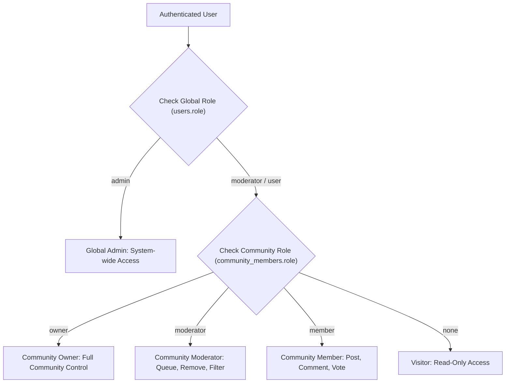

# Anivio — Security, Moderation & Privacy Architecture

> **Single Source of Truth (SSOT) for Application Hardening, RBAC & Abuse Prevention**  
> Status: **LOCKED BASELINE (Version 1.0)**  
> Last Updated: 12 November 2026

This document specifies the security controls, authentication flows, role-based access models, content sanitization rules, anti-abuse mechanisms, and moderation audit protocols for the Anivio Anime Community Platform.

---

## 1. Authentication & Session Security

### 1.1 OAuth 2.0 & PKCE
- Authentication is restricted exclusively to OAuth 2.0 with Proof Key for Code Exchange (PKCE) via **Google** and **Discord** providers.
- Password storage, hashing, and recovery flows are completely absent from the platform, eliminating credential stuffing and database breach password liabilities.
- Redirect URIs are strictly pinned per environment:
  - Local: `http://localhost:3000/api/auth/callback/[provider]`
  - Production: `https://anivio.app/api/auth/callback/[provider]`
  - Wildcard redirects (`*`) are prohibited.

### 1.2 Session Management Architecture
- **Database Session Strategy**: Session records reside in the PostgreSQL `sessions` table, managed by Auth.js and Drizzle ORM.
- **Cookie Security Attributes**:
  - `HttpOnly`: Accessible only via HTTP headers, inaccessible to client-side JavaScript (`document.cookie`), neutralizing token theft via XSS.
  - `Secure`: Cookie transmitted strictly over HTTPS (enforced in production).
  - `SameSite=Lax`: Defends against Cross-Site Request Forgery (CSRF).
  - `Path=/`: Scoped to root domain.
- **Immediate Revocation**: Deleting a session row in PostgreSQL immediately logs out the targeted device upon its next HTTP request.

---

## 2. Role-Based Access Control (RBAC) & Authorization

Anivio enforces a dual-layered authorization hierarchy: Global System Roles and Scoped Community Roles.



### 2.1 Role Permission Matrix

| Capability / Action | Anonymous Visitor | Standard User | Community Member | Community Moderator | Community Owner | Global Admin |
|---|---|---|---|---|---|---|
| View public feeds & anime data | ✅ | ✅ | ✅ | ✅ | ✅ | ✅ |
| Upvote / Downvote content | ❌ | ✅ | ✅ | ✅ | ✅ | ✅ |
| Manage personal watchlist | ❌ | ✅ | ✅ | ✅ | ✅ | ✅ |
| Post within community | ❌ | ❌ | ✅ | ✅ | ✅ | ✅ |
| Comment within community | ❌ | ✅ | ✅ | ✅ | ✅ | ✅ |
| Create a new community | ❌ | ✅ (Account >= 3d) | ✅ | ✅ | ✅ | ✅ |
| Edit post within 24 hours | ❌ | Author only | Author only | ✅ (In community) | ✅ (In community) | ✅ |
| Remove / Filter community posts | ❌ | ❌ | ❌ | ✅ (In community) | ✅ (In community) | ✅ |
| Access `/mod` queue | ❌ | ❌ | ❌ | ✅ (In community) | ✅ (In community) | ✅ |
| Shadowban user account | ❌ | ❌ | ❌ | ❌ | ❌ | ✅ |
| Access `/mod/log` system audit | ❌ | ❌ | ❌ | ❌ | ❌ | ✅ |

### 2.2 Scoped Authorization Guards
Authorization checks must be performed in server-side application logic against the loaded database row, **never** relying on client-supplied role identifiers:
```typescript
// Verified pattern in Server Actions
const session = await requireUser();
const community = await getCommunity(slug);
const membership = await getMembership(community.id, session.user.id);

if (!membership || !['moderator', 'owner'].includes(membership.role)) {
  return { success: false, error: { code: 'Forbidden', message: 'Moderator rights required for this community.' } };
}
```

---

## 3. Input Validation & Injection Defenses

### 3.1 SQL Injection Prevention
- All queries execute through **Drizzle ORM**, generating parameterized SQL statements.
- Hand-written raw SQL functions (e.g. `add_comment`, `wilson_lower`) consume values exclusively as typed parameters (`$1`, `$2`), never via string concatenation or template literal interpolation.

### 3.2 Cross-Site Scripting (XSS) Defenses
- **Tiptap Schema Whitelist**: Posts are saved strictly as structured JSON documents conforming to an allowlist of nodes and marks.
- **HTML Prohibition**: Raw HTML, `<script>`, `<iframe>`, `onload`, and javascript-protocol URLs are stripped during server-side validation.
- **Server Component Static Rendering**: Post bodies are rendered into React elements on the server. Content strings are escaped by React during tree rendering.

### 3.3 CSRF Mitigation
- All state-altering mutations execute as HTTP `POST` requests via Next.js Server Actions.
- Next.js automatically validates the request `Origin` and `Host` headers against the host domain, rejecting cross-origin POST attempts.

---

## 4. Secure File Uploads (Cloudflare R2)

To prevent server bandwidth exhaustion, remote code execution, and unvetted file serving:
1. **Presigned Upload Flow**: The client requests an upload authorization token via `/api/upload/sign`. The server authorizes the user, validates MIME type, and generates a presigned S3 PUT URL for Cloudflare R2.
2. **File Size & Type Constraints**:
   - Max file size: **5 MB**.
   - Allowed MIME types: `image/webp`, `image/jpeg`, `image/png`.
   - Max 4 images attached per discussion post.
3. **Isolated Public CDN Origin**: Uploaded images are served strictly from an isolated custom domain (`https://media.anivio.app`), completely separated from the application domain (`https://anivio.app`). This prevents malicious SVG or HTML file uploads from executing scripts in the application context.
4. **Mandatory Accessibility**: Every uploaded image requires the author to provide non-empty alternative description text (`alt_text`).

---

## 5. Rate Limiting & Anti-Abuse (Upstash Redis)

Distributed token bucket rate limits are enforced via Upstash Redis using an atomic Lua script:

| Endpoint / Operation | Rate Limit Target | Window / Bucket Size | Action Upon Exhaustion |
|---|---|---|---|
| Post Creation | Per User Session | 5 posts / hour | Return HTTP 429 `RateLimited` |
| Comment Submission | Per User Session | 30 comments / hour | Return HTTP 429 `RateLimited` |
| Voting (Post/Comment) | Per User Session | 120 votes / minute | Return HTTP 429 `RateLimited` |
| Anime Search (`/api/search/anime`) | Per IP Address | 30 requests / minute | Return HTTP 429 with `Retry-After` |
| Image Upload Signing | Per User Session | 10 uploads / hour | Return HTTP 429 `RateLimited` |
| New Account Throttle (<24h old) | Per User Session | Quartered limits; **no external links allowed** | Return HTTP 403 `Forbidden` |

---

## 6. Moderation Tooling & Trust Infrastructure

### 6.1 Automated Threshold Filtering
- When any post or comment accumulates **3 distinct reports** from accounts older than 24 hours:
  - Target `status` is automatically updated to `'filtered'`.
  - Item is immediately removed from all public feeds and lists.
  - Target is enqueued in the `/mod` dashboard for moderator review.

### 6.2 Account-Level Shadow Filtering (`is_shadowbanned`)
- Applied exclusively to malicious automated bots or persistent spammers by Global Admins.
- The user's client functions normally without receiving errors.
- Database queries across feeds, threads, and comments append `WHERE is_shadowbanned = false` for all public visitors, silently hiding the bot's footprint without triggering bot reinfection.

### 6.3 Content Removal Policy
- User content is **soft-deleted** (`is_deleted = true`).
- Author name and content text are replaced with `[deleted]`.
- The row is preserved in the database to prevent orphaning nested reply trees.

### 6.4 Immutable Moderation Audit Log (`audit_log`)
- Every moderation action (approval, removal, filter, shadowban, role change) writes an append-only row to `audit_log` inside the same transaction as the change.
- **Privacy Policy Compliance**: Full client IP addresses are NEVER persisted. The system hashes the IP address with a monthly rotating salt (`SHA256(ip + salt)`) and retains logs for 30 days maximum.

