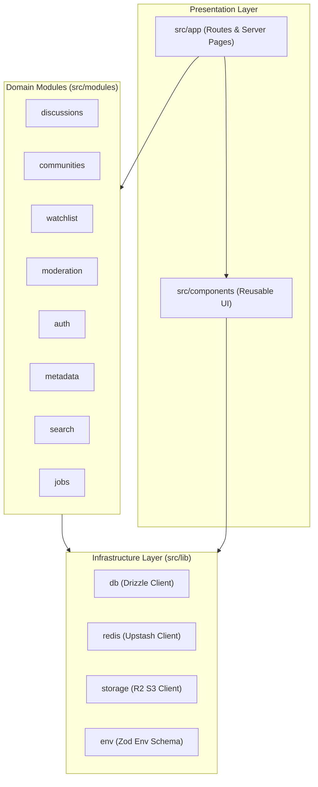
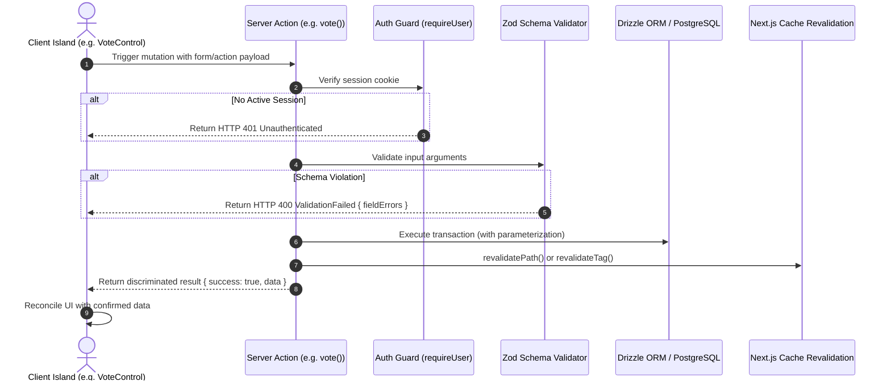

# Anivio — Repository & Application Architecture

> **Single Source of Truth (SSOT) for Codebase Organization & Module Boundaries**  
> Status: **PROPOSED TARGET ARCHITECTURE (Pre-Initialization Baseline)**  
> Last Updated: 12 November 2026

This document specifies the target filesystem architecture, module separation, dependency rules, and server/client component boundaries for the Anivio Anime Community Platform.

> [!NOTE]
> **Repository Inspection Finding**:  
> The repository at `D:/project/Anivio` is currently in the pre-development planning phase. It contains documentation and project charters. The codebase tree documented below is the **authoritative target blueprint** to be initialized in Milestone 1.

---

## 1. High-Level Target Repository Layout

```text
/
├── README.md                      # Primary repository entry point
├── docs/                          # Project SSOT documentation suite
├── drizzle/                       # Generated & hand-crafted SQL migrations
│   ├── 0001_extensions.sql
│   ├── 0002_identity.sql
│   └── ...
├── scripts/                       # Database seed, backfill, and maintenance scripts
│   ├── seed-minimal.ts
│   ├── seed-realistic.ts
│   └── seed-stress.ts
├── public/                        # Static assets (favicons, logos, OG image templates)
├── src/
│   ├── app/                       # Next.js 16 App Router (routes, layouts, boundaries)
│   ├── components/                # Reusable UI component library (design system primitives)
│   ├── modules/                   # Domain-driven feature modules (data, queries, actions)
│   ├── lib/                       # Low-level infrastructure clients (DB, Redis, S3, utils)
│   ├── styles/                    # Global stylesheets and token definitions
│   └── test/                      # Test fixtures, mock factories, Playwright specs
├── .env.example                   # Environment variable template with documentation
├── drizzle.config.ts              # Drizzle ORM migration configuration
├── next.config.ts                 # Next.js build and cache configuration
├── package.json                   # Pinned dependency definitions
├── tailwind.config.ts             # Tailwind CSS theme binding design tokens
└── tsconfig.json                  # Strict TypeScript compiler configuration
```

---

## 2. Directory Responsibilities & Dependency Rules

Anivio follows a **Domain-Driven Modular Monolith** pattern. Code is grouped primarily by domain rather than file type, preventing cross-domain spaghetti code.



### Detailed Responsibility & Boundaries Table

| Directory | Core Responsibility | What Belongs Here | What MUST NOT Belong Here | Allowed Dependencies | Forbidden Inward Dependencies |
|---|---|---|---|---|---|
| `src/app/` | Routing, Page composition, Route Handlers | `page.tsx`, `layout.tsx`, `loading.tsx`, `error.tsx`, `route.ts` | Direct raw SQL queries, DOM manipulation, business calculation algorithms | `src/modules/*`, `src/components/*`, `src/lib/*` | Nothing may import from `src/app/` |
| `src/components/ui/` | Unstyled headless shadcn primitives | Button, Dialog, Popover, Input, DropdownMenu | Domain logic, database queries, provider API calls | Tailwind utilities, `clsx`, `tailwind-merge` | Never import domain modules or database schemas |
| `src/components/anime/` | Anime presentation components | `AnimeCard`, `AnimeTagPill`, `AnimeHoverCard`, `EpisodeRow` | Database mutation actions, direct external API fetching | `src/components/ui/`, types from `src/modules/metadata/` | Domain modules must not import these |
| `src/components/discussion/` | Discussion presentation components | `PostCard`, `CommentTree`, `CommentNode`, `VoteControl` | SQL statements, direct Redis calls | `src/components/ui/`, actions from `src/modules/discussions/` | Must not import route handlers |
| `src/modules/metadata/` | External anime data consumption & snapshots | Provider adapters (Tenrai, AniList), normalizers, snapshot queries | React components, JSX, client state | `src/lib/db`, `src/lib/redis`, `src/lib/errors` | UI components must not import adapters directly |
| `src/modules/discussions/` | Posts, comments, votes, ranking math | Drizzle tables, queries, server actions, Wilson Score function | External anime API calls, UI styling | `src/lib/db`, `src/modules/auth` (for session guards) | Must not depend on `src/app` |
| `src/modules/watchlist/` | User tracking lists and episode counts | Watchlist schema, mutations, progress validator | Third-party OAuth logic | `src/lib/db`, `src/modules/metadata` (to check max episodes) | Must not import UI |
| `src/modules/moderation/` | Reports, threshold rules, audit logs | Moderation actions, report tables, shadowban filters | Raw HTML renderers | `src/lib/db`, `src/modules/auth` | Must not import UI components |
| `src/lib/` | Cross-cutting infrastructure primitives | PostgreSQL client pool, Redis connection, R2 S3 client, `env.ts` | Domain business logic, UI components | External packages only | Must not import from `src/modules` or `src/app` |

---

## 3. Next.js App Router Structure & Route Groups

Anivio utilizes route groups enclosed in parentheses `(name)` to establish isolated layout hierarchies without altering the public URL paths:

```text
src/app/
├── (marketing)/                   # Public orientation & static policies (no sidebar)
│   ├── layout.tsx                 # Clean minimal header/footer layout
│   ├── about/page.tsx             # /about - Platform mission & architecture
│   ├── terms/page.tsx             # /terms - Terms of service
│   ├── privacy/page.tsx           # /privacy - Privacy policy & data deletion info
│   └── guidelines/page.tsx        # /guidelines - Community conduct rules
│
├── (main)/                        # Core application experience (sticky header + dual column)
│   ├── layout.tsx                 # AppShell layout: Header, navigation, main feed column
│   ├── page.tsx                   # / - Home feed (joined communities + discovery slice)
│   ├── season/page.tsx            # /season - Airing anime grid
│   ├── top/page.tsx               # /top - All-time anime ranking
│   ├── search/page.tsx            # /search - Global full-text discussion & anime search
│   ├── anime/
│   │   └── [malId]/
│   │       ├── page.tsx           # /anime/[malId] - Anime detail & watchlist hub
│   │       └── episodes/
│   │           └── [n]/page.tsx   # /anime/[malId]/episodes/[n] - Episode discussion thread
│   ├── c/
│   │   ├── [slug]/
│   │   │   ├── page.tsx           # /c/[slug] - Community feed with Hot/New/Best tabs
│   │   │   └── submit/page.tsx    # /c/[slug]/submit - Rich-text post editor
│   │   └── [slug]/p/[postId]/
│   │       └── page.tsx           # /c/[slug]/p/[postId] - Post detail & comment tree
│   ├── u/
│   │   └── [username]/
│   │       ├── page.tsx           # /u/[username] - Public user profile & posts
│   │       └── watchlist/page.tsx # /u/[username]/watchlist - Owner watchlist management
│   └── me/
│       └── settings/page.tsx      # /me/settings - Profile settings & account deletion
│
├── (auth)/                        # Authentication screens (centered card layout)
│   └── auth/
│       ├── signin/page.tsx        # /auth/signin - Google & Discord login buttons
│       └── onboarding/page.tsx    # /auth/onboarding - Mandatory username selection
│
├── mod/                           # Moderation & administrative suite
│   ├── layout.tsx                 # Protected admin layout with role verification
│   ├── page.tsx                   # /mod - Moderation queue of flagged content
│   └── log/page.tsx               # /mod/log - Audit trail of moderator decisions
│
└── api/                           # Public & internal Route Handlers
    ├── search/anime/route.ts      # GET /api/search/anime - Debounced anime search
    ├── hover/anime/[id]/route.ts  # GET /api/hover/anime/[id] - Lightweight card payload
    ├── feed/route.ts              # GET /api/feed - Keyset-paginated feed loader
    ├── comments/route.ts          # GET /api/comments - Branch fetch for continue-thread
    ├── upload/sign/route.ts       # POST /api/upload/sign - Presigned Cloudflare R2 upload URL
    ├── health/route.ts            # GET /api/health - Infrastructure status endpoint
    └── cron/daily/route.ts        # POST /api/cron/daily - Scheduled daily maintenance job
```

---

## 4. Server vs. Client Component Boundaries

To comply with the strict performance budget (First-load JS < 180 KB), Anivio enforces a **Server-First Component Policy**:
- **Default**: Every component is a React Server Component (RSC).
- **Client Components (`'use client'`)**: Permitted **only** when local browser APIs, interactive event listeners (`onClick`, `onChange`), or optimistic hooks (`useOptimistic`, `useActionState`) are strictly required.

### Boundary Matrix

```text
[Server Component: Post Detail Page]
  ├── [Server Component: Post Header & Metadata]
  ├── [Server Component: Server-Rendered Post Content Body]
  │     └── [Client Component: AnimeTagPill] (Interactive hover card trigger)
  ├── [Client Component: VoteControl] (Optimistic voting buttons)
  ├── [Client Component: CommentComposer] (Text input & optimistic insert)
  └── [Server Component: CommentTree]
        └── [Client Component: CommentNode] (Collapse toggle, reply drawer, vote)
```

#### Approved Client Component Islands:
1. `PostEditor.tsx`: Tiptap rich-text state and media dropzone.
2. `VoteControl.tsx`: Immediate optimistic feedback with rollback.
3. `CommentComposer.tsx`: Controlled textarea and optimistic insertion.
4. `CommentNode.tsx`: Collapse/expand subtree and inline reply trigger.
5. `SpoilerBlock.tsx`: Local reveal toggle without server round-trip.
6. `SearchBox.tsx`: Debounced keyboard input and combobox focus trap.
7. `AnimeHoverCard.tsx`: Floating UI portal and Escape dismissal.
8. `WatchlistControl.tsx`: Interactive status selector and episode counter.
9. `MobileDrawer.tsx`: Off-canvas navigation slide-out.
10. `Toast.tsx`: Transient feedback notification container.

---

## 5. Data Flow & Mutation Architecture

All state mutations in Anivio flow through **Next.js Server Actions** accompanied by **Zod Schema Validation**:



### Server Action Error Contract
Server Actions **never** throw unhandled exceptions to the client. All actions return a typed discriminated union:
```typescript
export type ActionResult<T> =
  | { success: true; data: T }
  | {
      success: false;
      error: {
        code: 'ValidationFailed' | 'Unauthenticated' | 'Forbidden' | 'NotFound' | 'Conflict' | 'RateLimited' | 'Internal';
        message: string;
        fieldErrors?: Record<string, string[]>;
      };
    };
```

