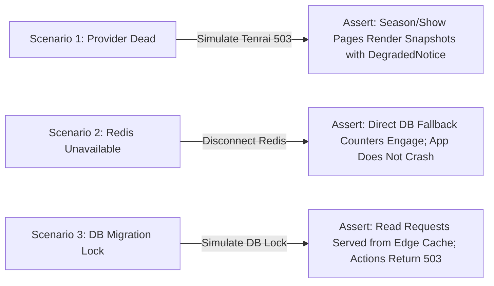

# Anivio — Quality Assurance & Testing Plan

> **Single Source of Truth (SSOT) for Automated Testing, CI Gates & Failure Scenarios**  
> Status: **LOCKED BASELINE (Version 1.0)**  
> Last Updated: 12 November 2026

This document specifies the testing strategy, test layers, critical end-to-end user journeys, failure injection protocols, and performance budgets for the Anivio Anime Community Platform.

---

## 1. Testing Philosophy & Core Rules

Anivio rejects broad, shallow test coverage that tests implementation details rather than user-visible contracts. The suite adheres to two non-negotiable rules:
1. **Never assert on internal implementation details**: Tests assert on input/output contracts, database constraints, and user interactions. Refactoring component internals must not break tests.
2. **Every bug receives a failing test first**: When a defect is discovered during manual QA or production monitoring, a reproduction test must be written and committed before the fix is authored.

---

## 2. Test Architecture & Layer Distribution

| Test Layer | Framework | Target Count | What It Proves | Execution Trigger |
|---|---|---|---|---|
| **Unit Tests** | Vitest | ~30 tests | Pure mathematical calculations (Wilson score, hot rank), normalizers, Zod schemas, path algorithms | Every Pull Request |
| **Integration Tests** | Vitest + Postgres | ~15 tests | Database constraints (depth cap <= 8), advisory locks, GiST index reads, duplicate votes, snapshot upsert | Every Pull Request |
| **End-to-End (E2E)** | Playwright | 4 Critical Journeys | End-to-end user interaction from browser to database across seeded preview deployments | Every Pull Request |
| **Failure Injection** | Custom Scripts | 3 Scenarios | Provider total outage, Redis failure, DB read-only resilience | Milestone Sign-Off |
| **Manual A11y** | Screen Reader / Axe | 5 Core Pages | WCAG 2.1 AA keyboard trapping, focus visibility, screen reader tree announcement | Milestone Sign-Off |
| **Load Testing** | k6 / Artillery | 1 Script | 200 concurrent readers on feed & 1,000-comment thread page (<400ms p95) | Pre-Launch (M8) |

---

## 3. Unit Testing Specification (Vitest)

Unit tests run in an isolated in-memory environment with zero external dependencies.

### 3.1 Ranking Algorithms Verification (`src/test/unit/ranking.test.ts`)
Must verify exact floating-point outputs against a baseline reference table:
- **Zero Votes**: `wilson_lower(0, 0)` must equal `0.0`.
- **Single Positive Vote**: `wilson_lower(1, 0)` must yield approx. `0.2065` (reflecting low statistical confidence).
- **High-Volume Mixed Votes**: `wilson_lower(100, 10)` must outrank `wilson_lower(1, 0)`.
- **Controversial Votes**: `wilson_lower(100, 90)` must rank significantly lower than `wilson_lower(10, 1)`.
- **Hot Rank Decay**: Posts of equal net score must rank chronologically with newer posts scoring higher; negative scores preserve sign.

### 3.2 Metadata Normalizer Verification (`src/test/unit/normalizer.test.ts`)
- Correctly parses missing or null fields from Tenrai and AniList API responses.
- Extracts English titles where available, falling back to canonical Romaji titles.
- Re-encodes missing poster art to fallback SVGs without throwing unhandled exceptions.

### 3.3 Zod Schema Validation (`src/test/unit/schemas.test.ts`)
- Rejects usernames containing spaces, special symbols, or under 3 characters.
- Rejects reserved names (`admin`, `anivio`, `mod`).
- Enforces post title limits (3–300 characters).
- Rejects comment content exceeding 10,000 characters.

---

## 4. Database Integration Testing (Vitest + Postgres)

Integration tests execute against a real containerized or Neon branch PostgreSQL instance:

1. **Depth Cap Enforcement**:
   - Seed a post and insert 8 nested comment levels using `add_comment()`.
   - Attempting to insert a 9th level must fail with exception `comments_depth_cap`.
2. **Duplicate Vote Rejection**:
   - Assert that calling `vote()` twice in the same direction for the same target updates or leaves the existing vote rather than inserting a duplicate row.
3. **Thread Order Querying**:
   - Seed a 50-comment branched hierarchy.
   - Assert that `ORDER BY path` returns the exact conversation tree order.
4. **Soft Delete Preservation**:
   - Mark a parent comment as `is_deleted = true`.
   - Assert that descendant comment paths remain resolvable and intact.
5. **Snapshot Upsert**:
   - Multiple writes for the same `(entity_type, entity_id)` must update `payload` and `fetched_at` cleanly without duplicate key errors.

---

## 5. Critical End-to-End User Journeys (Playwright)

Executed against seeded preview deployments on every Pull Request:

### Journey 1: Authentication & Onboarding
1. Navigate to `/auth/signin`.
2. Emulate OAuth provider callback with mock identity.
3. Arrive at `/auth/onboarding`.
4. Enter unique username `Spike_2026`.
5. Complete onboarding; assert redirection to preserved home page.
6. Verify session cookie attributes (`HttpOnly`, `Secure`, `SameSite=Lax`).

### Journey 2: Community Creation & Post Publishing
1. Authenticated user navigates to `/c/create`.
2. Create community `c/bounty-hunters`.
3. Enter post title *"Best Bebop Episode?"* in Tiptap editor.
4. Type `@Cowboy Bebop`, select anime from combobox.
5. Submit post; assert redirection to `/c/bounty-hunters/p/[postId]`.
6. Assert inline `AnimeTagPill` renders with thumbnail and title.

### Journey 3: Comment Nesting & Voting Interaction
1. Navigate to existing discussion post.
2. Submit top-level comment.
3. Submit 3 reply levels beneath the top-level comment.
4. Verify indentation guides and collapse button functionality.
5. Click Upvote chevron on comment; assert score updates from 0 to 1 optimistically.
6. Refresh browser; assert score persists at 1.

### Journey 4: Hover Card & Watchlist Toggle
1. Hover cursor over `AnimeTagPill` inside a post.
2. Assert `AnimeHoverCard` portal opens within 200ms.
3. Click "Add to Watchlist" -> select "Watching" inside hover card.
4. Close hover card.
5. Navigate to `/u/[username]/watchlist`.
6. Assert the tagged anime appears under the "Watching" filter tab.

---

## 6. Failure Injection Scenarios (Milestone Sign-Off)

To guarantee resilient architecture before production launch, three failure scenarios are injected into staging:



1. **Scenario 1: Upstream Anime Provider Total Outage**:
   - Block outbound HTTP traffic to Tenrai and AniList domains.
   - Assert that `/season`, `/top`, and `/anime/[id]` load cached snapshots with a prominent amber `DegradedNotice`.
   - Assert that no user sees a 500 server crash page.
2. **Scenario 2: Redis Cache & Rate Limiter Down**:
   - Disable Upstash Redis token credentials.
   - Assert that application falls back to database-backed budget counters and does not crash.
3. **Scenario 3: Database Read-Only During Migration**:
   - Put PostgreSQL database in read-only transaction mode.
   - Assert that public read-only pages (feeds, show details) continue serving from cache.
   - Assert that write actions return clear `Internal` error toasts rather than unhandled white-screen crashes.

---

## 7. Performance & Load Quality Gates

```text
======================================================================
ANIVIO PERFORMANCE BUDGET
======================================================================
Metric                             Budget Target         Enforcement
----------------------------------------------------------------------
First-load JS (Feed Page)          < 180 KB compressed   Build step
First-load JS (Show Detail)        < 200 KB compressed   Build step
Largest Contentful Paint (LCP)     < 2.5s (Mobile 4G)    Lighthouse CI
Cumulative Layout Shift (CLS)      < 0.1                 Lighthouse CI
Thread Render Time (1,000 nodes)   < 400ms at p95        Vitest timing
Provider Calls on Warm Cache       0 calls               Request budget
======================================================================
```

