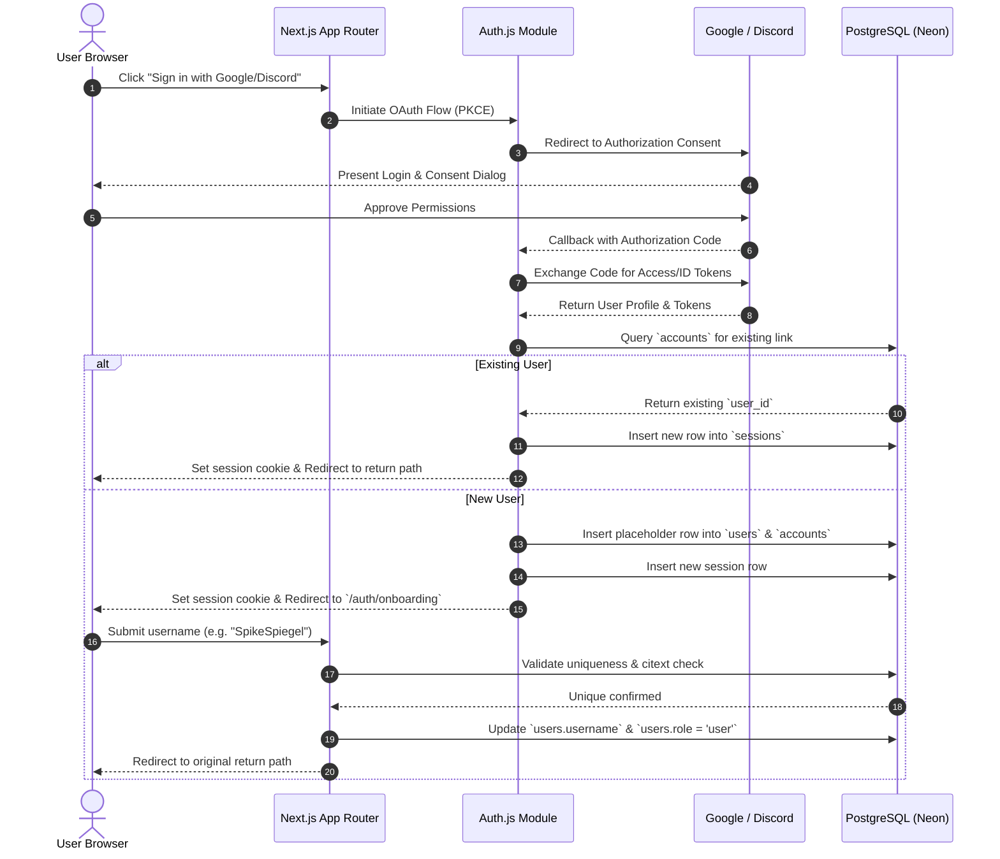
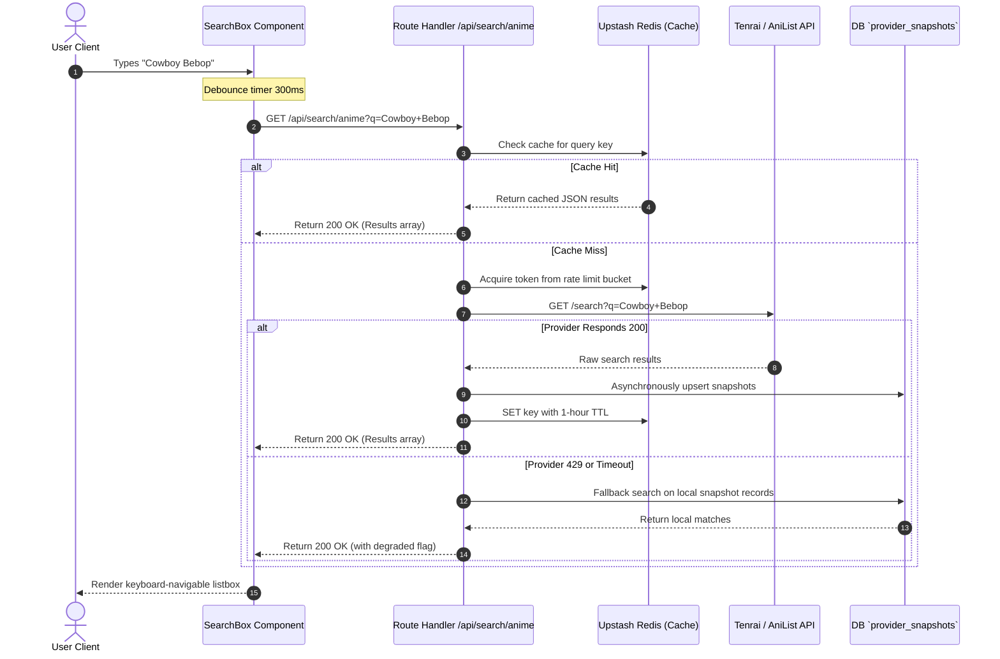
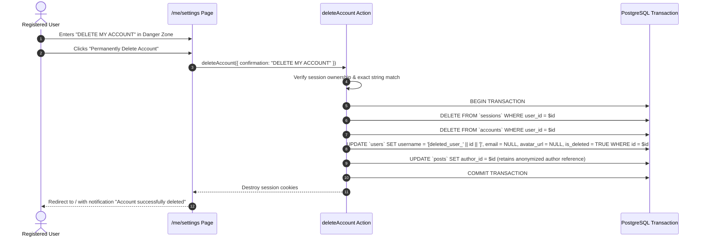

# Anivio — User Journeys & Application Workflows

> **Single Source of Truth (SSOT) for Interaction Workflows & State Transitions**  
> Status: **LOCKED BASELINE (Version 1.0)**  
> Last Updated: 12 November 2026

This document specifies the end-to-end user journeys, sequence diagrams, failure pathways, and state transitions for all core workflows in the Anivio Anime Community Platform.

---

## 1. Visitor & Onboarding Workflows

### WF-001: Anonymous Visitor Journey
- **Trigger**: Unauthenticated user lands on any public URL (`/`, `/season`, `/top`, `/anime/[id]`, `/c/[slug]`).
- **Preconditions**: No active session cookie present.
- **Main Flow**:
  1. Visitor views server-rendered public pages.
  2. Visitor can freely browse seasonal charts, anime details, community discussions, and comment trees.
  3. When visitor clicks any interactive mutation button (Upvote, Reply, Join Community, Add to Watchlist, Create Post), client intercepts action.
  4. System opens Auth Modal or redirects to `/auth/signin?callbackUrl=[current_path]`.
- **Alternate Flow**: Visitor uses search input; server serves debounced public search results.
- **Resulting State**: Visitor remains read-only until authentication is completed.

---

### WF-002: OAuth Registration & Onboarding Flow
- **Trigger**: Visitor clicks "Sign in with Google" or "Sign in with Discord".
- **Preconditions**: Valid OAuth account with third-party provider.



- **Failure Conditions**:
  - Provider cancellation: redirects to `/auth/signin` with notification.
  - Username already taken: returns HTTP 409 `Conflict`; user remains on onboarding form.

---

## 2. Anime Discovery & Search Workflows

### WF-003: Seasonal Anime Discovery & Caching
- **Trigger**: User navigates to `/season`.
- **Preconditions**: None (public route).
- **Main Flow**:
  1. Next.js checks framework Data Cache (`'use cache'`).
  2. If cache is warm (within 24h), renders static server component instantly (<300ms).
  3. If cache is cold:
     - Calls Metadata Service layer.
     - Requests seasonal anime list from primary provider (Tenrai API).
     - Persists raw payload into `provider_snapshots` table.
     - Returns normalized `AnimeSummary[]` array to view layer.
- **Degraded Flow (Provider Outage)**:
  - If upstream API returns HTTP 429, 500, or times out (5s):
  - Metadata layer catches exception, queries latest `provider_snapshots` row.
  - Renders page with snapshot data and displays `DegradedNotice` ("Serving cached data from X hours ago").
- **Resulting State**: Clean responsive grid rendered; no 500 crash.

---

### WF-004: Real-Time Anime Search & Tag Querying
- **Trigger**: User types in global search box or editor `@` combobox.



---

## 3. Community & Content Workflows

### WF-005: Community Creation
- **Trigger**: Authenticated user submits form at `/c/create`.
- **Preconditions**: Active session, account age >= 3 days, not rate-limited (max 2/week).
- **Main Flow**:
  1. User fills `slug`, `name`, `description`.
  2. Server action validates inputs via Zod schema.
  3. Begins database transaction:
     - Inserts row into `communities`.
     - Inserts row into `community_members` with `role = 'owner'`.
     - Inserts row into `audit_log`.
  4. Commits transaction.
  5. Revalidates community discovery indexes.
  6. Redirects user to `/c/[slug]`.
- **Failure Conditions**:
  - Slug already taken: returns `Conflict` ("Community slug is already in use").
  - Account < 3 days old: returns `Forbidden`.

---

### WF-006: Joining / Leaving Communities
- **Trigger**: User clicks "Join" or "Leave" button on `/c/[slug]`.
- **Preconditions**: User is authenticated.
- **Main Flow**:
  1. Client applies optimistic UI update: button toggles label, member count increments/decrements.
  2. Calls Server Action `joinCommunity({ communityId })`.
  3. Server executes idempotent query:
     `INSERT INTO community_members (community_id, user_id, role) VALUES (...) ON CONFLICT DO NOTHING`.
  4. Increments `communities.member_count`.
  5. Returns success status.
- **Alternate / Failure Flow**: If server action fails (e.g., database timeout), client reverts button state and renders error toast.

---

### WF-007: Rich-Text Post Creation with Anime Tagging

```mermaid
sequenceDiagram
    autonumber
    actor Author as Registered User
    participant Editor as PostEditor (Tiptap)
    participant Storage as Cloudflare R2
    participant Action as createPost Server Action
    participant Zod as Zod Validator
    participant DB as PostgreSQL (Neon)
    participant Queue as Background Job Queue

    Author->>Editor: Drafts post, types @Frieren
    Editor->>Editor: Selects anime from combobox; inserts TagNode
    alt Has Image Attachments
        Author->>Editor: Selects up to 4 images
        Editor->>Action: POST /api/upload/sign
        Action-->>Editor: Presigned R2 PUT URLs
        Editor->>Storage: Direct PUT image bytes (WebP)
        Storage-->>Editor: 200 OK (ETags & Keys)
    end
    Author->>Editor: Clicks "Publish Post"
    Editor->>Action: Call createPost(payload)
    Action->>Zod: Validate structured document JSON & metadata
    Zod-->>Action: Validated clean payload
    Action->>DB: BEGIN TRANSACTION
    Action->>DB: Verify membership in community
    Action->>DB: Insert row into `posts`
    Action->>DB: Insert rows into `post_tags` (entity_type='anime', entity_id=malId)
    Action->>DB: Insert rows into `post_media`
    Action->>DB: COMMIT TRANSACTION
    Action->>Queue: Enqueue search vector index update
    Action-->>Editor: Return { success: true, postId: uuid }
    Editor-->>Author: Redirect to /c/[slug]/p/[postId]
```

---

### WF-008: Inline Anime Entity Tagging & Hover Card Interaction
- **Trigger**: Reader hovers cursor or tabs focus onto an `AnimeTagPill` within post text.
- **Preconditions**: Post rendered with valid `post_tags` reference.
- **Main Flow**:
  1. Pointer enters tag pill; 200ms intent timer starts.
  2. `AnimeHoverCard` opens floating portal positioned via `@floating-ui`.
  3. Client fetches lightweight payload from `/api/hover/anime/[id]`.
  4. Card displays poster art, title, community score, genre tags, and synopsis snippet.
  5. Embedded `WatchlistControl` displays user's current status for this show.
  6. User can click "Add to Watchlist" directly inside the hover card without navigating away from discussion.
- **Dismissal**: Pressing `Escape`, clicking outside, or mouse leaving the hover card boundary closes the portal.

---

### WF-009: Nested Commenting & Discussion Tree

```mermaid
sequenceDiagram
    autonumber
    actor Commenter as Registered User
    participant UI as CommentComposer
    participant Action as createComment Action
    participant DB as PostgreSQL Function `add_comment`
    participant Job as Background Jobs

    Commenter->>UI: Enters reply text, toggles spoiler=false
    Commenter->>UI: Clicks "Reply"
    UI->>UI: Optimistically append comment node to local tree
    UI->>Action: Call createComment({ postId, parentId, content, isSpoiler })
    Action->>Action: Verify session & check rate limit
    Action->>DB: Call add_comment(p_post, p_author, p_parent, p_content, p_spoiler)
    Note over DB: Acquires pg_advisory_xact_lock(hashtext(post_id))
    Note over DB: Resolves parent ltree path; appends sequence value
    Note over DB: Verifies depth constraint (depth <= 8)
    Note over DB: Inserts comment row into `comments`
    DB-->>Action: Returns new comment UUID & ltree path
    Action->>Job: Enqueue notification to post/parent author
    Action-->>UI: Return { success: true, comment: row }
    UI->>UI: Reconcile optimistic node with server-confirmed row
```

- **Edge Case (Depth Limit Exceeded)**: If parent comment is already at depth 8, PostgreSQL raises exception `comments_depth_cap`. Server action catches error and returns `DepthExceeded` code. Client reverts optimistic comment and displays toast: *"Maximum discussion depth reached for this branch."*

---

## 4. Voting & Ranking Workflows

### WF-010: Voting Mechanics & Score Recalculation
- **Trigger**: User clicks Upvote (+1) or Downvote (-1) on a post or comment.
- **Preconditions**: User is authenticated; author != voter.
- **Main Flow**:
  1. Client updates optimistic score and toggles chevron highlight color.
  2. Calls `vote({ targetType, targetId, value })`.
  3. Server upserts row in `post_votes` or `comment_votes` on composite key `(user_id, target_id)`:
     - If clicking same value again: removes row (unvotes, value=0).
     - If clicking opposite value: updates row to new value.
  4. Server enqueues `recomputeScore` job.
  5. Background job calculates:
     - New net `score = sum(value)`.
     - New `wilson_lower = wilson_lower(ups, downs)`.
     - New `hot_rank = hot_rank(score, created_at)`.
  6. Updates target row.

---

## 5. Tracking & Watchlist Workflows

### WF-011: Watchlist Status & Progress Mutation
- **Trigger**: User updates status or episode count on `WatchlistControl`.
- **Preconditions**: User is authenticated; anime ID exists in platform metadata.
- **Main Flow**:
  1. User selects status: `Watching`, `Completed`, `Dropped`, or `Plan to Watch`.
  2. User increments episodes watched (e.g. from 11 to 12).
  3. Action `upsertWatchlistEntry` verifies episode count <= total episodes from cached snapshot.
  4. Upserts row in `watchlists` table.
  5. If new status is `Completed`, sets `episodes_watched = total_episodes`.
  6. Returns updated entry; UI displays confirmation checkmark.
- **Failure Conditions**:
  - `episodes_watched > total_episodes` (when total is known): returns `InvalidProgress` error.

---

## 6. Trust, Safety & Moderation Workflows

### WF-012: Content Reporting & Auto-Moderation Threshold
- **Trigger**: User flags post or comment via `ReportDialog`.
- **Preconditions**: Authenticated, not reporting own content.
- **Main Flow**:
  1. User selects violation reason (`spam`, `harassment`, `spoilers`, `illegal`) and optional note.
  2. Server inserts report into `reports` table (`UNIQUE (reporter_id, target_type, target_id)`).
  3. Threshold check evaluates count of unique reports from accounts > 24 hours old.
  4. **Threshold Reached (>= 3 Reports)**:
     - System automatically transitions target `status` to `'filtered'`.
     - Target is instantly hidden from public feeds.
     - Places entry into `/mod` queue.
- **Confirmation**: Client displays generic confirmation: *"Thank you. Our moderation team has received your report."* (never reveals current report count to avoid brigading).

---

### WF-013: Moderator Resolution Workflow
- **Trigger**: Community moderator or Admin visits `/mod`.
- **Preconditions**: Session role is `moderator` for community or `admin` globally.
- **Main Flow**:
  1. Moderator reviews flagged content, report counts, and author history.
  2. Moderator selects action:
     - **Approve**: Restores status to `'published'`; dismisses reports.
     - **Remove**: Sets status to `'removed'`; replaces public content with removed placeholder.
     - **Shadowban**: Flags author account as `is_shadowbanned = true`.
  3. Atomic transaction executes status change, updates report resolution, and logs entry to `moderation_actions` and `audit_log`.

---

### WF-014: Controlled Account Deletion



- **Integrity Guarantee**: All authored discussions and nested comments remain structurally intact for the community, but personal identifying data (email, OAuth tokens, username, avatar) is completely erased.

